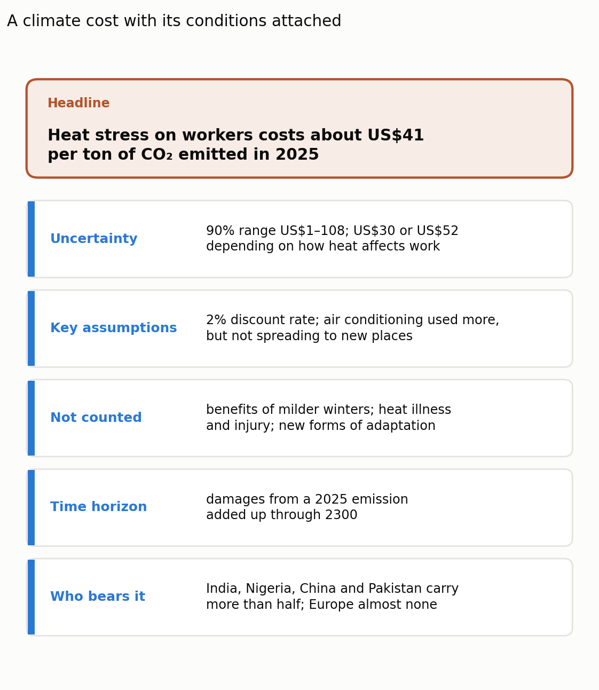
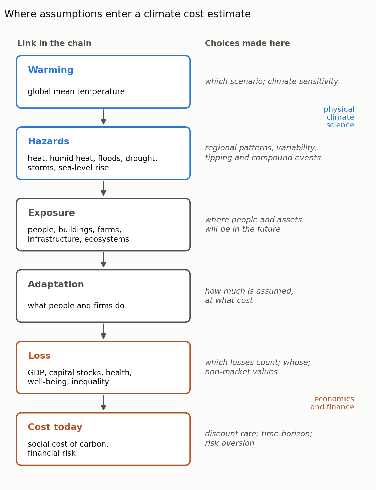

"Each degree of warming will cost X% of world GDP." Numbers like this drive carbon prices, bank stress tests and public debate. But behind each one is a long chain of translation: from emissions to warming, from warming to floods and heatwaves, from hazards to damaged houses and lost working hours, and from there to money. Physical climate scientists build the first half of that chain, economists the second. A comment in _Nature Climate Change_ by Steven Sherwood and thirteen colleagues from climate science, economics and finance argues that the two communities do not communicate well, and that the damage from this gap reaches far beyond academia (Sherwood et al. 2026). This post summarizes their argument.

## The numbers are necessary

The authors start by defending quantification. Since Nordhaus's first integrated climate–economy model (Nordhaus 1992), cost estimates have shaped mitigation and adaptation policy, the social cost of carbon used in regulation, and the climate risk assessments of banks and insurers. Refusing to put numbers on climate damage does not remove numbers from these decisions. It replaces carefully examined estimates with implicit ones that nobody examines.

The problem is how the numbers travel. Each estimate is valid only under the assumptions and models that produced it, but it is usually passed on as if it were a self-contained fact.

## Why the gap is serious

**Two narrow pipes.** Most of the conversation between the disciplines, and between them and the public, runs through two numbers: global mean surface temperature and gross domestic product. Both are useful summaries, and both are asked to carry more meaning than they can. Nobody experiences a global average temperature; people experience floods, droughts, storms, humid heat and rising seas, which depend on regional patterns, natural variability and time lags. GDP, in turn, measures the flow of production, not the houses, roads, health and ecosystems on which future well-being depends. After Hurricanes Katrina and Rita, the recorded losses of GDP were small compared with the destruction of housing, infrastructure and lives. If only temperature leaves climate science and only GDP leaves economics, most of what each field knows is filtered out before the conversation starts.

**False precision.** Published estimates of global losses differ by an order of magnitude for the same amount of warming, and the spread has widened over two decades. The authors stress that this is not mainly error. It reflects legitimate differences in which hazards are counted, how adaptation is assumed, how losses are spread across regions and incomes, and how the future is discounted. Some of it is genuine scientific uncertainty, some of it reflects value judgments. When results are compressed into a headline number, these distinctions disappear, and users from journalists to central banks are left with a precision that does not exist. Risks that are poorly understood, such as tipping points and compound events, are included inconsistently or not at all (Rising et al. 2022).

**Lessons that did not cross over.** Many recent damage estimates are empirical: they measure how economies have responded to year-to-year weather and extrapolate to a warmer future. Climate science learned the hard way that such relationships can mislead. A study of extreme rainfall in Australia found that the observed link between daily rainfall extremes and local temperature understates how much extremes will intensify under warming, partly because heavy rain itself cools the air on the days it falls (Bao et al. 2017). The same trap, the comment argues, may affect empirical damage functions.

**A culture clash.** Physical climate scientists usually judge a model by whether it represents known processes and matches observations. Economists more often value models that clarify choices and mechanisms, even with deliberately stylized assumptions. Each side, judging the other by its own standards, finds the other's models either dangerously unrealistic or opaque.

**Different users, different questions.** Investors and regulators care about shocks over the next decade, when natural variability can outweigh the warming trend. Vulnerable communities care about the weather they will have to adapt to. No single number serves all of them.

## Four ways to close the gap

**1. Make assumptions and uncertainty part of the headline.** Long lists of caveats can make an estimate look useless, so the key is to report the conditions that materially change the result or its use. The authors suggest layers: a clear central message, followed by visible statements of the key assumptions, omitted risks, time horizon and uncertainty range. Figure 1 applies this idea to the estimate of heat-related labour losses discussed in an [earlier post](). Users also need to learn that a conditional estimate is usually more trustworthy, not less.

{: style="width: 100%; height: auto;" data-zoomable="" }

_**Figure 1.** An example of a layered presentation: the labour component of the social cost of carbon estimated by Moore et al. (2026), shown with the conditions that change how it should be used. Figure by Daeha Kim, applying the recommendation of Sherwood et al. (2026) to numbers reported in Moore et al. (2026)._

**2. Widen the pipes.** Report damage to capital stocks and to different groups alongside GDP totals, and describe climate change in the hazards that matter for decisions rather than in global averages alone. For investors and regulators, that means loss estimates with explicit time horizons that separate sudden shocks from gradual change.

**3. Link a suite of models transparently.** A single model that does everything is neither realistic nor desirable. Instead, the links from physical hazard to exposure, adaptation, economic loss and financial risk should be visible, so users can see which assumption drives which conclusion (Figure 2).

{: style="width: 100%; height: auto;" data-zoomable="" }

_**Figure 2.** The chain that turns warming into an economic cost, and the choices made at each link. The upper links are the domain of physical climate science, the lower links of economics and finance; the middle links belong to both. Figure by Daeha Kim, a schematic based on the argument of Sherwood et al. (2026)._

**4. Let the IPCC set the standard.** The Seventh Assessment Report will again separate physical science and economics into different working groups, which reduces the chance for translation. The authors ask that physical scientists, economists and finance experts work together closely in this cycle, and that no headline number reach the Summary for Policymakers without its conditions stated in plain language.

## What a hydrologist takes from it

**This is our problem too.** Flood risk assessment has long been framed as hazard, exposure and vulnerability, which is exactly the chain in Figure 2. Hydrologists can help move the conversation from global temperature to the hazards people actually face: river floods, flash droughts, low flows and humid heat.

**Nonstationarity applies to economies as well.** Hydrologists learned that statistics fitted to past records can mislead when the climate shifts. The rainfall example in the comment is the same lesson. Damage functions fitted to historical weather deserve the same caution as flood frequency curves fitted to a changing climate.

**Conditional is not weak.** Engineering design already works this way: a design flood comes with a return period, a record length and a confidence interval. Climate costs could be communicated the same way.

## Bottom line

Climate cost estimates are indispensable, but they pass through two narrow pipes, global temperature and GDP, that strip out most of what climate scientists and economists know. The result is a spread of numbers that look precise and contradictory at the same time. Sherwood and colleagues propose four remedies: put assumptions and uncertainty in the headline, report hazards and losses beyond the two averages, link models transparently, and use the next IPCC assessment to set the standard. A number with its conditions attached is not a weaker number; it is one that decision-makers can actually trust.

**Questions to think about**

1. Which climate hazard would be more useful than global mean temperature for a water manager in your region, and why?
2. If two damage estimates differ by a factor of ten, how would you explain to a policymaker which parts of the difference are uncertainty and which are value judgments?
3. What would a "layered" presentation look like for a flood risk estimate you have worked with?

---

**한 줄 요약 (Korean summary).** Sherwood 등(2026)은 물리 기후과학과 경제학 사이의 소통 단절이 학계 내부 문제를 넘어 정책, 금융, 대중 논의까지 왜곡한다고 지적한다. 두 분야는 주로 전지구 평균기온과 GDP라는 두 숫자로만 대화하는데, 평균기온은 사람들이 실제로 겪는 홍수·가뭄·폭염을 담지 못하고, GDP는 생산의 흐름만 잴 뿐 주택, 기반시설, 건강, 생태계 같은 자산의 손실은 놓친다. 같은 온난화에 대한 피해 추정치가 열 배나 차이 나는 것은 오류라기보다 어떤 위험을 포함하고 적응과 할인을 어떻게 가정했는지의 차이인데, 헤드라인 숫자로 압축되면 이 차이가 사라져 거짓 정밀성이 생긴다. 저자들은 가정과 불확실성을 헤드라인에 함께 제시하고, GDP와 평균기온 외의 손실과 위험을 함께 보고하며, 위험에서 손실까지 이어지는 모델들을 투명하게 연결하고, IPCC 7차 보고서에서 이를 기준으로 삼자고 제안한다. 과거 자료로 만든 관계가 기후가 바뀌면 틀릴 수 있다는 점은 수문학의 비정상성 문제와 같은 교훈이다.

---

**References**

Sherwood, S. C., Amiot, M., Schmedders, K., Thompson, T., Sillmann, J., Alexander, P., Lontzek, T., Tavoni, M., Franzke, C. L. E., Rising, J., Kornhuber, K., Narita, D., Scheidegger, S., & Hegerl, G. C. (2026). Closing the climate–economics communication gap. _Nature Climate Change_. [https://doi.org/10.1038/s41558-026-02784-w](https://doi.org/10.1038/s41558-026-02784-w)

Bao, J., Sherwood, S. C., Alexander, L. V., & Evans, J. P. (2017). Future increases in extreme precipitation exceed observed scaling rates. _Nature Climate Change_, 7, 128–132. [https://doi.org/10.1038/nclimate3201](https://doi.org/10.1038/nclimate3201)

Moore, F. C., Haqiqi, I., Kong, Q., Rennels, L., Baldos, U., Ganapathi, H., Huber, M., & Hertel, T. (2026). New labour and agricultural damages improve climate cost estimates. _Nature Climate Change_, 16, 1170–1177. [https://doi.org/10.1038/s41558-026-02749-z](https://doi.org/10.1038/s41558-026-02749-z)

Nordhaus, W. D. (1992). An optimal transition path for controlling greenhouse gases. _Science_, 258, 1315–1319. [https://doi.org/10.1126/science.258.5086.1315](https://doi.org/10.1126/science.258.5086.1315)

Rising, J., Tedesco, M., Piontek, F., & Stainforth, D. A. (2022). The missing risks of climate change. _Nature_, 610, 643–651. [https://doi.org/10.1038/s41586-022-05243-6](https://doi.org/10.1038/s41586-022-05243-6)

_Both figures are original. The Python scripts that produce them are available on GitHub: [Figure 1](https://github.com/daehakim-waterlab/daehakim-waterlab.github.io/blob/main/scripts/blog/2026-11-02-gap-card.py), [Figure 2](https://github.com/daehakim-waterlab/daehakim-waterlab.github.io/blob/main/scripts/blog/2026-11-02-gap-chain.py)._
