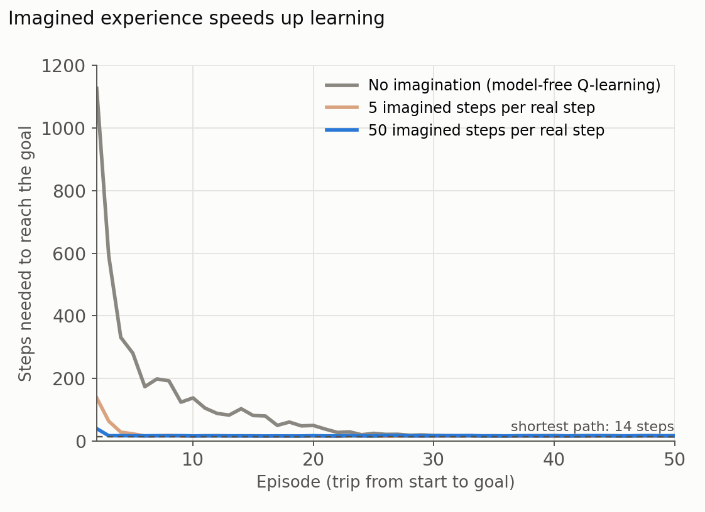

In [part I](), bilaterian worms learned to steer toward the good and away from the bad. In [part II](), early vertebrates learned by trial and error, with dopamine signaling whether things turned out better than expected. Both kinds of learning share a limitation: the animal has to actually do something to learn from it.

This post covers the third breakthrough in Max Bennett's _A Brief History of Intelligence_ (2023): simulating. In Bennett's account it arrived with the first mammals and their new brain structure, the neocortex, which let an animal try things out in imagination before trying them in the world. In AI, the same idea is called model-based reinforcement learning. As before, the summary is my own paraphrase of the book's argument, and some connections, notably to Dyna, AlphaGo and MuZero, come from the broader literature.

## 1. Breakthrough 3, Simulating: trying things out in the head

A fish that learns by trial and error stores, for each situation, how good each action has turned out to be. This works, but it has a cost: every lesson requires a real attempt, and some attempts are fatal. It is also inflexible. If the world changes, for example if food moves to a new place, the fish must relearn by trial and error, because it has no idea why its old habits worked.

An animal with a model of its world can do better. It can ask "what would happen if I went left?" and answer the question without moving.

In Bennett's account, this is what set early mammals apart. Fish and lizards, then as now, can move quickly, remember patterns and learn by trial and error, but they do not plan their movements. The ancestors of mammals were small animals living under the constant threat of dinosaur predators, and the ability to simulate gave them a way to outthink rather than outrun their enemies.

### Rats that think before they turn

In 1948, Edward Tolman reported that rats allowed to explore a maze without any reward later learned to run it much faster than rats that had never seen it, and that they could take shortcuts they had never been trained on (Tolman 1948). He concluded that rats build a "cognitive map" of their surroundings, not just a list of rewarded turns.

Tolman and his contemporaries also noticed that rats at a choice point often pause and look back and forth between the options, a behavior called vicarious trial and error. Almost sixty years later, recordings from the rat hippocampus showed what happens during those pauses. Place cells, which fire when a rat is at a particular location, fired in sequences that swept ahead of the animal, first down one path and then down the other, as if the rat were mentally walking each route before choosing (Johnson and Redish 2007).

## 2. Two simulators: a model of the world and a model of the self

### The sensory neocortex: a model of the world

The neocortex is the structure that most distinguishes the mammalian brain. Bennett's central claim about its sensory regions is that they work as a generative model: they learn how the world is structured well enough to produce plausible sensory experience on their own.

This idea is older than modern AI. In the nineteenth century, Hermann von Helmholtz argued that perception is a kind of unconscious inference: we do not simply receive images, we infer the most likely world that would have produced them. That is why we fill in the blind spot and see shapes in ambiguous pictures. If the brain can generate what it expects to see, the same machinery can be run without input, and that is imagination.

**The AI connection.** Neural network researchers arrived at similar ideas. The "wake-sleep" algorithm of the 1990s trained a network to recognize inputs while a second, generative pathway learned to produce them, alternating between a waking phase driven by data and a "sleeping" phase driven by the network's own fantasies (Hinton et al. 1995). Predictive coding models of the visual cortex proposed that higher brain areas send predictions downward and only the errors travel upward (Rao and Ballard 1999). Today's generative AI, which produces text, images and video from learned models, is the most visible descendant of this line of thought.

### The first frontal cortex: a model of the self

A model of the world is not enough to plan; an animal also needs a model of itself. Bennett argues that the first region of the frontal neocortex, the agranular prefrontal cortex, plays this role. It models the animal's own movements and internal states, such as hunger, and builds something like intent: an account of what the animal is trying to do that explains its own behavior.

Working together, the self model and the world model let an animal pause and run through situations it is not actually in: "if I, being hungry, go down this path, what will I find?" This combination is what AI researchers call model-based reinforcement learning.

### The search problem

Simulation raises a new difficulty. There are far too many possible futures to imagine them all, and imagining takes time an animal in danger may not have. Bennett credits the frontal cortex with solving this search problem, at least well enough: it chooses which paths are worth simulating and decides when it is worth stopping to simulate at all.

**The AI connection.** The same problem limits game-playing programs. Go has vastly more possible continuations than any computer can explore. AlphaGo dealt with this by letting a neural network propose a few promising moves and spending its simulations on those (Silver et al. 2016), much as a rat considers two or three routes rather than every possible path.

## 3. What simulation buys

### Planning

A model lets an animal compare futures before committing to one, as the hippocampal sweeps suggest rats do. This is planning, and it is most useful when mistakes are costly and the situation is new.

### Learning from imagined experience

A model also lets an animal learn from experiences it never had. During sleep and rest, the rat hippocampus replays sequences of place-cell activity from the day's runs (Wilson and McNaughton 1994), a candidate mechanism for consolidating and extending what was learned.

**The AI connection.** In 1990, Richard Sutton proposed Dyna, an architecture in which an agent learns a model of its environment from real experience and then also learns from simulated experience generated by that model (Sutton 1990). The effect is dramatic even in a tiny maze. Figure 1 shows a simulation I ran of the maze used in Sutton and Barto's textbook: an agent that learns only from real steps needs about 28 trips to find a near-shortest path, while one that adds 50 imagined steps for each real step needs about 3. Replaying stored experience later became a key ingredient of deep reinforcement learning, including DQN, which learned to play 49 Atari games directly from the screen pixels (Mnih et al. 2015).

{: style="width: 100%; height: auto;" data-zoomable="" }

_**Figure 1.** Steps needed to reach the goal in a small maze, for an agent that learns only from real experience and for agents that also learn from 5 or 50 imagined steps per real step, generated from a model learned along the way (Dyna-Q). Averages over 30 runs; the first episode is omitted. Figure by Daeha Kim, a simulation of the Dyna maze described in Sutton and Barto (2018)._

### Learning from what did not happen

A model makes it possible to ask "what if I had chosen otherwise?" Rats seem to do this too. In a task where they chose between restaurants offering food after different delays, rats that skipped a good deal and then met a worse one looked back toward the option they had passed, and neurons in their orbitofrontal cortex represented the missed option, a pattern the authors interpreted as regret (Steiner and Redish 2014). Learning from counterfactuals extracts more from each experience than learning from outcomes alone. It also offers a better answer to the credit assignment problem from [part I](). An animal that only links outcomes to whatever came just before them is easily misled; an animal that can compare what happened with what would have happened otherwise can give credit to the actual cause, including its own choice.

### Remembering specific episodes

Simulation also made possible episodic memory: recalling a specific past event, including what the animal itself did, and using it to adjust behavior. Memory and imagination appear to share the same machinery. Patients with damage to the hippocampus not only struggle to remember the past; they also struggle to imagine new experiences, producing fragmented scenes when asked to picture, for example, lying on a beach (Hassabis et al. 2007).

### Planning the body

In later mammals, Bennett notes, the motor cortex evolved, which let them plan and simulate specific body movements: a cat looking at the branches ahead and deciding where to put each paw before it jumps. This is a skill we rarely think of as intelligence, yet it is one of the hardest for machines. Robots still struggle with dexterous movement that animals perform effortlessly, a contrast known as Moravec's paradox (Moravec 1988).

### Habits and plans side by side

Mammals did not replace the old system with the new one. They kept both. Fast, cached habits handle familiar situations; slow, model-based planning handles new or changing ones. An influential computational account proposes that the brain arbitrates between the two according to which is more reliable at the moment, with planning favored early in learning and habits once a task is well practiced (Daw et al. 2005).

## 4. The AI connection: planning with a model

The most famous AI systems of the last decade are, at their core, simulators. AlphaGo combined neural networks, which learned to evaluate positions and suggest moves, with tree search, which simulated possible continuations of the game before each move. It played Go using a perfect model of the rules.

MuZero went a step further: it learned its own model of the environment and planned inside that learned model, reaching superhuman play in Go, chess and shogi and strong play in Atari games without being told the rules (Schrittwieser et al. 2020). DreamerV3 learns a world model and trains its behavior largely in imagined trajectories, and with one fixed configuration it learned to collect diamonds in Minecraft from scratch (Hafner et al. 2025). These are the engineering versions of a rat pausing at a fork in the maze.

## 5. The correspondence at a glance

The table below pairs each biological mechanism with its AI counterpart. The last column is my own judgment of how close the match is.

| Biological mechanism | AI counterpart | How close |
| --- | --- | --- |
| Cognitive map (Tolman) | Learned model of the environment | Same idea |
| Sensory neocortex as a generative model of the world | Generative models (wake-sleep, modern generative AI) | Same principle, very different mechanisms |
| Agranular prefrontal cortex as a model of the self and its intent | Agents that model their own actions and goals | Loose |
| Choosing which paths to simulate (search problem) | Policy networks guiding tree search (AlphaGo) | Functional match |
| Perception as inference, predictive coding | Predictive coding networks | Influential hypothesis on both sides |
| Vicarious trial and error, hippocampal sweeps | Planning by simulation (tree search) | Functional match |
| Replay during sleep and rest | Dyna, experience replay | Functional match |
| Regret, counterfactual learning | Counterfactual updates in planning | Partial match |
| Episodic memory | Stored episodes for replay and retrieval | Partial match |
| Motor cortex: planning body movements | Motion planning in robotics | Still far apart (Moravec's paradox) |
| Arbitration between habits and planning | Hybrid model-free and model-based agents | Active research on both sides |

## 6. Closing: imagination has a price

Simulation made mammals flexible learners. With a model of the world and a model of themselves, small mammals could outplan predators far larger than themselves, learn from experiences they never had, credit the real causes of good and bad outcomes, remember specific episodes and plan their own movements. But simulation is slow and costly, which is why habits remain, and a simulation is only as good as the model behind it. A wrong model produces confident plans that fail, a problem that model-based AI shares.

Bennett's next breakthrough, mentalizing, turns the simulator inward and toward others: primates began to model not just the world but minds, including their own. That is the subject of part IV.

**Questions to think about**

1. A model-free learner needs many real trials; a model-based learner needs a good model. In which of your own problems is it easier to collect experience, and in which is it easier to build a model?
2. Hydrologists run rainfall–runoff models to compare flood-control options before choosing one. In what ways is that like a rat pausing at a fork in the maze, and in what ways is it different?
3. If imagination and memory share the same machinery, what might that mean for how reliable our memories are?

---

**한 줄 요약 (Korean summary).** 『A Brief History of Intelligence』의 세 번째 돌파 과정은 초기 포유류가 신피질을 통해 얻은 시뮬레이션(simulating) 능력이다. 감각 신피질은 바깥 세계의 모형을, 처음 생긴 전두엽 영역인 무과립 전전두피질은 자기 몸과 상태의 모형을 만들었고, 둘이 함께 지금 겪고 있지 않은 상황을 머릿속에서 시뮬레이션하게 했다. 이 덕분에 포유류는 갈림길에서 멈춰 가능한 길을 미리 시도해 보고, 하지 않은 선택의 결과와 비교해 진짜 원인을 가려내고, 지난 일을 떠올려 행동을 고칠 수 있게 되었으며, 이후 운동피질이 생기면서 몸의 움직임까지 계획하게 되었다. 공룡의 위협 속에서 살아남은 작은 포유류의 이 능력은 AI에서 모형 기반 강화학습으로 다시 나타나, Dyna에서 AlphaGo와 MuZero로 이어졌다.

---

**References**

Bennett, M. (2023). _A Brief History of Intelligence: Evolution, AI, and the Five Breakthroughs That Made Our Brains_. Mariner Books.

Daw, N. D., Niv, Y., & Dayan, P. (2005). Uncertainty-based competition between prefrontal and dorsolateral striatal systems for behavioral control. _Nature Neuroscience_, 8, 1704–1711. [https://doi.org/10.1038/nn1560](https://doi.org/10.1038/nn1560)

Hafner, D., Pasukonis, J., Ba, J., & Lillicrap, T. (2025). Mastering diverse control tasks through world models. _Nature_, 640, 647–653. [https://doi.org/10.1038/s41586-025-08744-2](https://doi.org/10.1038/s41586-025-08744-2)

Hassabis, D., Kumaran, D., Vann, S. D., & Maguire, E. A. (2007). Patients with hippocampal amnesia cannot imagine new experiences. _Proceedings of the National Academy of Sciences_, 104, 1726–1731. [https://doi.org/10.1073/pnas.0610561104](https://doi.org/10.1073/pnas.0610561104)

Hinton, G. E., Dayan, P., Frey, B. J., & Neal, R. M. (1995). The "wake-sleep" algorithm for unsupervised neural networks. _Science_, 268, 1158–1161. [https://doi.org/10.1126/science.7761831](https://doi.org/10.1126/science.7761831)

Johnson, A., & Redish, A. D. (2007). Neural ensembles in CA3 transiently encode paths forward of the animal at a decision point. _Journal of Neuroscience_, 27, 12176–12189. [https://doi.org/10.1523/JNEUROSCI.3761-07.2007](https://doi.org/10.1523/JNEUROSCI.3761-07.2007)

Mnih, V., Kavukcuoglu, K., Silver, D., Rusu, A. A., Veness, J., Bellemare, M. G., et al. (2015). Human-level control through deep reinforcement learning. _Nature_, 518, 529–533. [https://doi.org/10.1038/nature14236](https://doi.org/10.1038/nature14236)

Moravec, H. (1988). _Mind Children: The Future of Robot and Human Intelligence_. Harvard University Press.

Rao, R. P. N., & Ballard, D. H. (1999). Predictive coding in the visual cortex: a functional interpretation of some extra-classical receptive-field effects. _Nature Neuroscience_, 2, 79–87. [https://doi.org/10.1038/4580](https://doi.org/10.1038/4580)

Schrittwieser, J., Antonoglou, I., Hubert, T., Simonyan, K., Sifre, L., Schmitt, S., et al. (2020). Mastering Atari, Go, chess and shogi by planning with a learned model. _Nature_, 588, 604–609. [https://doi.org/10.1038/s41586-020-03051-4](https://doi.org/10.1038/s41586-020-03051-4)

Silver, D., Huang, A., Maddison, C. J., Guez, A., Sifre, L., van den Driessche, G., et al. (2016). Mastering the game of Go with deep neural networks and tree search. _Nature_, 529, 484–489. [https://doi.org/10.1038/nature16961](https://doi.org/10.1038/nature16961)

Steiner, A. P., & Redish, A. D. (2014). Behavioral and neurophysiological correlates of regret in rat decision-making on a neuroeconomic task. _Nature Neuroscience_, 17, 995–1002. [https://doi.org/10.1038/nn.3740](https://doi.org/10.1038/nn.3740)

Sutton, R. S. (1990). Integrated architectures for learning, planning, and reacting based on approximating dynamic programming. In _Machine Learning Proceedings 1990_ (pp. 216–224). Morgan Kaufmann. [https://doi.org/10.1016/B978-1-55860-141-3.50030-4](https://doi.org/10.1016/B978-1-55860-141-3.50030-4)

Sutton, R. S., & Barto, A. G. (2018). _Reinforcement Learning: An Introduction_ (2nd ed.). MIT Press.

Tolman, E. C. (1948). Cognitive maps in rats and men. _Psychological Review_, 55, 189–208. [https://doi.org/10.1037/h0061626](https://doi.org/10.1037/h0061626)

Wilson, M. A., & McNaughton, B. L. (1994). Reactivation of hippocampal ensemble memories during sleep. _Science_, 265, 676–679. [https://doi.org/10.1126/science.8036517](https://doi.org/10.1126/science.8036517)

_The figure is original. The Python script that produces it is available on [GitHub](https://github.com/daehakim-waterlab/daehakim-waterlab.github.io/blob/main/scripts/blog/2026-11-03-dyna-maze.py)._
