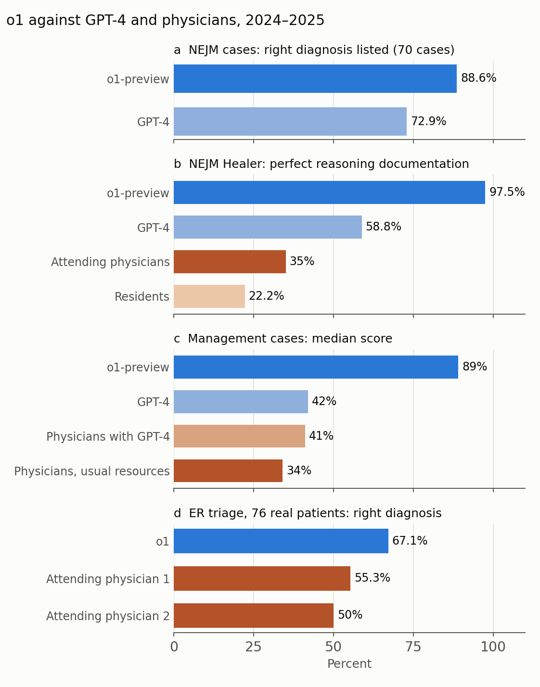
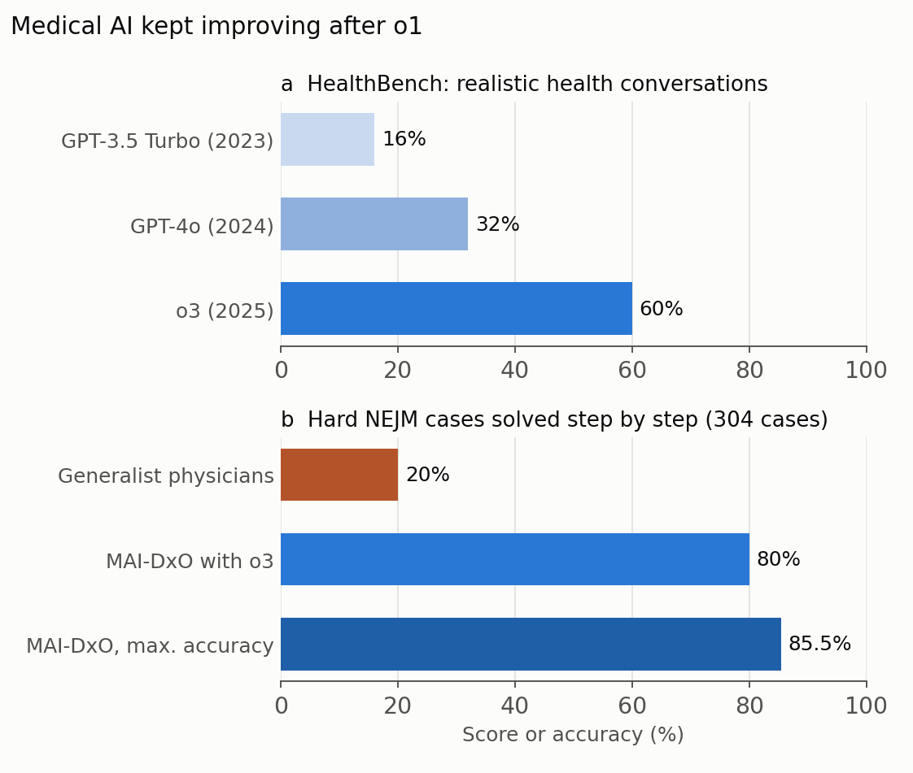

In 1959, Robert Ledley and Lee Lusted argued in _Science_ that computers could help with medical diagnosis, and that the right test was to give them difficult clinical cases (Ledley and Lusted 1959). For more than sixty years, every generation of diagnostic software, from Bayesian calculators to rule-based expert systems, was measured against that standard. In April 2026, _Science_ published what may become a landmark answer: a study in which a large language model outperformed physicians on most tasks of clinical reasoning, including second opinions on real patients in an emergency department (Brodeur et al. 2026).

## What makes this study different

Earlier studies of language models in medicine mostly used multiple-choice exam questions or narrow tasks, often without any human comparison. This study, led by researchers at Beth Israel Deaconess Medical Center, Harvard Medical School and Stanford, did three things differently. It compared the model with baselines from hundreds of physicians. It had physicians score the model's answers with validated rating scales, often without knowing whether a human or the AI had written them. And it went beyond published cases to real, unstructured patient records from an emergency department in Boston.

## The six experiments

**Difficult published cases.** On 143 clinicopathological case conferences from the _New England Journal of Medicine_ (NEJM), the long-standing test bed for diagnostic software, the model listed the correct diagnosis among its possibilities in 78% of cases and named it first in 52%. Counting very close or helpful answers, it was useful in 98%. Performance did not differ significantly between cases published before and after the model's training data cutoff, which suggests it was not simply recalling answers. On 70 cases previously given to GPT-4, the exact or a very close diagnosis appeared in 89% of the new model's answers versus 73% of GPT-4's. Asked which test to order next, it chose the right one in 88% of cases.

**Showing its reasoning.** On 20 virtual patient cases used to teach clinical reasoning, the model's written reasoning earned a perfect score on 78 of 80 attempts, against 47 of 80 for GPT-4, 28 of 80 for attending physicians and 16 of 72 for residents. It was not, however, significantly better at listing the "cannot-miss" diagnoses that must be ruled out early.

**Management decisions.** On five cases asking what to do next, scored against a consensus of 25 expert physicians, the model's median score was 89%, compared with 42% for GPT-4, 41% for physicians using GPT-4 and 34% for physicians using conventional resources.

**Unpublished diagnostic cases.** On six cases deliberately never released, to rule out memorization, the model scored a median of 97%, but this was not significantly higher than GPT-4 (92%) or physicians (74–76%).

**Probabilistic reasoning.** Asked to estimate the probability of disease before and after a test, a task given to 553 clinicians in an earlier study, the model performed similarly to GPT-4 and was far less variable than the clinicians.

**Real emergency department patients.** Finally, the team took 76 randomly selected patients from the emergency department and asked the model and two experienced attending physicians for a differential diagnosis at three points: triage, the first physician evaluation, and admission. Two other attending physicians scored the answers without knowing their source, and mostly could not tell which were written by AI. The model's top five diagnoses contained the exact or a very close diagnosis in 67% of cases at triage, against 55% and 50% for the two physicians, and it stayed ahead at the later points (72% and 82%), although the gap narrowed as more information became available (Figure 1).

{: style="width: 100%; height: auto;" data-zoomable="" }

_**Figure 1.** Selected results: (a) the exact or a very close diagnosis among the model's possibilities on 70 NEJM cases; (b) share of perfect scores for documented clinical reasoning; (c) median score on management cases; (d) the exact or a very close diagnosis in the top five at emergency department triage for 76 real patients. Figure by Daeha Kim, drawn from numbers reported in Brodeur et al. (2026)._

## Which model, and when

This matters for interpreting the results. Five of the six experiments used **o1-preview**, the first of OpenAI's "reasoning" models, released on 12 September 2024. The emergency department study used the full **o1** model and, for comparison, **GPT-4o**. The work first appeared as a preprint on 14 December 2024, then covering only the o1-preview experiments, under the title "Superhuman performance of a large language model on the reasoning tasks of a physician". The emergency department study was added in 2025, the paper was submitted to _Science_ on 2 June 2025, accepted on 23 February 2026 and published on 30 April 2026. The word "superhuman" was dropped from the published title.

In other words, the paper published in 2026 describes models from late 2024. By the authors' own account, o1-preview had already been superseded by newer models such as o3, and they expected performance to be sustained or improved.

## What the authors caution

- The study covers text only. Real clinical work also relies on what a physician sees and hears, from imaging to a patient's level of distress.
- The cases came mostly from internal and emergency medicine, and many were curated for teaching, which may overstate performance on messy real-world records.
- The emergency department task, a second opinion at fixed points, is a proof of concept. Emergency care is mostly about triage, disposition and immediate treatment, not diagnostic accuracy alone.
- The model was not always clearly better, notably on cannot-miss diagnoses and on the unreleased cases.
- What is needed now is prospective trials that test whether such tools improve patient outcomes.

## How would today's models do?

This section is my own view, not the paper's.

**On these tasks, almost certainly better, but the benchmarks are running out of room.** Medical results published since the study point in one direction. On HealthBench, a set of 5,000 realistic health conversations scored with rubrics written by physicians, OpenAI reported that its scores rose from 32% for GPT-4o to 60% for o3 within about a year (Arora et al. 2025). Microsoft's diagnostic orchestrator, running on o3 and working through 304 hard NEJM cases step by step, reached 80–86% accuracy, against an average of 20% for generalist physicians on the same cases (Nori et al. 2025; Figure 2). The same group that wrote the _Science_ paper later built an AI system that produced the first AI-generated diagnosis published in the century-long history of the NEJM case conferences (Buckley et al. 2025). Today's frontier models, two generations further on, also hallucinate considerably less on hard factual questions than the models of 2024, as discussed in an [earlier post](). But when a 2024 model already writes perfect clinical reasoning 97% of the time, there is little room left to show improvement. The authors' warning about "benchmark saturation" applies even more today.

{: style="width: 100%; height: auto;" data-zoomable="" }

_**Figure 2.** Two later results: (a) HealthBench scores reported by OpenAI for three successive models; (b) accuracy on 304 NEJM cases solved step by step, for generalist physicians and for Microsoft's MAI-DxO orchestrator running on o3. The two benchmarks measure different things and cannot be compared with Figure 1 directly. Figure by Daeha Kim, drawn from numbers reported in Arora et al. (2025) and Nori et al. (2025)._

**The bottleneck has moved from the model to everything around it.** The most telling number in the paper may be this one: physicians who had GPT-4 available scored no better than GPT-4 alone (41% versus 42%) on management cases. A more capable model does not automatically make a more capable doctor. Whether physicians and AI together do better than either alone, how to handle incomplete and noisy records, how to combine text with images and examinations, and who is responsible for a wrong suggestion are questions that better models do not answer. Those require the prospective trials the authors call for.

## What scientists in other fields can take from it

The study is also a model of how to evaluate AI fairly, useful well beyond medicine. It compared the model with real experts rather than only with older models; it had blinded experts score open-ended answers; it held back unreleased cases to rule out memorization; and it checked performance before and after the training cutoff. The same design would serve any field, hydrology included, that asks whether an AI can do expert work.

## Bottom line

Brodeur and colleagues showed, with hundreds of physicians as a baseline and real emergency patients, that OpenAI's o1 models matched or exceeded physicians on most text-based tasks of diagnostic and management reasoning, and clearly exceeded GPT-4. The models tested date from late 2024; today's models are very likely better still, but many of these benchmarks are close to their ceiling. The open question is no longer whether a language model can reason through a clinical case on paper, but whether doctors working with one will make better decisions for real patients.

**Questions to think about**

1. Physicians with access to GPT-4 did no better than GPT-4 alone. What would have to change for a human and an AI together to outperform either one?
2. If a benchmark is saturated, how would you design a harder, fairer test of clinical reasoning?
3. Which expert task in your own field could be evaluated with the same design: expert baselines, blinded scoring and unreleased cases?

---

**한 줄 요약 (Korean summary).** Brodeur 등(2026)은 OpenAI의 추론 모델 o1-preview와 o1을 수백 명의 의사와 비교해, 어려운 임상 사례의 진단, 임상 추론의 기술, 치료 결정, 확률 추론, 그리고 보스턴 응급실의 실제 환자 76명에 대한 진단 소견까지 대부분의 과제에서 의사와 GPT-4를 앞섰음을 보였다. 실험에 쓰인 모델은 2024년 9월에 공개된 o1-preview(사례 실험 다섯 가지)와 o1, GPT-4o(응급실 실험)이며, 2024년 12월 프리프린트로 처음 공개되고 2025년 6월 투고, 2026년 4월 출판되었다. 제 의견으로는 지금의 최신 모델은 이 과제들에서 거의 확실히 더 나을 것이지만, 이미 정답률이 97%에 이른 과제도 있을 만큼 벤치마크의 여유가 남아 있지 않다. 이제 핵심 질문은 모델의 실력이 아니라, GPT-4를 쓴 의사도 GPT-4 단독보다 낫지 않았다는 결과가 보여주듯 의사와 AI가 함께 실제 환자를 더 잘 돌볼 수 있느냐이며, 이는 전향적 임상시험으로만 답할 수 있다.

---

**References**

Brodeur, P. G., Buckley, T. A., Kanjee, Z., Goh, E., Ling, E. B., Jain, P., et al. (2026). Performance of a large language model on the reasoning tasks of a physician. _Science_, 392, 524–527. [https://doi.org/10.1126/science.adz4433](https://doi.org/10.1126/science.adz4433)

Arora, R. K., et al. (2025). HealthBench: evaluating large language models towards improved human health. _arXiv_, 2505.08775. [https://doi.org/10.48550/arXiv.2505.08775](https://doi.org/10.48550/arXiv.2505.08775)

Buckley, T. A., et al. (2025). Teaching large language models to reason like expert diagnosticians. _arXiv_, 2509.12194. [https://doi.org/10.48550/arXiv.2509.12194](https://doi.org/10.48550/arXiv.2509.12194)

Ledley, R. S., & Lusted, L. B. (1959). Reasoning foundations of medical diagnosis. _Science_, 130, 9–21. [https://doi.org/10.1126/science.130.3366.9](https://doi.org/10.1126/science.130.3366.9)

Nori, H., et al. (2025). Sequential diagnosis with language models. _arXiv_, 2506.22405. [https://doi.org/10.48550/arXiv.2506.22405](https://doi.org/10.48550/arXiv.2506.22405)

_Both figures are original. The Python scripts that produce them are available on GitHub: [Figure 1](https://github.com/daehakim-waterlab/daehakim-waterlab.github.io/blob/main/scripts/blog/2026-11-06-physician-llm.py), [Figure 2](https://github.com/daehakim-waterlab/daehakim-waterlab.github.io/blob/main/scripts/blog/2026-11-06-healthbench.py)._
