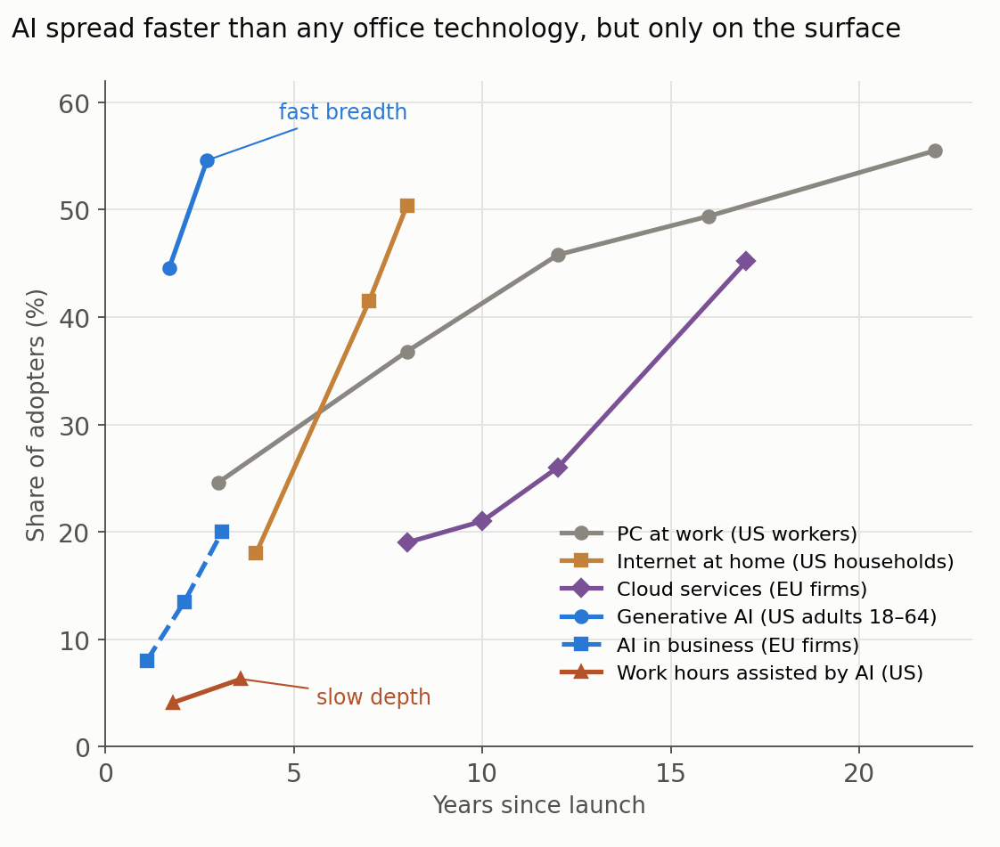
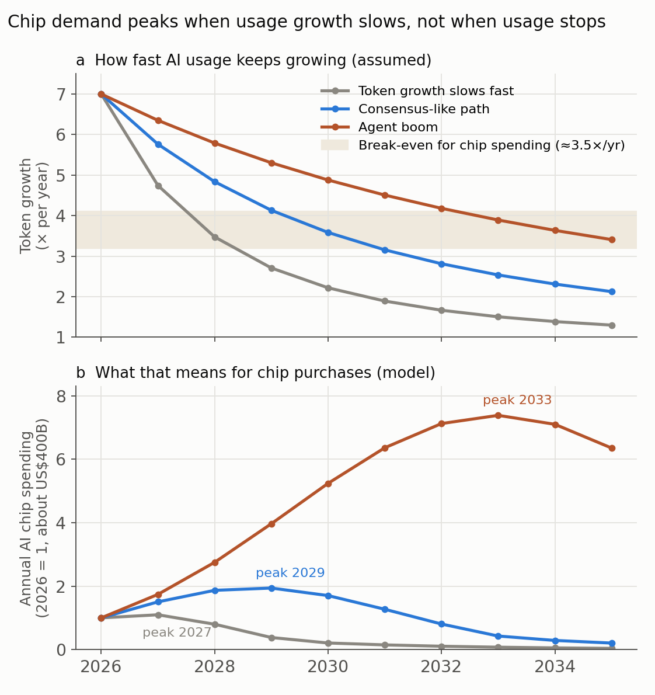

By November 2026, AI tools can write code from a description, draft a paper and run multistep tasks on their own; I have written about [vibe coding]() and about [using LLMs for writing and coding](). Yet capability is not the same as adoption. When spreadsheets arrived, companies did not dissolve their bookkeeping departments overnight. When Python made it possible to do most of what ArcGIS does, only some analysts made the switch, mostly those who could imagine doing so. New programming languages keep appearing, and most people never use any of them.

So how long will it take for AI tools to be absorbed into ordinary work, and when will demand for them peak? And what does that mean for the semiconductors behind them? Nobody can answer these questions precisely. But the history of earlier technologies, the adoption data of the last three years and a simple model can at least frame the answer. Everything below is an estimate with stated assumptions; it is not a forecast and not investment advice.

## How long earlier tools took

Office technologies have usually taken one to three decades to reach half of their potential users.

- **Computers at work.** The share of US workers using a computer on the job rose from 24.6% in 1984 to 49.4% in 1997 and about 56% in 2003 (NCES 2004). From the IBM PC in 1981 to half the workforce took 16 to 20 years.
- **The internet at home.** US households with internet access went from 18% in 1997 to 50% in 2001, roughly eight years after the web browser appeared (US Census Bureau 2010).
- **Cloud computing.** Seventeen years after Amazon Web Services launched, only 45% of EU firms bought cloud services in 2023 (Eurostat 2023).
- **Electricity.** Electric motors drove less than 5% of US factory machinery in 1899 and about half around 1920, and the productivity gains came only in the 1920s, once factories were redesigned around the new power source (David 1990).

The spreadsheet story is especially telling. Spreadsheets made bookkeeping tasks cheap and "what if" analysis easy, and the number of accountants grew while the number of bookkeeping clerks declined. Yet bookkeeping, accounting and auditing clerks were still a 1.6-million-job occupation in the United States in 2024, forty-five years after the first spreadsheet program (US Bureau of Labor Statistics 2025). Work changes far more slowly than tools do. Economists call the lag the productivity J-curve: firms must first invest in new processes, skills and organization, intangible investments that take years to pay off (Brynjolfsson et al. 2021).

## AI has spread fast, but only on the surface

Generative AI broke every record for how fast people try something new. Among US adults aged 18 to 64, 44.6% used it in August 2024 and 54.6% in August 2025, less than three years after ChatGPT. At the same age, household adoption of the PC was 19.7% and of the internet 30.1% (Bick et al., via St. Louis Fed 2025). In February 2026, 49% of all US adults had used an AI chatbot and 24% used one daily (Pew Research Center 2026).

Firms are slower. In May 2026, 19.8% of US businesses used AI to produce goods or services, rising to 37% among firms with 250 or more employees (US Census Bureau 2026). In the EU, the share of enterprises using AI rose from 8% in 2023 to 20% in 2025 (Eurostat 2025).

And the depth of use is still small. AI assisted 6.3% of all US work hours in the second quarter of 2026, up from 4.1% in late 2024, and saved about 2% of them (FRED Blog 2026). Figure 1 puts these numbers next to earlier technologies. Breadth came at record speed because AI rode on the phones, laptops and broadband people already had. Depth, the reorganization of actual work, is moving at something closer to the old pace. This is the ArcGIS-and-Python gap: almost everyone has tried the tool, but only some people have imagined how to rebuild their work around it.

{: style="width: 100%; height: auto;" data-zoomable="" }

_**Figure 1.** Adoption by years since launch: US workers using a computer at work, US households with internet access, EU firms buying cloud services, US adults aged 18–64 using generative AI, EU firms using AI, and the share of US work hours assisted by AI. The measures differ and are not strictly comparable; the figure shows speed, not exact levels. Figure by Daeha Kim, drawn from NCES, US Census Bureau, Eurostat, St. Louis Fed and FRED data._

## Three kinds of "peak"

"When will AI demand peak?" has different answers depending on what is counted.

**Users.** In the United States, simple adoption curves fitted to the survey data reach 90% of their likely ceiling between 2027 and 2030. Worldwide, where about one in five working-age people used AI by mid-2026 according to Microsoft's telemetry, the fastest growth is still ahead, roughly 2028–2030, with saturation in the mid-2030s. These are rough curve fits with assumed ceilings.

**Usage.** For computing, the number of users matters less than how much each one uses. Google processed 9.7 trillion tokens a month in May 2024, about 480 trillion in May 2025 and 3.2 quadrillion in May 2026 (Google 2026). Most of that growth came from heavier use per person, especially agents and reasoning models that consume many more tokens per task, not from new users. With AI assisting only 6% of work hours, there is a long way to go: usage will very likely keep growing well into the 2030s. Its growth rate, however, has already peaked: from fiftyfold in a year to sevenfold.

**Chips.** This is where the answer surprises.

## Why chip demand peaks first

Chips are bought to add capacity and to replace old ones. So annual chip purchases depend on how fast the need for computing is growing, not on how large it is. Meanwhile, every year the industry squeezes more tokens out of each dollar of hardware, through better chips, better software and smaller models. Comparing the sevenfold growth in Google's tokens with the roughly twofold growth in AI hardware spending in 2026 suggests a gain of about three to four times more tokens per hardware dollar each year (my estimate). The consequence is a simple rule: **spending on AI chips keeps rising only while usage grows faster than about 3.5 times a year.**

Figure 2 shows a simple model built on this rule. If token growth slows quickly, chip spending peaks as early as 2027 even though usage keeps rising. On a path consistent with mainstream forecasts, such as McKinsey's estimate of 5.2 trillion US dollars of AI data-center investment by 2030 (McKinsey 2025), spending peaks around 2029 at roughly twice the 2026 level. Only an "agent boom", with usage growing five to six times a year until the end of the decade, pushes the peak into the 2030s, and that path would cost more than the largest buyers' entire cash flow, so power and finance would ration it. Hyperscaler capital spending was already growing about 70% a year in 2026 against about 23% for their operating cash flow (Epoch AI 2026).

{: style="width: 100%; height: auto;" data-zoomable="" }

_**Figure 2.** (a) Three assumed paths for annual growth in AI usage (tokens), starting from Google's sevenfold growth in 2025–26, and the break-even growth rate above which chip spending rises. (b) The annual chip spending each path implies in a simple stock-flow model: required capacity grows with token use divided by efficiency gains, chips last five years, and the cost of capacity falls 1.4 times a year. 2026 is set to 1, roughly 400 billion US dollars of AI chips (my estimate from NVIDIA, Broadcom and AMD data-center revenue). Figure by Daeha Kim, an illustrative model, not a forecast._

The model ignores order backlogs, long-term contracts and supply shortages, which would smooth the curves. Its message is about shape, not exact numbers: the hardware cycle turns when usage growth slows, years before usage itself stops growing.

## Lessons from railways and fiber

History offers sobering analogs. In 1847, the peak year of Britain's railway mania, investment in railways was, relative to the size of the economy, the equivalent of more than one trillion US dollars today, and many of the lines authorized during the mania were never built (Odlyzko 2010). Around 2000, telecom companies built networks for internet traffic that was widely said to double every three or four months, more than tenfold a year, when actual growth was about 100% a year (Odlyzko 2000). Much of the new fiber sat unused for years, and equipment makers such as Lucent and Nortel lost almost all of their value, even though the internet kept growing.

The lesson is not that the technology failed. Railways and the internet were transformative. Investors lost because they paid for capacity on the assumption of growth that arrived later than expected. AI has one important difference. Fiber lasts decades, so the unused strands were eventually lit and became the cheap backbone of the 2000s internet. AI chips become obsolete in about five years. A chip bought for demand that arrives three years late has lost most of its value by then. The durable parts of the AI build-out, such as sites, buildings and power connections, are more like railway track; the chips are more like the telecom switching gear.

## The big picture

Putting this together gives a long-run optimistic and a medium-run cautious view.

- **Usage keeps growing into the 2030s.** As with electricity and computers, the real gains come when work is reorganized, and that takes a decade or more. Usage per worker, not the number of users, is the driver.
- **Chip demand is cyclical.** Annual spending depends on whether usage growth stays above the pace of efficiency gains. On current trends, the turning point could come anywhere from 2027 to the end of the decade.
- **The most exposed parts of the chain are memory and manufacturing equipment**, which respond to changes in the growth rate of spending, and new chip factories ordered at a boom tend to come online just as the boom fades.

Five numbers would tell which path we are on: year-on-year growth in AI tokens relative to about 3.5 times; the ratio of AI capital spending to operating cash flow; memory prices and inventories; the share of work hours assisted by AI (6.3% in 2026); and the share of firms running AI agents at scale (about one in five large companies).

None of this is investment advice. It is a way to see which assumptions current spending plans already contain.

## Bottom line

AI reached half of American adults faster than any office technology before it, but it has changed only about 6% of working hours. If history is a guide, the deeper reorganization of work will take another decade or more, and AI usage will keep growing through it. Chip demand behaves differently: because efficiency improves several-fold each year, annual chip purchases rise only while usage grows faster than about 3.5 times a year. On current trends that condition may fail sometime between 2027 and 2030, so the semiconductor cycle is likely to turn long before AI demand peaks.

**Questions to think about**

1. In your own organization, which work could already be done with AI tools but is still done the old way, and what is holding it back: skills, rules, trust or imagination?
2. Spreadsheets reduced bookkeeping clerks but increased accountants. Which jobs in your field might AI expand rather than replace?
3. If you had to pick one of the five indicators above to watch, which would you choose, and why?

---

**한 줄 요약 (Korean summary).** 스프레드시트, PC, 인터넷, 클라우드 같은 도구는 사람들의 절반에 퍼지기까지 대개 10~20년이 걸렸고, 일하는 방식이 바뀌는 데는 그보다 더 오래 걸렸다. 생성형 AI는 3년 만에 미국 성인의 절반 이상이 써 볼 만큼 역대 가장 빠르게 퍼졌지만, 실제로 AI의 도움을 받는 근무 시간은 아직 약 6%에 불과해 일의 재편은 예전 기술과 비슷한 속도로 진행되고 있다. 따라서 AI 사용량은 2030년대까지 계속 늘어날 가능성이 크지만, 반도체 수요는 다르다. 칩은 늘어나는 사용량만큼 새로 사는 것이고 효율이 해마다 몇 배씩 좋아지므로, 사용량이 연 3.5배 이상 늘어날 때만 칩 구매가 계속 늘어나고, 현재 추세라면 2027~2030년 사이에 반도체 사이클이 먼저 꺾일 수 있다. 이는 투자 조언이 아니라 가정을 드러낸 대략적인 추정이다.

---

**References**

Brynjolfsson, E., Rock, D., & Syverson, C. (2021). The productivity J-curve: how intangibles complement general purpose technologies. _American Economic Journal: Macroeconomics_, 13, 333–372. [https://doi.org/10.1257/mac.20180386](https://doi.org/10.1257/mac.20180386)

David, P. A. (1990). The dynamo and the computer: an historical perspective on the modern productivity paradox. _American Economic Review_, 80(2), 355–361.

Epoch AI (2026). Hyperscaler capex versus cash flow. [https://epoch.ai/data-insights/hyperscaler-capex-vs-cash-flow](https://epoch.ai/data-insights/hyperscaler-capex-vs-cash-flow)

Eurostat (2023). Cloud computing used by 45% of EU enterprises. [https://ec.europa.eu/eurostat/fr/web/products-eurostat-news/w/ddn-20231208-1](https://ec.europa.eu/eurostat/fr/web/products-eurostat-news/w/ddn-20231208-1)

Eurostat (2025). Use of artificial intelligence in enterprises. [https://ec.europa.eu/eurostat/statistics-explained/index.php?title=Use_of_artificial_intelligence_in_enterprises](https://ec.europa.eu/eurostat/statistics-explained/index.php?title=Use_of_artificial_intelligence_in_enterprises)

FRED Blog (2026). Does generative AI save time at work? Federal Reserve Bank of St. Louis, August 2026. [https://fred.stlouisfed.org/blog/2026/08/does-generative-ai-save-time-at-work/](https://fred.stlouisfed.org/blog/2026/08/does-generative-ai-save-time-at-work/)

Google (2026). Sundar Pichai at Google I/O 2026. [https://blog.google/innovation-and-ai/sundar-pichai-io-2026/](https://blog.google/innovation-and-ai/sundar-pichai-io-2026/)

McKinsey & Company (2025). The data center demands of AI. [https://www.mckinsey.com/featured-insights/week-in-charts/data-center-demands](https://www.mckinsey.com/featured-insights/week-in-charts/data-center-demands)

NCES (2004). Digest of Education Statistics, Table 429: Percentage of workers 18 years old and over who use computers on the job. [https://nces.ed.gov/programs/digest/d04/tables/dt04_429.asp](https://nces.ed.gov/programs/digest/d04/tables/dt04_429.asp)

Odlyzko, A. (2000). Internet growth: myth and reality, use and abuse. AT&T Labs – Research. [https://www-users.cse.umn.edu/~odlyzko/doc/internet.growth.myth2.pdf](https://www-users.cse.umn.edu/~odlyzko/doc/internet.growth.myth2.pdf)

Odlyzko, A. (2010). Collective hallucinations and inefficient markets: the British railway mania of the 1840s. University of Minnesota, preliminary version. [https://www-users.cse.umn.edu/~odlyzko/doc/hallucinations.pdf](https://www-users.cse.umn.edu/~odlyzko/doc/hallucinations.pdf)

Pew Research Center (2026). Americans and AI, 2026. [https://www.pewresearch.org/internet/2026/06/17/americans-and-ai-2026/](https://www.pewresearch.org/internet/2026/06/17/americans-and-ai-2026/)

St. Louis Fed (2025). The state of generative AI adoption in 2025 (Bick, Blandin & Deming, Real-Time Population Survey). 13 November 2025. [https://www.stlouisfed.org/on-the-economy/2025/nov/state-generative-ai-adoption-2025](https://www.stlouisfed.org/on-the-economy/2025/nov/state-generative-ai-adoption-2025)

US Bureau of Labor Statistics (2025). Occupational Outlook Handbook: bookkeeping, accounting, and auditing clerks. [https://www.bls.gov/ooh/office-and-administrative-support/bookkeeping-accounting-and-auditing-clerks.htm](https://www.bls.gov/ooh/office-and-administrative-support/bookkeeping-accounting-and-auditing-clerks.htm)

US Census Bureau (2010). Computer and internet use in the United States, 1984–2009. [https://census.gov/history/pdf/internet-computer1984-2009.pdf](https://census.gov/history/pdf/internet-computer1984-2009.pdf)

US Census Bureau (2026). AI use among businesses. May 2026. [https://census.gov/library/stories/2026/05/ai-use-businesses.html](https://census.gov/library/stories/2026/05/ai-use-businesses.html)

_Both figures are original. The Python scripts that produce them are available on GitHub: [Figure 1](https://github.com/daehakim-waterlab/daehakim-waterlab.github.io/blob/main/scripts/blog/2026-11-07-ai-diffusion.py), [Figure 2](https://github.com/daehakim-waterlab/daehakim-waterlab.github.io/blob/main/scripts/blog/2026-11-07-chip-cycle.py)._
