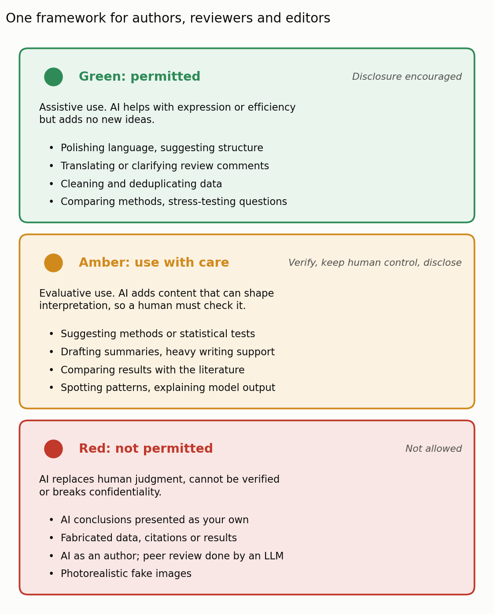

Machine learning has been part of the geosciences for a long time. Hydrologists have trained neural networks on rainfall and runoff for decades, and deep learning models such as LSTMs now rival or beat traditional rainfall–runoff models in many catchments (Kratzert et al. 2018). A review in 2019 argued that the future of Earth system science lies in combining such data-driven models with physical understanding (Reichstein et al. 2019).

What is new is that AI has moved from the analysis to the writing. Large language models now help draft, edit, translate and review manuscripts. In its November 2026 editorial, _Nature Geoscience_ argues that the geoscience community needs shared, transparent rules for this, and announces that its policies now follow a new risk-assessment framework from its publisher, Springer Nature (Nature Geoscience 2026). The editorial is short, but the framework behind it will affect how many of us write papers and review them.

## 1. How much are scientists already using LLMs?

More than many realize. One large study looked for statistical traces of LLM writing, such as a sudden rise in words that LLMs favor, in more than 1.1 million papers and preprints from arXiv, bioRxiv and Nature portfolio journals published between January 2020 and September 2024 (Liang et al. 2025). After ChatGPT appeared, the estimated share of LLM-modified text rose steadily, reaching up to 22% in computer science and up to 9% in mathematics and in Nature portfolio journals. An earlier version of the study found the highest rates in shorter papers, in crowded research areas and among authors who post preprints often.

Using an LLM to improve a paper is not, by itself, a problem. The editorial lists the benefits plainly: clearer, more readable manuscripts and better communication. The risks are just as plain: plagiarism, inaccurate or invented content, and the spread of misinformation, all of which erode trust in research. LLMs also make it cheaper for paper mills to produce fake papers at scale (Kendall and Teixeira da Silva 2024).

## 2. The traffic-light framework

The framework classifies AI use by its risk, not by the tool used, and applies the same three levels to authors, peer reviewers and editors (Figure 1).

{: style="width: 100%; height: auto;" data-zoomable="" }

_**Figure 1.** The three risk levels of the Springer Nature framework for AI use in research and publishing, with examples paraphrased and shortened from the policy. Figure by Daeha Kim, based on the Springer Nature journal policies on artificial intelligence (2026)._

**Green (permitted)** covers assistive uses that help with expression or efficiency without adding new intellectual content: polishing language, suggesting how to structure a section, translating or clarifying reviewer comments, cleaning data. The common feature is that the result can be checked and reversed, and the scientific judgment stays with the human. Disclosure is encouraged.

**Amber (use with care)** covers uses in which AI contributes to reasoning or interpretation: suggesting methods or statistical tests, drafting explanatory summaries, comparing results with the literature, finding patterns in exploratory data, explaining model output in plain language. These are allowed, but only with human verification, human control and disclosure.

**Red (not permitted)** covers uses in which AI replaces human judgment, produces outputs that cannot be verified, or breaks confidentiality: presenting AI-generated hypotheses or conclusions as one's own, fabricating data, citations or results, listing an AI system as an author, handing peer review to an LLM, and creating photorealistic fake images.

## 3. Four principles behind the colors

The policy rests on four principles, and the editorial repeats them in its own words.

1. **Accountability stays human.** Authors remain fully responsible for what they publish, whatever tools they used. An AI system cannot be an author because it cannot be held accountable.
2. **AI may support judgment but not replace it.** This applies to editors and reviewers as much as to authors. AI can help with editorial and review work, but decisions about a manuscript rest on the expertise and judgment of people.
3. **Transparency builds trust.** Authors should say how AI was used, so that readers and editors do not have to guess. The editorial adds that the use of machine learning and other AI tools for data analysis must also be disclosed.
4. **Confidentiality is not negotiable.** Manuscripts under review and other non-public material must not be pasted into open or unsecured AI systems. For reviewers, this is probably the rule most easily broken without thinking.

## 4. What it might mean for everyday work in hydrology

The policy's examples are general, so it is worth asking how they apply to typical tasks in our field. The table below is my own reading, not an official classification.

| Task | Likely level | Why |
| --- | --- | --- |
| Polishing the English of a manuscript | Green | Language only; you check every change |
| Writing code to remove duplicate gauge records | Green | Data cleaning that can be verified |
| Asking an LLM which trend test to use for streamflow | Amber | It recommends a method; you must judge it |
| Letting an LLM compare your results with earlier studies | Amber | Check every cited paper exists and says that |
| Using an LSTM to fill gaps in a discharge record | Disclose | Machine learning in analysis must be stated |
| Pasting a manuscript you are reviewing into a public chatbot | Red | Breaks confidentiality |
| Letting an LLM write your review report | Red | Peer review cannot be delegated |
| Publishing an LLM-written discussion as your own reasoning | Red | Undisclosed AI reasoning |

The amber rows deserve the most attention. LLMs are very good at producing fluent comparisons with the literature, and very good at citing papers that do not exist or do not say what is claimed. The amber label is a reminder that the time saved in drafting has to be spent again in checking.

## 5. Why this matters

Rules like these will keep changing, as the editorial admits. Detection tools are imperfect and disclosure depends on honesty, so the framework cannot be enforced perfectly. Its main value is that it gives authors, reviewers and editors a shared vocabulary for a question that used to be answered privately and inconsistently: not whether AI was used, but how, and who checked the result.

For students, I think the most useful lesson is the simplest one. An LLM can make a paper easier to read, but it cannot take responsibility for whether the paper is right. That part of the work, and the credit or blame that comes with it, still belongs to us.

**Questions to think about**

1. In your last paper or thesis chapter, which uses of AI would fall under green, which under amber, and did you disclose them?
2. Where exactly is the line between "polishing language" (green) and "extensive writing support" (amber)? How would you decide for your own text?
3. If you receive a review report that you suspect was written by an LLM, what should you do as an author, and what should an editor do?

---

**한 줄 요약 (Korean summary).** 최근 한 지구과학 학술지의 사설(2026)은 AI가 데이터 분석을 넘어 논문 작성과 심사에까지 쓰이면서, 저자, 심사자, 편집자 모두가 투명한 원칙을 따라야 한다고 강조한다. 출판사 Springer Nature의 새 신호등 체계는 AI 사용을 위험도에 따라 초록(문장 다듬기, 데이터 정리처럼 검증 가능한 보조), 주황(분석 방법 제안, 문헌 비교처럼 해석에 영향을 주므로 사람의 검증과 공개가 필요한 사용), 빨강(AI 결론을 자기 것으로 제시, 데이터나 인용 조작, AI를 저자로 표기, 심사를 LLM에 맡기기)으로 나눈다. 핵심 원칙은 책임은 끝까지 사람에게 있고, AI는 판단을 돕되 대신할 수 없으며, 사용 방식을 공개하고, 심사 중인 원고를 공개된 AI 도구에 넣지 않는 것이다. AI는 논문을 읽기 쉽게 만들 수는 있지만 그 내용이 맞는지에 대한 책임까지 대신 지지는 않는다.

---

**References**

Kendall, G., & Teixeira da Silva, J. A. (2024). Risks of abuse of large language models, like ChatGPT, in scientific publishing: authorship, predatory publishing, and paper mills. _Learned Publishing_, 37, 55–62. [https://doi.org/10.1002/leap.1578](https://doi.org/10.1002/leap.1578)

Kratzert, F., Klotz, D., Brenner, C., Schulz, K., & Herrnegger, M. (2018). Rainfall–runoff modelling using Long Short-Term Memory (LSTM) networks. _Hydrology and Earth System Sciences_, 22, 6005–6022. [https://doi.org/10.5194/hess-22-6005-2018](https://doi.org/10.5194/hess-22-6005-2018)

Liang, W., Zhang, Y., Wu, Z., Lepp, H., Ji, W., Zhao, X., et al. (2025). Quantifying large language model usage in scientific papers. _Nature Human Behaviour_, 9, 2599–2609. [https://doi.org/10.1038/s41562-025-02273-8](https://doi.org/10.1038/s41562-025-02273-8)

Nature Geoscience (2026). Responsible use of artificial intelligence. _Nature Geoscience_, 19, 1257. [https://doi.org/10.1038/s41561-026-02149-0](https://doi.org/10.1038/s41561-026-02149-0)

Reichstein, M., Camps-Valls, G., Stevens, B., Jung, M., Denzler, J., Carvalhais, N., & Prabhat (2019). Deep learning and process understanding for data-driven Earth system science. _Nature_, 566, 195–204. [https://doi.org/10.1038/s41586-019-0912-1](https://doi.org/10.1038/s41586-019-0912-1)

Springer Nature (2026). Editorial policies: artificial intelligence (AI). [https://www.springernature.com/gp/policies/editorial-policies](https://www.springernature.com/gp/policies/editorial-policies)

_The figure is original. The Python script that produces it is available on [GitHub](https://github.com/daehakim-waterlab/daehakim-waterlab.github.io/blob/main/scripts/blog/2026-11-07-ai-traffic-light.py)._
