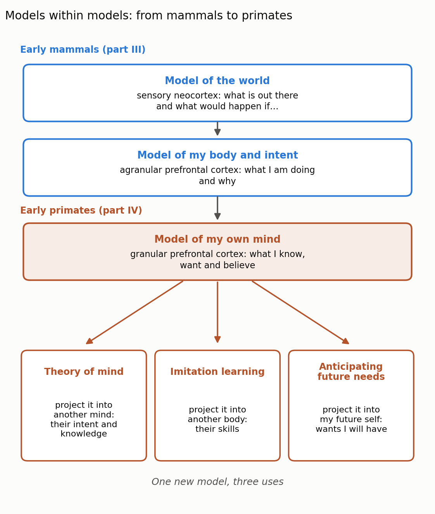
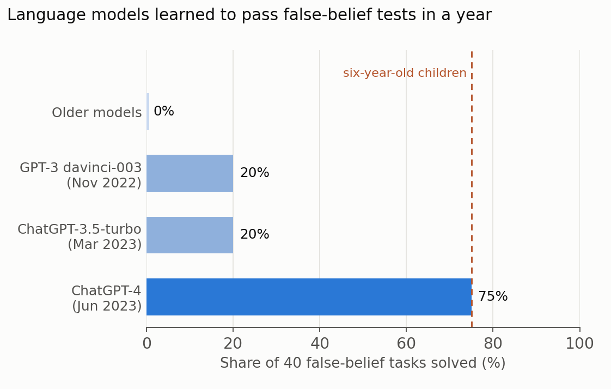

In [part I](), bilaterian worms learned to steer. In [part II](), early vertebrates learned by trial and error. In [part III](), early mammals learned to simulate: a model of the world and a model of the self let them try things out in imagination before trying them in the world.

This post covers the fourth breakthrough in Max Bennett's _A Brief History of Intelligence_ (2023): mentalizing. In Bennett's account it arrived with the early primates, and it added one more model on top of the others, a model of one's own mind. As before, the summary is my own paraphrase of the book's argument, and the AI connections, notably to inverse reinforcement learning and to language models taking theory-of-mind tests, come from the broader literature.

## 1. Breakthrough 4, Mentalizing: a model of one's own mind

A rat that pauses at a fork in the maze is simulating the world and its own movements in it. What it does not seem to do is think about its own thinking: what it knows, what it wants, what it believes and why. Bennett argues that early primates gained this ability, and that it came with a new region of the frontal cortex, the granular prefrontal cortex, which first evolved in primates.

The idea follows naturally from part III. The sensory neocortex is a generative model of the world. The agranular prefrontal cortex is a generative model of the animal's own body and intent. The granular prefrontal cortex, in Bennett's account, models the activity of those older models themselves: a model of a model, or a second-order generative model. Its subject is the animal's own mind.

Figure 1 sums up this stacking of models and the three abilities that, Bennett argues, follow from the newest one.

{: style="width: 100%; height: auto;" data-zoomable="" }

_**Figure 1.** Models within models. Early mammals gained a model of the world and a model of their own body and intent (part III); early primates added a model of their own mind, which can be projected into another individual or into one's own future. Figure by Daeha Kim, a schematic summarizing the argument of Bennett (2023)._

### Three abilities that arrived together

Bennett points to three abilities that appeared in primates:

1. **Theory of mind**: inferring what another individual intends and knows.
2. **Imitation learning**: acquiring a new skill by watching someone else perform it.
3. **Anticipating future needs**: acting now for a want one does not yet feel.

These look like separate talents, but Bennett suggests they may be three uses of the same thing. If you can model your own mind, you can run that model with someone else's situation as input and ask what you would want and know in their place. You can run it with someone else's movements and ask what they are trying to do. And you can run it with your own future situation and ask what you will want then.

### Why one model, not three

Bennett gives several lines of evidence that the three abilities share a common basis. They depend on overlapping brain regions, centered on the granular prefrontal cortex. Children acquire them at roughly similar ages; for example, children usually begin to pass false-belief tests, which ask where someone will look for an object that was moved while they were away, at around four years old (Wimmer and Perner 1983). Damage to these regions tends to impair them together.

The same regions are also used when we reason about our own minds, and damage to them can disrupt the sense of self in striking ways. Bennett mentions conditions such as mirror-sign syndrome, in which a patient no longer recognizes their own reflection, and alien hand syndrome, in which one hand seems to act with a will of its own. In development, a child's ability to reason about her own mind tends to appear before her ability to reason about others'.

Finally, the new primate regions are not built from new parts. The neocortex is made of the same basic circuit repeated across its surface, an observation going back to Vernon Mountcastle. If that circuit learns generative models, as the line of thought from Helmholtz to Hinton, Hawkins and Friston suggests, then a new region can be a new application of the same machinery, this time modeling the rest of the brain.

## 2. Three abilities, one model

### Theory of mind

The term comes from a 1978 paper that asked whether chimpanzees attribute mental states to others (Premack and Woodruff 1978). The hardest version of the question is whether an animal understands that another individual can hold a false belief. In 2016, an eye-tracking study showed great apes videos in which a person saw an object being hidden, left, and missed it being moved. The apes looked in anticipation at the place where the person wrongly believed the object to be, not where it actually was (Krupenye et al. 2016). In this limited sense at least, our closest relatives seem to track what others believe.

### Imitation learning

Watching others is a cheap way to learn. A young primate does not have to discover how to crack a nut or fish for termites by trial and error; it can watch an expert. But copying movements alone is not enough. The learner has to understand what the demonstrator is trying to do, so that it can fill in what it cannot see and ignore what does not matter. In Bennett's account, this is where the model of one's own mind helps: the learner infers the demonstrator's intent, then simulates the movements needed to achieve the same goal.

**The AI connection.** Robotics distinguishes two ways of learning from demonstration. Behavior cloning copies the expert's actions directly. Inverse reinforcement learning first infers what reward the expert must be pursuing and then learns its own way to pursue it (Ng and Russell 2000). The second is closer to what Bennett describes: imitation as inference about another's goals. Large language models can also be seen as imitation learners on an enormous scale, since their pretraining consists of predicting the next word that a human writer would produce.

### Anticipating future needs

Many animals can learn to act for a reward they currently want. Acting now for a need one does not feel yet is harder: a well-fed animal has little reason to save food. In a classic test of this ability, bonobos and orangutans chose a tool that would be useful in another room later, carried it out of the test room and brought it back for use one hour later, and in a further experiment fourteen hours later (Mulcahy and Call 2006). Because both species did it, the authors suggested that the precursors of planning for the future were present in great apes before about 14 million years ago.

## 3. Why primates?

Why did this breakthrough happen in primates? One well-known answer is the social brain hypothesis: primates live in large, complex groups, and keeping track of allies, rivals and debts requires a large neocortex. Across primates, the relative size of the neocortex rises with typical group size (Dunbar 1998). A competing answer is ecological. In a larger sample of more than 140 primate species, diet predicted brain size better than group size did, with fruit-eaters having larger brains than leaf-eaters (DeCasien et al. 2017).

Bennett argues that the two hypotheses may be two sides of the same coin. Ripe fruit is scattered in space and time, so a fruit eater benefits from planning ahead for where and when food will be ready, and from learning foraging tricks from others. The same model of minds that helps with foraging also helps with politics: predicting who will side with whom and keeping track of who knows what. Mentalizing was useful for both.

## 4. The AI connection: machines that model minds

Do language models have a theory of mind? Michal Kosinski gave 11 language models 40 false-belief tasks, each counted as solved only if every one of its eight related scenarios was answered correctly (Kosinski 2024). Older models solved none. GPT-3 davinci-003 and ChatGPT-3.5-turbo each solved 20%. ChatGPT-4 solved 75%, comparable to six-year-old children in earlier studies (Figure 2).

{: style="width: 100%; height: auto;" data-zoomable="" }

_**Figure 2.** Share of 40 false-belief tasks solved by language models released between 2022 and 2023. A task counted as solved only if all eight of its scenarios were answered correctly. Figure by Daeha Kim, based on the results reported by Kosinski (2024)._

A larger study compared GPT-4, GPT-3.5 and LLaMA2 with 1,907 human participants on a battery of theory-of-mind tests (Strachan et al. 2024). GPT-4 performed at or above human levels on indirect requests, false beliefs and misdirection, but struggled to detect faux pas. Further experiments suggested this was not a failure to infer the speaker's mental state but an overly cautious reluctance to commit to an answer. LLaMA2's apparent advantage on faux pas turned out to be an artifact of a bias toward one kind of answer.

What these results mean is debated. One view is that a model trained to predict human writing must, to some extent, learn to model the people who wrote it, because much of human writing is about what people know, want and believe. Another is that the tests themselves appear in many forms in the training data, and that small changes to a task can still trip the models up. In Bennett's terms, the question is whether the model has a model of minds or has learned the surface patterns of text about minds. A useful practical point is that the same kinds of tests used for children and apes can now be used to probe machines, and the results change quickly from one model generation to the next.

## 5. The correspondence at a glance

The table below pairs each biological mechanism with its AI counterpart. The last column is my own judgment of how close the match is.

| Biological mechanism | AI counterpart | How close |
| --- | --- | --- |
| Granular prefrontal cortex as a model of one's own mind | Models that represent their own uncertainty and reasoning | Loose |
| Theory of mind, false-belief understanding | Language models on false-belief tests | Similar test scores, debated mechanism |
| Imitation by inferring the demonstrator's intent | Inverse reinforcement learning | Same idea |
| Copying movements directly | Behavior cloning | Functional match |
| Learning from others at scale | Pretraining on human-written text | Partial match |
| Anticipating future needs | Planning with predicted future rewards | Partial match |
| Same cortical circuit reused for new models | One architecture (transformer) reused for many tasks | Analogy only |

## 6. Closing: a mind that can step outside itself

Mentalizing let primates step outside their own point of view, into another individual's head, another's body, or their own future self. With it came reading the intentions of others, learning skills by watching, and preparing today for tomorrow's hunger, which together made primates better foragers and better politicians.

Bennett places this breakthrough in a long timeline. If the 600 million years since the first brains were compressed into one calendar year, our last common ancestor with chimpanzees, who lived about 7 million years ago, would appear only in the last week of December. Everything that separates us from other apes, from foraging for fruit to launching rockets, happened in those final days. Bennett's fifth and last breakthrough, speaking, is where that story begins, and it is the subject of [part V]().

**Questions to think about**

1. When you explain a hydrological model to a policymaker, you have to guess what they already know and what they want from it. Which parts of that task are theory of mind, and which are knowledge of hydrology?
2. A student who copies a senior's code line by line and a student who first understands what the code is for are learning in different ways. Which is closer to behavior cloning and which to inverse reinforcement learning?
3. If a language model passes a false-belief test, what further evidence would you want before saying it understands what others believe?

---

**한 줄 요약 (Korean summary).** 『A Brief History of Intelligence』의 네 번째 돌파 과정은 초기 영장류가 과립 전전두피질을 통해 얻은 마음 읽기(mentalizing), 곧 자기 마음에 대한 모형이다. 이 모형을 남에게 투사하면 상대의 의도와 앎을 짐작하는 마음 이론이, 남의 몸에 투사하면 보고 따라 배우는 모방 학습이, 미래의 자신에게 투사하면 아직 느끼지 않는 필요를 미리 준비하는 능력이 생긴다. 과일을 찾아다니는 생태적 요구와 복잡한 무리 생활이라는 사회적 요구가 모두 이 능력을 키운 것으로 보인다. AI에서는 시연자의 목표를 추론하는 역강화학습이 이와 닮았고, Kosinski(2024)에 따르면 GPT-4는 틀린 믿음 과제의 75%를 풀어 여섯 살 아이 수준에 이르렀지만, 이것이 진짜 마음 모형인지는 아직 논쟁 중이다.

---

**References**

Bennett, M. (2023). _A Brief History of Intelligence: Evolution, AI, and the Five Breakthroughs That Made Our Brains_. Mariner Books.

DeCasien, A. R., Williams, S. A., & Higham, J. P. (2017). Primate brain size is predicted by diet but not sociality. _Nature Ecology & Evolution_, 1, 0112. [https://doi.org/10.1038/s41559-017-0112](https://doi.org/10.1038/s41559-017-0112)

Dunbar, R. I. M. (1998). The social brain hypothesis. _Evolutionary Anthropology_, 6, 178–190. [https://doi.org/10.1002/(SICI)1520-6505(1998)6:5&lt;178::AID-EVAN5&gt;3.0.CO;2-8](https://doi.org/10.1002/%28SICI%291520-6505%281998%296:5%3C178::AID-EVAN5%3E3.0.CO;2-8)

Kosinski, M. (2024). Evaluating large language models in theory of mind tasks. _Proceedings of the National Academy of Sciences_, 121, e2405460121. [https://doi.org/10.1073/pnas.2405460121](https://doi.org/10.1073/pnas.2405460121)

Krupenye, C., Kano, F., Hirata, S., Call, J., & Tomasello, M. (2016). Great apes anticipate that other individuals will act according to false beliefs. _Science_, 354, 110–114. [https://doi.org/10.1126/science.aaf8110](https://doi.org/10.1126/science.aaf8110)

Mulcahy, N. J., & Call, J. (2006). Apes save tools for future use. _Science_, 312, 1038–1040. [https://doi.org/10.1126/science.1125456](https://doi.org/10.1126/science.1125456)

Ng, A. Y., & Russell, S. (2000). Algorithms for inverse reinforcement learning. In _Proceedings of the Seventeenth International Conference on Machine Learning_ (pp. 663–670). Morgan Kaufmann.

Premack, D., & Woodruff, G. (1978). Does the chimpanzee have a theory of mind? _Behavioral and Brain Sciences_, 1, 515–526. [https://doi.org/10.1017/S0140525X00076512](https://doi.org/10.1017/S0140525X00076512)

Strachan, J. W. A., Albergo, D., Borghini, G., Pansardi, O., Scaliti, E., Gupta, S., et al. (2024). Testing theory of mind in large language models and humans. _Nature Human Behaviour_, 8, 1285–1295. [https://doi.org/10.1038/s41562-024-01882-z](https://doi.org/10.1038/s41562-024-01882-z)

Wimmer, H., & Perner, J. (1983). Beliefs about beliefs: representation and constraining function of wrong beliefs in young children's understanding of deception. _Cognition_, 13, 103–128. [https://doi.org/10.1016/0010-0277(83)90004-5](https://doi.org/10.1016/0010-0277%2883%2990004-5)

_The figures are original. The Python scripts that produce them are available on GitHub: [Figure 1](https://github.com/daehakim-waterlab/daehakim-waterlab.github.io/blob/main/scripts/blog/2026-11-07-mentalizing-layers.py) and [Figure 2](https://github.com/daehakim-waterlab/daehakim-waterlab.github.io/blob/main/scripts/blog/2026-11-07-llm-tom.py)._
