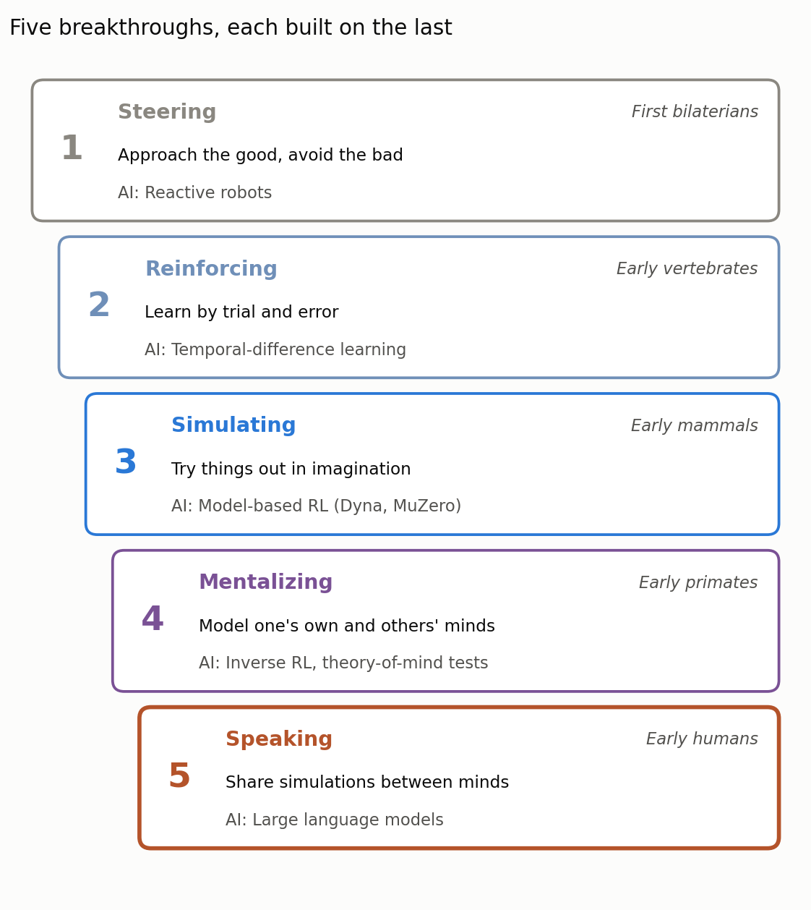
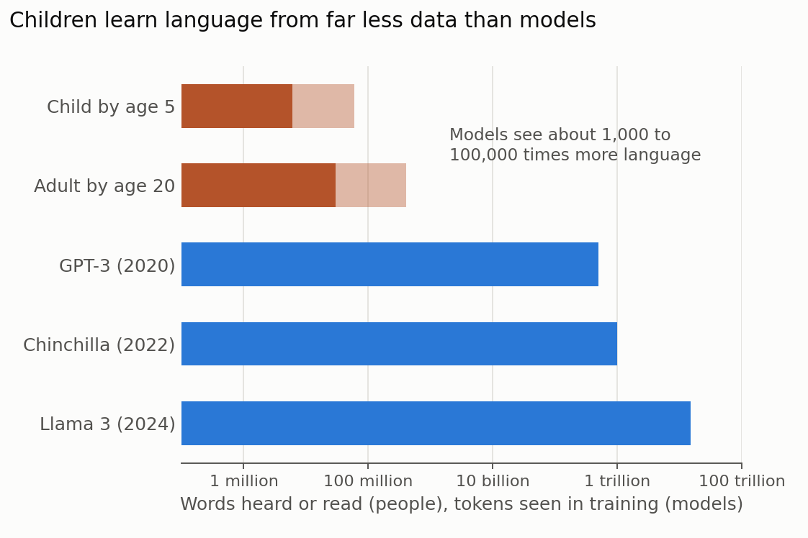

This is the last part of a series on Max Bennett's _A Brief History of Intelligence_ (2023). Bilaterian worms learned to steer ([part I]()), early vertebrates learned by trial and error ([part II]()), early mammals learned to simulate the world in imagination ([part III]()), and early primates learned to model minds, including their own ([part IV]()). Figure 1 puts the five together.

{: style="width: 100%; height: auto;" data-zoomable="" }

_**Figure 1.** The five breakthroughs in Bennett's account, the animals in which each first appeared, and the AI counterparts discussed in this series. Each breakthrough builds on the ones before it. Figure by Daeha Kim, a schematic summarizing Bennett (2023)._

The fifth breakthrough is speaking. It is the one that most obviously connects to today's AI, because the most capable AI systems we have are, at their core, models of language. As before, the summary is my own paraphrase of the book's argument, and some connections, notably to the data that children and language models learn from, come from the broader literature.

## 1. Breakthrough 5, Speaking: sharing what is in our heads

Many animals communicate. Vervet monkeys have different alarm calls for eagles, leopards and snakes, and apes can be taught hundreds of signs. What sets human language apart, in Bennett's account, is what it carries. Thanks to the earlier breakthroughs, a human brain holds a rich inner simulation of the world and of other minds. Language lets one brain put part of that simulation into another: what happened at the river yesterday, how to shape a stone tool, who cannot be trusted.

That changes how learning works. Until now, every animal had to learn mostly from its own experience, plus whatever it could copy by watching. With language, a person can learn from the experience of people they have never met, including people who died long ago. Knowledge no longer has to be rediscovered in each generation; it can accumulate.

## 2. A perfect storm

Why did this happen in our lineage and not in other apes? Bennett describes an unlikely combination of pressures, each of which made the next more likely.

### Out of the forest, into tools and meat

As African forests shrank and gave way to savannah, early humans moved into a new way of life: making stone tools and eating meat. Tool making is hard to learn and easy to lose. If a skill is passed on poorly, each generation does a little worse, and the technology never improves. Bennett argues that early proto-languages helped tool-making skills survive accurately from one generation to the next.

An experiment supports this idea. Researchers taught 184 modern volunteers to make simple stone flakes of the kind found at the oldest tool sites, passing the skill along chains of learners under five conditions, from examining finished flakes and watching an expert, to being taught by demonstration, with gestures or with speech (Morgan et al. 2015). Skill transmitted best when learners were taught, and best of all with spoken instruction; simply watching did little. The authors suggested that the very slow change of the oldest stone-tool tradition, which stayed much the same for roughly 700,000 years, may reflect how poorly skills spread without teaching and language.

### A learning program, not a new brain part

Bennett argues that the brain did not need a new structure for language. Areas of the neocortex involved in language have counterparts in other primates. What changed, in his view, was a set of instincts that turns a child into a language learner: babies take part in back-and-forth "proto-conversations" with their caregivers long before they can speak, and they share attention with others, looking where someone points and pointing to show things themselves. Human infants begin to point to share interest at around their first birthday, a behavior that is rare or absent in other apes (Tomasello et al. 2007).

Together, joint attention and turn-taking work like a curriculum. When a parent and child look at the same thing and the parent names it, the child can tie the word to a part of its inner simulation of the world. Trained this way, older neocortical areas were repurposed for language.

### Gossip, altruism and punishment

Once humans could talk, they began to talk with people who were not close kin, and much of what they talked about was other people. Robin Dunbar has argued that gossip is one of the main functions of language: it lets people keep track of who is reliable in groups too large to monitor directly (Dunbar 2004). Bennett describes a feedback loop. Language made it possible to reward people who helped others and to punish cheaters by spreading the word about them, which made cooperation with strangers safer, which made larger groups possible, which in turn favored people with better language skills.

### Cooking and bigger brains

As groups grew and ideas began to hop from brain to brain, there was more to learn and remember, and bigger brains became worth their cost. The human brain is about three times the size of a chimpanzee's, and brain tissue is expensive to run. Bennett points to cooking, a hypothesis developed by Richard Wrangham, as one way our ancestors paid for it: cooked food yields far more energy for less chewing and digestion (Wrangham 2009). Whether cooking drove brain growth or was made possible by it, it offered the surplus that a growing brain needed.

## 3. A mind tethered to other minds

From this perfect storm came the fifth and final breakthrough. Bennett's closing point is that, with language, the human mind is no longer a single mind. Each of us is connected to others through a long history of accumulated ideas: tools, words, stories, mathematics and science, none of which any one of us could have invented alone. He also notes that language brought out both the best and the worst of us, from altruism toward strangers to coordinated cruelty.

For a scientist this is a familiar idea. No hydrologist derives the water balance, Darcy's law or the Penman equation from scratch; we inherit them through textbooks and papers and add a little to the pile. Science is an unusually disciplined form of the accumulation that language made possible.

## 4. The AI connection: language without a body

Large language models are trained on exactly this accumulation: a large share of the text that humans have written down. In one sense they are the most direct AI counterpart of any breakthrough in the book. In another, they reverse the order in which evolution built intelligence.

Evolution built the inner simulation first and added language on top, so that words are labels for parts of a world model. Language models start from the words. Bennett discusses how early large language models produced fluent text while failing simple questions that require picturing a physical situation, and how newer models have closed many of these gaps. Whether they did so by building something like a world model from text, or by learning ever better statistical patterns in text about the world, is still debated. Some researchers argue that a system trained only on linguistic form cannot, in principle, learn meaning (Bender and Koller 2020).

The difference in how the two learn is easy to quantify (Figure 2). A child hears somewhere between a few million and a few tens of millions of words by age five, depending on how much language surrounds them. Even a 20-year-old who reads a great deal has met perhaps a few hundred million words. The training set of GPT-3 held about 500 billion tokens, and Llama 3 was trained on about 15 trillion (Frank 2023; Grattafiori et al. 2024). Frank (2023) suggests three possible reasons why children need so much less: a brain shaped by evolution before any data arrives, language grounded in sight, touch and action, and input that comes through social interaction in which the child takes part. These are, almost point for point, the earlier breakthroughs and the learning program described above.

{: style="width: 100%; height: auto;" data-zoomable="" }

_**Figure 2.** Language heard or read by people compared with the training data of three language models, on a logarithmic scale. For people, the dark part of each bar shows the estimate for children growing up with little language around them and the light part extends to the estimate for language-rich environments (and, at age 20, heavy reading). Figure by Daeha Kim, based on estimates from Frank (2023) and training-set sizes reported by Frank (2023) and Grattafiori et al. (2024)._

## 5. The correspondence at a glance

The table below pairs each biological mechanism with its AI counterpart. The last column is my own judgment of how close the match is.

| Biological mechanism | AI counterpart | How close |
| --- | --- | --- |
| Language as a way to share inner simulations | Language models trained on human text | Shared medium, reversed order |
| Accumulated knowledge across generations | Pretraining on the written record | Close match |
| Joint attention, naming what both can see | Multimodal models linking words and images | Partial match |
| Proto-conversations, learning by interaction | Instruction tuning, learning from human feedback | Partial match |
| Teaching skills with words | Learning a task from instructions in a prompt | Functional match |
| Small data, rich prior structure | Huge data, weak prior structure | Contrast |

## 6. Closing: five breakthroughs and a sixth

Looking back over the series, each breakthrough solved a problem by building on the previous one. Steering needed a sense of good and bad; reinforcing used that sense to learn from experience; simulating let animals learn from experience they never had; mentalizing turned the simulator toward minds; and speaking let minds share their simulations, so that learning could continue beyond a single lifetime. Again and again, AI researchers have arrived at similar solutions, often without knowing that evolution had found them first.

The book ends by asking what a sixth breakthrough might be, and the obvious candidate is the one being built now: minds that are not made of neurons at all. If Bennett's history teaches anything, it is that each new kind of intelligence was built from the parts of the old ones. It will be interesting to see which of the five our machines are still missing.

**Questions to think about**

1. Much of what a hydrologist knows was learned from papers and textbooks rather than from personal fieldwork. Which parts of your own expertise could not have been passed on in words?
2. Morgan et al. found that stone-tool skills spread poorly by watching alone. Which skills in your field are still learned mainly by watching, and how could they be taught better?
3. A child needs far less language than a language model. Which of Frank's three explanations do you find most convincing, and how might it change how we train models?

---

**한 줄 요약 (Korean summary).** 『A Brief History of Intelligence』의 다섯 번째이자 마지막 돌파 과정은 초기 인류가 얻은 언어(speaking)로, 머릿속 시뮬레이션을 다른 사람의 머리로 옮겨 경험을 세대를 넘어 쌓을 수 있게 했다. 숲이 줄어든 사바나에서 도구 제작과 육식이 시작되자 기술을 정확히 전수할 필요가 생겼고, 함께 바라보기와 주고받는 대화를 통해 아이가 단어를 세계 모형에 연결하는 학습 프로그램이 생기면서 기존 신피질이 언어에 쓰이게 되었으며, 험담, 이타성, 처벌의 되먹임과 요리로 얻은 에너지가 더 큰 뇌를 뒷받침했다. 그 결과 인간의 마음은 더 이상 혼자가 아니라 오랜 세월 쌓인 생각을 통해 서로 연결되었다. 대규모 언어모형은 이 축적된 기록에서 출발하지만 아이보다 수천~수십만 배 많은 언어 자료가 필요하며, 몸과 세계 모형 없이 배운 언어가 진짜 이해인지는 아직 논쟁 중이다.

---

**References**

Bender, E. M., & Koller, A. (2020). Climbing towards NLU: on meaning, form, and understanding in the age of data. In _Proceedings of the 58th Annual Meeting of the Association for Computational Linguistics_ (pp. 5185–5198). [https://doi.org/10.18653/v1/2020.acl-main.463](https://doi.org/10.18653/v1/2020.acl-main.463)

Bennett, M. (2023). _A Brief History of Intelligence: Evolution, AI, and the Five Breakthroughs That Made Our Brains_. Mariner Books.

Dunbar, R. I. M. (2004). Gossip in evolutionary perspective. _Review of General Psychology_, 8, 100–110. [https://doi.org/10.1037/1089-2680.8.2.100](https://doi.org/10.1037/1089-2680.8.2.100)

Frank, M. C. (2023). Bridging the data gap between children and large language models. _Trends in Cognitive Sciences_, 27, 990–992. [https://doi.org/10.1016/j.tics.2023.08.007](https://doi.org/10.1016/j.tics.2023.08.007)

Grattafiori, A., Dubey, A., Jauhri, A., Pandey, A., Kadian, A., Al-Dahle, A., et al. (2024). The Llama 3 herd of models. _arXiv_, 2407.21783. [https://doi.org/10.48550/arXiv.2407.21783](https://doi.org/10.48550/arXiv.2407.21783)

Morgan, T. J. H., Uomini, N. T., Rendell, L. E., Chouinard-Thuly, L., Street, S. E., Lewis, H. M., et al. (2015). Experimental evidence for the co-evolution of hominin tool-making teaching and language. _Nature Communications_, 6, 6029. [https://doi.org/10.1038/ncomms7029](https://doi.org/10.1038/ncomms7029)

Tomasello, M., Carpenter, M., & Liszkowski, U. (2007). A new look at infant pointing. _Child Development_, 78, 705–722. [https://doi.org/10.1111/j.1467-8624.2007.01025.x](https://doi.org/10.1111/j.1467-8624.2007.01025.x)

Wrangham, R. (2009). _Catching Fire: How Cooking Made Us Human_. Basic Books.

_The figures are original. The Python scripts that produce them are available on GitHub: [Figure 1](https://github.com/daehakim-waterlab/daehakim-waterlab.github.io/blob/main/scripts/blog/2026-11-08-five-breakthroughs.py) and [Figure 2](https://github.com/daehakim-waterlab/daehakim-waterlab.github.io/blob/main/scripts/blog/2026-11-08-language-data-gap.py)._
