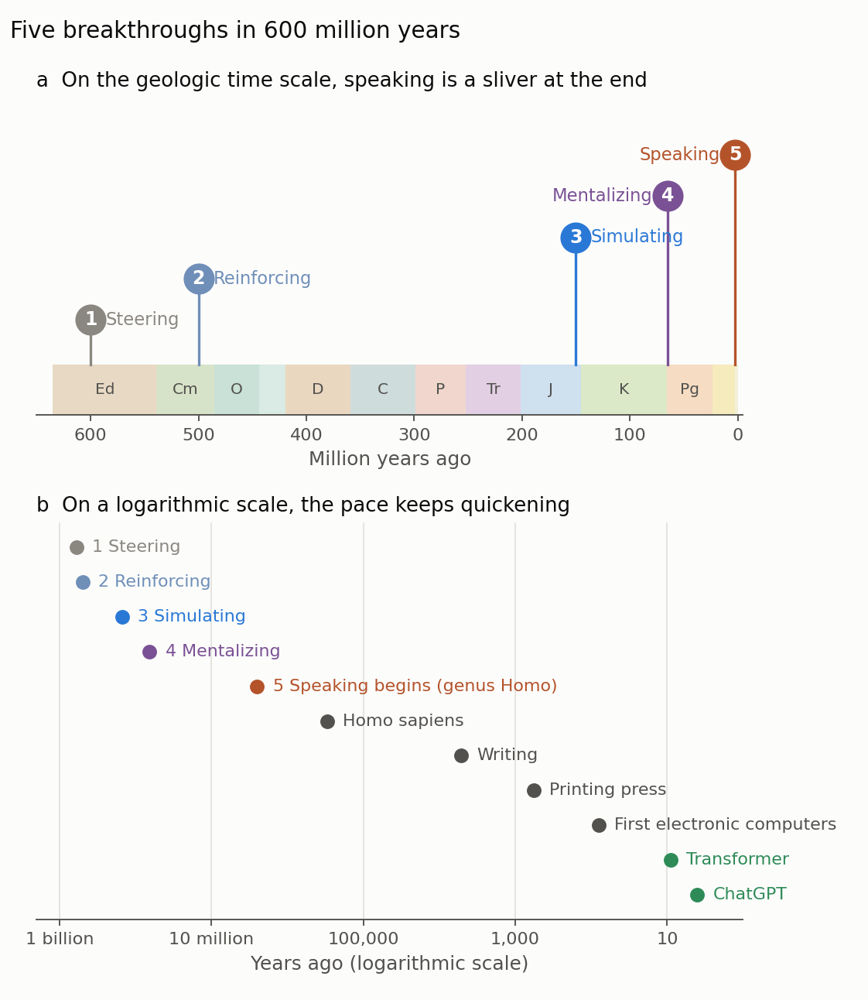
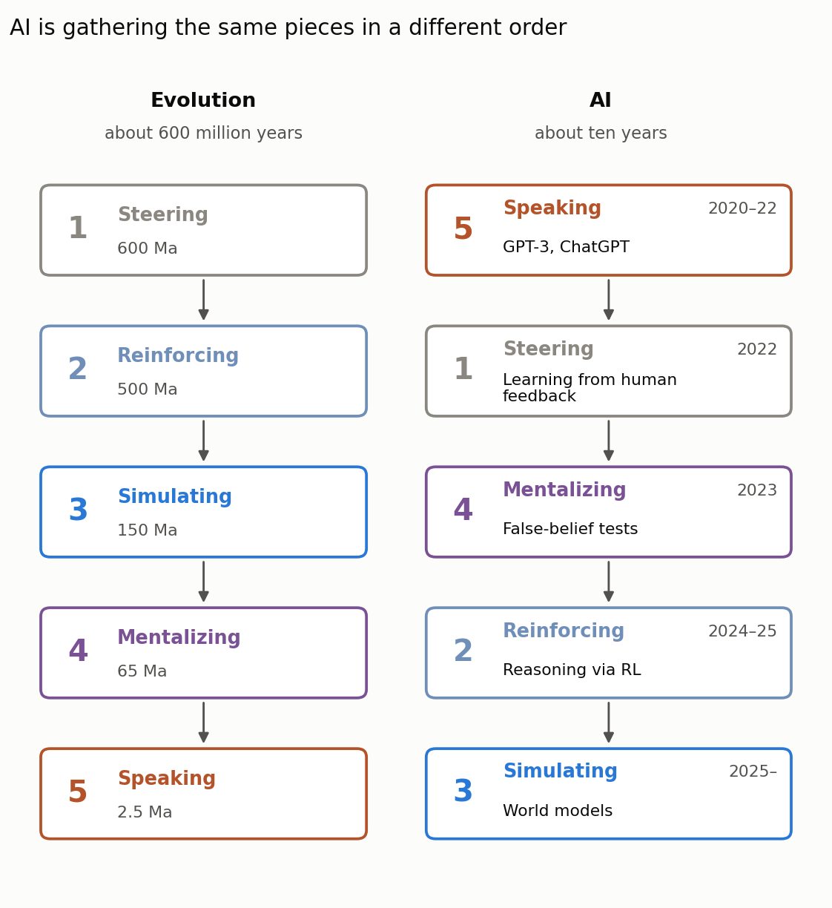

Over five posts, this series followed the five breakthroughs of Max Bennett's _A Brief History of Intelligence_ (2023): steering ([part I]()), reinforcing ([part II]()), simulating ([part III]()), mentalizing ([part IV]()) and speaking ([part V]()). The book ends with a short conclusion titled "The Sixth Breakthrough", and the obvious candidate for that breakthrough is the one being built in data centers today.

This last post steps back. It places the five breakthroughs on the geologic time scale, looks at what AI has done in the three years since the book was written, and asks whether today's language models are on the road to a sixth breakthrough. The first half follows the book; the second half is my own reading of developments since 2024, and it is an opinion, not a forecast.

## 1. Five breakthroughs on the geologic time scale

Earth scientists are used to deep time, but even for us Figure 1a is striking. The first brains appeared in the Ediacaran, about 600 million years ago. Vertebrates and their dopamine-based trial-and-error learning followed in the Cambrian, mammals and their simulating neocortex in the Jurassic, and primates near the start of the Paleogene, shortly after the asteroid impact that ended the age of dinosaurs. Speaking, which began with early humans about 2.5 million years ago, does not even get its own visible slice of the axis. It sits in the Quaternary, the thin pale band at the right end.

{: style="width: 100%; height: auto;" data-zoomable="" }

_**Figure 1.** (a) The five breakthroughs on the geologic time scale (Ed Ediacaran, Cm Cambrian, O Ordovician, D Devonian, C Carboniferous, P Permian, Tr Triassic, J Jurassic, K Cretaceous, Pg Paleogene; the Silurian, Neogene and Quaternary are unlabeled). (b) The same events on a logarithmic scale of years before present, with later milestones of human culture and computing. Dates are approximate. Figure by Daeha Kim, using period boundaries from the International Chronostratigraphic Chart and the breakthroughs of Bennett (2023)._

Bennett uses a calendar to make the same point, and it is worth extending. If the 600 million years since the first brains were compressed into one year, each real year would last about a twentieth of a second.

| Event | Years ago | On a one-year calendar |
| --- | --- | --- |
| First brains (steering) | 600 million | 1 January |
| Early vertebrates (reinforcing) | 500 million | 2 March |
| Early mammals (simulating) | 150 million | 1 October |
| Early primates (mentalizing) | 65 million | 22 November |
| Genus _Homo_ (speaking begins) | 2.5 million | 30 December, before noon |
| _Homo sapiens_ | 300,000 | 31 December, about 7:40 pm |
| Writing | 5,200 | 4.5 minutes before midnight |
| First electronic computers | 80 | 4 seconds before midnight |
| ChatGPT | 4 | 0.2 seconds before midnight |

Figure 1b shows the same events on a logarithmic axis, which is the natural way to see a process that keeps speeding up. Each breakthrough took less time than the one before, and once language let knowledge accumulate outside individual brains, the intervals collapsed: from writing to printing to computers to language models. Whatever the sixth breakthrough turns out to be, it is happening in the last fraction of a second of Bennett's year.

## 2. What Bennett means by a sixth breakthrough

In his conclusion, Bennett suggests that the next breakthrough may be intelligence that is no longer bound to biology: minds built from silicon rather than neurons, possibly far more capable than our own. His emphasis is less on when this happens than on what it inherits. Each earlier breakthrough was built from the parts of the ones before, and an artificial superintelligence would be built, at least at first, from the accumulated record of human language and the goals we choose to give it. The question he leaves the reader with is therefore partly technical and partly moral: what do we want such minds to value?

## 3. What has happened since the book

Bennett wrote the book when ChatGPT was new. Much has happened since, and a striking pattern is that AI seems to be acquiring rough counterparts of the five breakthroughs in a different order from evolution (Figure 2).

{: style="width: 100%; height: auto;" data-zoomable="" }

_**Figure 2.** Evolution acquired the five breakthroughs in order over about 600 million years. AI systems have acquired rough counterparts of them in a different order, starting with language, within about a decade. The pairing on the right is my own interpretation, not a claim of the book. Figure by Daeha Kim._

Evolution built language last, on top of a body, a value system, a world model and a model of minds. AI started with language. Large language models were trained first to predict text (speaking). They were then tuned with human ratings of good and bad answers, a crude sense of valence (steering). By 2023 they could pass many theory-of-mind tests (mentalizing, part IV). The developments since 2024 fill in the rest.

**Reinforcing returned.** The biggest change since the book is the arrival of "reasoning" models, beginning with OpenAI's o1 in September 2024. These models are trained by reinforcement learning to produce long chains of reasoning, rewarded when the final answer can be checked as correct. DeepSeek showed that this kind of training alone can make reasoning behaviors such as self-checking emerge (Guo et al. 2025). In Bennett's terms, trial-and-error learning from part II, the oldest learning algorithm in vertebrates, was bolted onto a language model.

**Results that can be checked.** In July 2025, an advanced version of Google DeepMind's Gemini solved five of the six problems at the International Mathematical Olympiad, a gold-medal score certified by the competition's coordinators and achieved in natural language within the time limit (Google DeepMind 2025a). DeepMind's AlphaEvolve, a coding agent built on language models, found a way to multiply 4×4 complex matrices with 48 scalar multiplications, improving on an algorithm that had stood since 1969 (Google DeepMind 2025b). The 2024 Nobel Prize in Chemistry went in part to the developers of AlphaFold.

**Longer and longer tasks.** METR measures the length of software tasks, timed by how long they take skilled humans, that AI agents can complete with 50% reliability. That length doubled roughly every seven months from 2019 to early 2025 (Kwa et al. 2025), and faster since. By 2026 METR noted that its measurements above 16 hours were unreliable with its current task suite, and in September 2026 it stopped updating its public chart.

**Puzzles designed to resist memorization.** The ARC-AGI benchmarks consist of visual puzzles that are easy for people but were built to be hard for pattern-matching systems. When the interactive ARC-AGI-3 launched in March 2026, frontier models scored under 1%. By November 2026 the best entry on the public leaderboard scored 62.7% on ARC-AGI-3 and 95.0% on ARC-AGI-2, at a cost of tens of thousands of dollars per evaluation run (ARC Prize 2026).

**Simulating, at last.** Google DeepMind's Genie 3 (August 2025) generates interactive environments that a user or an agent can move through in real time, keeping them consistent for a few minutes (Google DeepMind 2025c). DeepMind describes such world models as a key step toward general intelligence. This is the closest AI has come to the rat at the fork in the maze of part III.

## 4. Are transformers enough?

The progress is real. Whether it leads to superintelligence is a different question, and the people building these systems disagree.

One camp argues that the current recipe, large transformer models plus reinforcement learning plus more compute, will keep working. Dario Amodei of Anthropic wrote in January 2026 that AI systems as capable as "a country of geniuses in a datacenter" could be as little as one to two years away, while adding that they could also be considerably further out (Amodei 2026). I discussed the limits of the scaling side of this argument in an [earlier post]().

The other camp argues that something important is missing, and the missing pieces line up remarkably well with Bennett's breakthroughs.

- **No learning from ongoing experience.** Richard Sutton and David Silver argue that AI is reaching the limits of what can be learned from human data and must enter an "era of experience", in which agents learn continually from their own interaction with the world (Silver and Sutton 2025). Andrej Karpathy has said that today's models lack continual learning and that working agents will take about a decade. A brain never stops learning; a deployed language model mostly does. This is the plasticity of part I and the trial-and-error learning of part II, applied for a lifetime rather than during a training run.
- **No world model built from the world.** Yann LeCun has long argued that predicting the next word is a dead end for human-level intelligence and that machines need world models learned from sensory data. He left Meta in late 2025 to build such systems. This is the simulating breakthrough of part III.
- **Running out of words.** Villalobos et al. (2024) estimated the stock of public human text at about 300 trillion tokens and projected that, at current trends, models would use it up between 2026 and 2032. A child learns language from a tiny fraction of that (part V), because it learns from a body, a world and other people, not from text alone.

Demis Hassabis of Google DeepMind sits between the camps: he has suggested that one or two more breakthroughs, in areas such as continual learning, planning and memory, may still be needed.

## 5. When?

Nobody knows, and the honest answer is that forecasts move. In a survey of 2,778 AI researchers conducted in 2023, the median respondent gave a 50% chance that machines would outperform humans at every task by 2047, thirteen years earlier than the same question had produced only a year before, and a 10% chance by 2027 (Grace et al. 2025). The authors of the widely read "AI 2027" scenario pushed their own estimates later in late 2025 and then earlier again in 2026; by August 2026, two of its authors, writing on the project's blog, placed superintelligence in 2029 and 2033 respectively (Kokotajlo et al. 2025). Lab leaders tend to give the shortest timelines, and some prominent researchers, such as Karpathy, give longer ones.

As a hydrologist, I read these numbers the way I read long-range streamflow forecasts: the spread between them says more than any single value. Three observations seem robust to me.

1. **Progress is fastest where answers can be checked.** Mathematics, programming and puzzles have clear right answers, so reinforcement learning works well there. Many important problems, from flood forecasting under a changing climate to policy, can only be checked slowly, partially or not at all. Expect AI to reach superhuman levels unevenly, first in verifiable domains.
2. **The missing pieces are old ones.** Continual learning, grounded world models and learning from interaction are what evolution built first. Language models skipped them. Whether they can be added on top, or must be rebuilt from below, is perhaps the central question for the next decade.
3. **Values are not a detail.** Bennett's closing question, what we want these minds to want, becomes more pressing, not less, the faster the technical progress.

## 6. Closing

Steering took the first brains, reinforcing took a backbone, simulating took a neocortex, mentalizing took a primate brain, and speaking took a human community. Each breakthrough was slower to arrive and faster to spread than anything before it, and each was built from the parts of the last. On Bennett's calendar, the whole story of artificial intelligence so far fits in less than a second before midnight.

I do not know whether the sixth breakthrough will come from transformers, from something that replaces them, or not for a long time. But this series has convinced me of one thing: the most useful guide to what machines are still missing is the long history of how brains got here.

**Questions to think about**

1. Which of Bennett's five breakthroughs do you think current AI systems lack most, and how would you test for it?
2. In hydrology, which problems have answers that can be checked quickly enough for AI to learn by trial and error, and which do not?
3. If you could choose one value or goal to pass on to a future superintelligence, what would it be, and how would you make sure it was understood as you meant it?

---

**한 줄 요약 (Korean summary).** 지질 시간 위에 놓으면 다섯 번의 돌파 과정 중 언어(speaking)는 6억 년의 마지막 0.4%에 불과하며, 6억 년을 1년으로 줄이면 ChatGPT는 자정 0.2초 전에 등장한다. 책이 쓰인 뒤 AI는 언어에서 출발해 사람의 피드백, 마음 이론 테스트, 강화학습 기반 추론 모델, 세계 모형으로 진화와 거의 반대 순서로 돌파 과정의 대응물을 갖추어 왔고, 수학 올림피아드 금메달 수준과 수십 년 된 알고리즘의 개선 같은 성과를 냈다. 그러나 경험에서 계속 배우는 능력, 세계에서 직접 배운 세계 모형, 고갈되어 가는 인간의 텍스트 같은 한계는 진화가 먼저 만든 바로 그 부분이어서, 트랜스포머만으로 초지능에 이를지는 여전히 논쟁 중이다. 전망 시점은 계속 앞뒤로 움직이므로 단일 값보다 그 폭을 읽어야 하며, 검증이 쉬운 분야부터 고르지 않게 발전할 가능성이 크고, Bennett가 남긴 질문처럼 그런 지능이 무엇을 원하도록 할지가 기술만큼 중요하다.

---

**References**

Amodei, D. (2026). The adolescence of technology. [https://www.darioamodei.com/essay/the-adolescence-of-technology](https://www.darioamodei.com/essay/the-adolescence-of-technology)

ARC Prize (2026). ARC-AGI leaderboard. Accessed 7 November 2026. [https://arcprize.org/leaderboard](https://arcprize.org/leaderboard)

Bennett, M. (2023). _A Brief History of Intelligence: Evolution, AI, and the Five Breakthroughs That Made Our Brains_. Mariner Books.

Google DeepMind (2025a). Advanced version of Gemini with Deep Think officially achieves gold-medal standard at the International Mathematical Olympiad. [https://deepmind.google/discover/blog/advanced-version-of-gemini-with-deep-think-officially-achieves-gold-medal-standard-at-the-international-mathematical-olympiad/](https://deepmind.google/discover/blog/advanced-version-of-gemini-with-deep-think-officially-achieves-gold-medal-standard-at-the-international-mathematical-olympiad/)

Google DeepMind (2025b). AlphaEvolve: a Gemini-powered coding agent for designing advanced algorithms. [https://deepmind.google/discover/blog/alphaevolve-a-gemini-powered-coding-agent-for-designing-advanced-algorithms/](https://deepmind.google/discover/blog/alphaevolve-a-gemini-powered-coding-agent-for-designing-advanced-algorithms/)

Google DeepMind (2025c). Genie 3: a new frontier for world models. [https://deepmind.google/discover/blog/genie-3-a-new-frontier-for-world-models/](https://deepmind.google/discover/blog/genie-3-a-new-frontier-for-world-models/)

Grace, K., Sandkühler, J. F., Stewart, H., Weinstein-Raun, B., Thomas, S., Stein-Perlman, Z., et al. (2025). Thousands of AI authors on the future of AI. _Journal of Artificial Intelligence Research_, 84. [https://doi.org/10.1613/jair.1.19087](https://doi.org/10.1613/jair.1.19087)

Guo, D., Yang, D., Zhang, H., Song, J., Wang, P., Zhu, Q., et al. (2025). DeepSeek-R1 incentivizes reasoning in LLMs through reinforcement learning. _Nature_, 645, 633–638. [https://doi.org/10.1038/s41586-025-09422-z](https://doi.org/10.1038/s41586-025-09422-z)

Kokotajlo, D., Alexander, S., Larsen, T., Lifland, E., & Dean, R. (2025). AI 2027. [https://ai-2027.com](https://ai-2027.com)

Kwa, T., West, B., Becker, J., Deng, A., Garcia, K., Hasin, M., et al. (2025). Measuring AI ability to complete long tasks. _arXiv_, 2503.14499. [https://doi.org/10.48550/arXiv.2503.14499](https://doi.org/10.48550/arXiv.2503.14499)

Silver, D., & Sutton, R. S. (2025). Welcome to the era of experience. Preprint of a chapter in _Designing an Intelligence_, MIT Press. [https://storage.googleapis.com/deepmind-media/Era-of-Experience%20/The%20Era%20of%20Experience%20Paper.pdf](https://storage.googleapis.com/deepmind-media/Era-of-Experience%20/The%20Era%20of%20Experience%20Paper.pdf)

Villalobos, P., Ho, A., Sevilla, J., Besiroglu, T., Heim, L., & Hobbhahn, M. (2024). Position: will we run out of data? Limits of LLM scaling based on human-generated data. In _Proceedings of the 41st International Conference on Machine Learning_, PMLR 235, 49523–49544. [https://proceedings.mlr.press/v235/villalobos24a.html](https://proceedings.mlr.press/v235/villalobos24a.html)

_The figures are original. The Python scripts that produce them are available on GitHub: [Figure 1](https://github.com/daehakim-waterlab/daehakim-waterlab.github.io/blob/main/scripts/blog/2026-11-08-breakthrough-timeline.py) and [Figure 2](https://github.com/daehakim-waterlab/daehakim-waterlab.github.io/blob/main/scripts/blog/2026-11-08-ai-reverse-order.py)._
