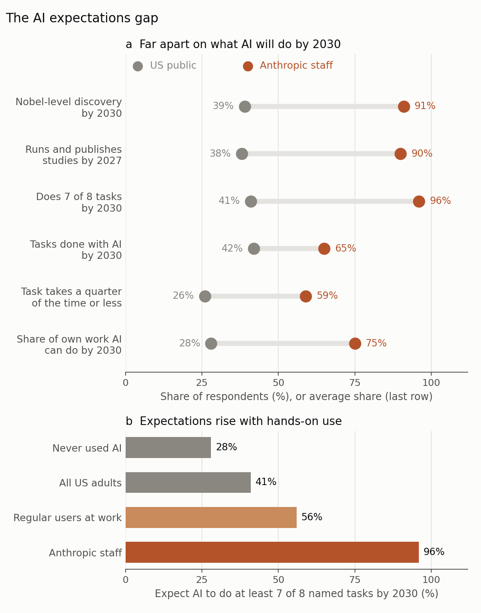
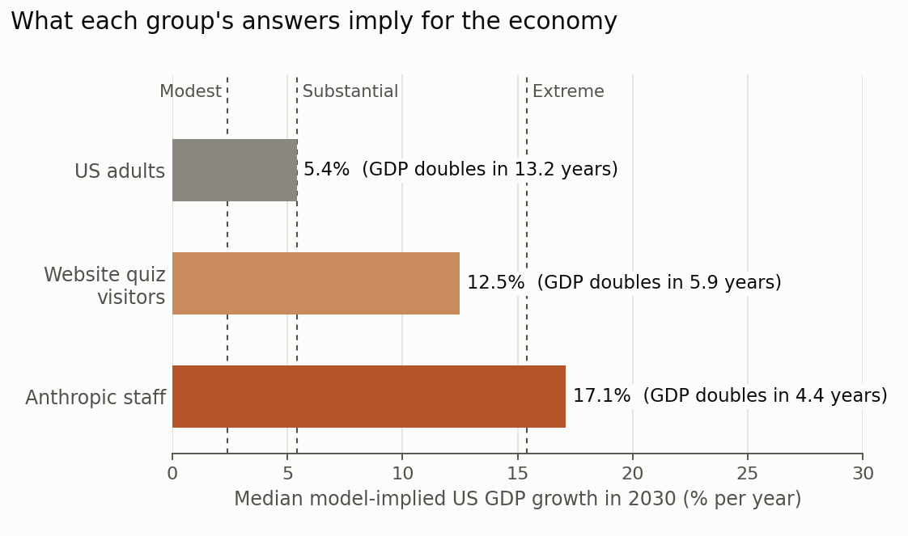

Ask people who build AI and people who do not what AI will be able to do in a few years, and you will get very different answers. That is not surprising. What is more interesting is _why_ the answers differ: do the two groups hold different theories about how AI will affect work, or do they simply see different things every day?

A report published in October 2026 by Sacher, Cotter, Jones, Korinek and McCrory at the Anthropic Institute tries to answer this with two surveys run in August 2026 (Sacher et al. 2026). One reached 10,980 US adults through the polling firm Morning Consult, weighted to be nationally representative. The other was an internal poll of 1,334 Anthropic staff, people who build frontier AI and use it all day. Both groups were asked the same questions about AI's capabilities, how widely it will be used, how much time it saves, how independently it will work, and what happens to workers it displaces.

One caution before the results: the report comes from an AI company and compares the public with that company's own employees. I come back to what that means at the end.

## 1. Same view of today, different views of 2030

The two groups largely agree about the present. Asked when AI will be able to do each of eight tasks as well as a skilled professional, from writing routine emails to making a Nobel-level discovery, both ranked the tasks in nearly the same order of difficulty, and about a quarter of each group said AI can already design, conduct and publish a scientific study.

They part ways about the future (Figure 1a). By 2027, about 9 in 10 staff expect AI to be able to run and publish scientific studies, against 38% of the public. By 2030, 91% of staff expect AI to be capable of a Nobel-level discovery, against 39% of US adults (44% when the survey was repeated in September). Perhaps the starkest difference: depending on the task, 19 to 40% of US adults said AI will _never_ be able to do it, compared with at most 2% of staff.

{: style="width: 100%; height: auto;" data-zoomable="" }

_**Figure 1.** (a) Expectations of the US public (grey) and Anthropic staff (orange). The time-saving row compares US adults who use AI at work with staff; the last row compares employed US adults with staff and shows averages rather than shares. (b) Share expecting AI to do at least seven of eight named tasks by 2030, by experience with AI. Figure by Daeha Kim, based on data reported by Sacher et al. (2026)._

The gap is not only about the frontier. Staff expect AI to be used for 65% of the work tasks it could do by 2030; the public expects 42%. Staff expect AI to work largely on its own, with people checking the result; four in ten US adults expect people to keep doing most of the work with some AI help. Asked how long a task suited to AI takes with it, including time spent checking and fixing, 59% of staff said a quarter of the time or less, compared with 26% of US adults who use AI at work. Among those workers, 29% said the task takes just as long or longer with AI, against 5% of staff.

## 2. Experience explains much of the gap

The most useful result, I think, is Figure 1b. Among US adults who have never used an AI tool, 28% expect AI to do at least seven of the eight tasks by 2030. Among all US adults the share is 41%, among those who use AI at work regularly (about one in five) it is 56%, and among staff it is 96%. Expectations rise with hands-on experience.

But experience does not close the gap. Even US workers in computer, engineering and science occupations who use AI regularly expect it to do only 40% of their work by 2030, closer to the average US worker (28%) than to the average staff member (75%). A frontier lab is not a typical workplace. More than 80% of the code merged into Anthropic's codebase is now written by its own AI, according to the report, and staff estimate that AI already does about half of the work of building a frontier model. People in that environment may be extrapolating from the most automatable job in the economy.

## 3. Same reasoning, different inputs

The two groups disagree sharply about their own jobs. On average, staff expect AI to be able to do 75% of their current work hours by 2030, and over half expect at least 80%. US workers put the share at 28%, and only 1 in 20 expect 80% or more.

Yet when it comes to what this means for the labor market, the two groups reason in the same way. Respondents were told that US unemployment is about 4.2% and asked to forecast it for 2030. Among US workers, those who expect AI to do less than half of their work forecast 7 to 8%; those who expect it to do 80% or more forecast 12.2%, higher than the peak of the 2008 financial crisis. Every ten percentage points of work exposed adds about 0.4 points to the forecast, and staff at the same level of exposure give nearly the same answers. The groups do not hold different theories; they feed different inputs into the same theory.

To a hydrologist this is familiar. Two modelers can run the same rainfall–runoff model and predict very different floods simply because they use different rainfall forecasts. Arguing about the model is pointless when the disagreement lies in the forcing.

Two details complicate the picture. Staff expect AI to do most of their own work, yet 95% of them expect Anthropic's headcount to grow over the next year, so automating tasks and shedding jobs are different predictions, at least inside a fast-growing lab. And staff are slightly more pessimistic than the public about how long a displaced worker would need to find a job in a new occupation: a median of 12 months, against 7 to 12 months for US adults.

## 4. What the expectations imply for the economy

The authors ran each respondent's answers through an economic model they had published earlier, which translates beliefs about capabilities, adoption, autonomy, time savings and re-employment into GDP growth (Figure 2). The median US adult's answers imply growth of 5.4% in 2030, already more than twice the usual US rate. The median staff member's answers imply 17.1%, at which the economy would double in size in about four and a half years. Visitors to an online version of the quiz, self-selected and interested in AI, fell in between at 12.5%. The spread within each group is wide, and the distributions overlap.

{: style="width: 100%; height: auto;" data-zoomable="" }

_**Figure 2.** Median model-implied US GDP growth in 2030 for each group, with the doubling time of GDP at that rate. Dashed lines mark the model's Modest (2.4%), Substantial (5.4%) and Extreme (15.4%) scenarios. Figure by Daeha Kim, based on data reported by Sacher et al. (2026)._

These are not forecasts by the respondents. Nobody was asked to predict GDP; the numbers are what a particular model makes of their answers. Still, the exercise shows how quickly small-sounding differences in beliefs, such as how much time a task saves, compound into very different economies.

## 5. Who is right?

The report does not say, and neither can I. But a few points are worth keeping in mind.

**Insiders see more, but they are not neutral.** Lab staff see unreleased systems and use AI more intensively than anyone, so their expectations deserve weight. They also chose to work at an AI company, which is likely to attract people who believe in the technology, and the report was produced by the same company. The authors are careful to say that staff answers are personal views, not company forecasts, but readers should still treat them as the views of an unusual group.

**Other surveys find gaps in other directions.** In a 2024 Pew survey, 56% of AI experts but only 17% of US adults expected AI to have a positive impact on the United States over the next 20 years. Yet 64% of the public expected AI to mean fewer jobs, against 39% of the experts (Pew Research Center 2025). Whether "insiders" look more optimistic or more alarming depends on who counts as an insider and what is asked.

**Adoption is not capability.** Even if AI can do a task, people have to choose to use it. US adults named customers preferring to deal with a person, data privacy and security, unreliable AI, and laws and liability as the biggest obstacles. Technology often spreads more slowly than its builders expect, a point I discussed in an [earlier post](). Not every new technology raises output much, either: one that merely replaces workers at about the same cost, a "so-so" technology in the words of Acemoglu and Restrepo (2019), displaces work without adding much to GDP.

**The gap may close from either side.** Public expectations rise with use, so they may move toward the insiders' as AI spreads. Or the work of a frontier lab may turn out to be unusually well suited to AI, and insiders' expectations may come down as AI meets messier jobs. As the authors put it, how far public expectations shift will depend on whether AI comes to do as much of the work elsewhere as it does at a frontier lab.

For those of us who teach, the most practical lesson may be closer to home. The same gap exists in every classroom and research group, between people who use AI daily and people who have barely tried it. Their expectations of what students and researchers will need to know in five years differ for the same reason as in this survey: they see different things every day.

**Questions to think about**

1. In your own work, what share of your hours could today's AI do, and what share do you expect by 2030? How did using AI yourself change that estimate?
2. The two groups reason the same way but use different inputs. In your field, is the main uncertainty about AI's impact in the "model" or in the "forcing"?
3. If insiders tend to overestimate and outsiders to underestimate, how would you combine their views into a single forecast?

---

**한 줄 요약 (Korean summary).** Sacher 등(2026)은 2026년 8월 미국 성인 약 1만 1천 명과 AI 기업 Anthropic 직원 1,334명에게 같은 질문을 던져, 두 집단이 현재 AI가 할 수 있는 일에는 대체로 동의하지만 2030년에 대해서는 크게 갈린다는 것을 보였다. 예를 들어 2030년까지 AI가 노벨상급 발견을 할 수 있다고 본 비율은 일반인 39%, 직원 91%였고, 자기 업무 중 AI가 할 수 있는 비율도 일반인 근로자는 평균 28%, 직원은 75%로 예상했으며, 이 답을 경제모형에 넣으면 2030년 GDP 성장률이 각각 5.4%와 17.1%로 나온다. 흥미롭게도 자기 일이 더 많이 자동화된다고 보는 사람일수록 실업률을 높게 예측하는 관계는 두 집단에서 거의 같아서, 차이는 이론이 아니라 입력값, 즉 매일 AI를 얼마나 쓰고 무엇을 보는지에서 나오는 것으로 보인다. 다만 이 조사는 AI 기업이 자사 직원을 대상으로 한 것이고, 다른 조사에서는 일자리에 대해 오히려 일반인이 더 비관적이기도 하므로, AI 사용이 확산되면서 이 간극이 어느 쪽에서 좁혀질지는 지켜볼 일이다.

---

**References**

Acemoglu, D., & Restrepo, P. (2019). Automation and new tasks: how technology displaces and reinstates labor. _Journal of Economic Perspectives_, 33(2), 3–30. [https://doi.org/10.1257/jep.33.2.3](https://doi.org/10.1257/jep.33.2.3)

Pew Research Center (2025). How the U.S. public and AI experts view artificial intelligence. [https://www.pewresearch.org/internet/2025/04/03/how-the-us-public-and-ai-experts-view-artificial-intelligence/](https://www.pewresearch.org/internet/2025/04/03/how-the-us-public-and-ai-experts-view-artificial-intelligence/)

Sacher, S., Cotter, T., Jones, C. I., Korinek, A., & McCrory, P. (2026). _The AI Expectations Gap: Public and Frontier Lab Views on AI's Impact on Work_. Technical report, The Anthropic Institute. [https://www.anthropic.com/research/ai-expectations-gap](https://www.anthropic.com/research/ai-expectations-gap)

_The figures are original. The Python scripts that produce them are available on GitHub: [Figure 1](https://github.com/daehakim-waterlab/daehakim-waterlab.github.io/blob/main/scripts/blog/2026-11-09-expectations-gap.py) and [Figure 2](https://github.com/daehakim-waterlab/daehakim-waterlab.github.io/blob/main/scripts/blog/2026-11-09-implied-gdp.py)._
