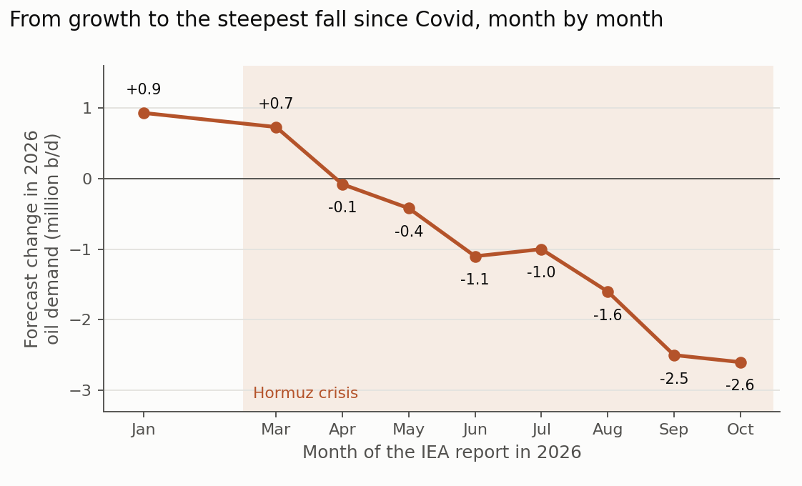
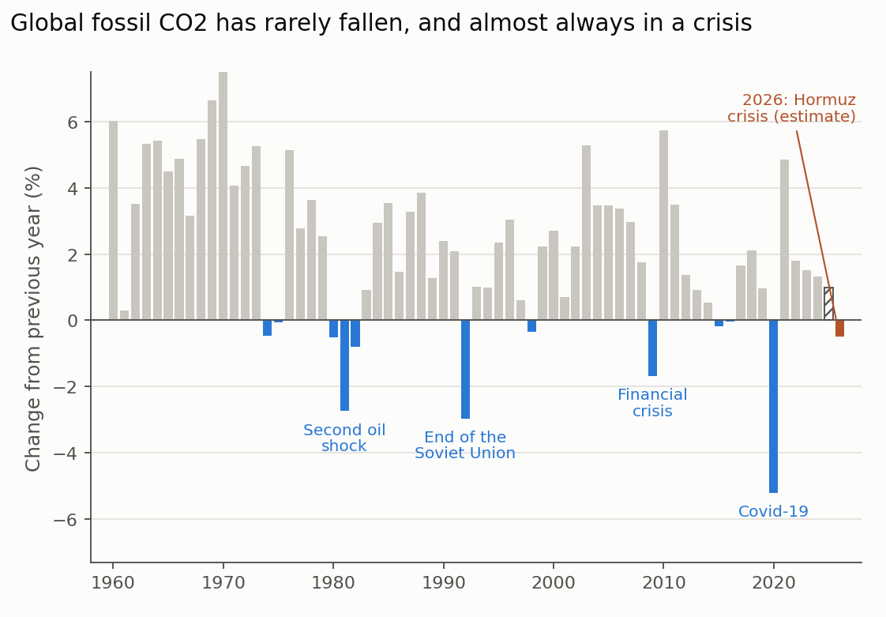

Global CO2 emissions from fossil fuels have fallen in only a handful of years since 1960, and almost every time something had gone badly wrong with the world economy. The last time was 2020, when Covid lockdowns emptied roads and skies. According to a new estimate from Carbon Brief, 2026 may join the list: global fossil-fuel CO2 emissions are set to fall by around 0.5% this year (Evans 2026).

Half a percent sounds small, and it is. But emissions have risen in almost every year for decades, and the Global Carbon Project's latest assessment projected a new record for 2025, about 1% higher than 2024 (Friedlingstein et al. 2026). A fall, if confirmed, would be the first since Covid and one of the few in more than 60 years.

## 1. What is happening

The trigger is the war between the US and Iran, which has severely disrupted shipping through the Strait of Hormuz since early 2026. Before the crisis, more than 20 million barrels of oil a day passed through the strait. The disruption sent oil and gas prices soaring. In October, Brent crude futures traded around 107 US dollars a barrel and diesel benchmarks reached all-time highs in Europe and the US (IEA 2026b).

High prices and scarce fuel have cut demand. The International Energy Agency (IEA), whose monthly oil reports are the standard reference, started the year expecting global oil demand to grow by 930,000 barrels a day in 2026. Month by month, as the crisis began and then dragged on, it revised that forecast down. By October it expected demand to _fall_ by 2.6 million barrels a day, about 2.5%, the first annual decline since 2020 (Figure 1). Even with a partial recovery, it expects 2027 demand to remain slightly below the 2025 level (IEA 2026b).

{: style="width: 100%; height: auto;" data-zoomable="" }

_**Figure 1.** The IEA's forecast of the change in global oil demand in 2026, as published in its monthly Oil Market Reports during the year (the February value is not shown). Figure by Daeha Kim, based on IEA Oil Market Reports (2026) and Carbon Brief (Evans 2026)._

## 2. Oil and gas down, coal up

Carbon Brief's estimate combines the IEA's latest forecasts for each fossil fuel (Evans 2026):

- **Oil:** down about 2.4% from 2025, the main reason emissions are falling.
- **Gas:** down about 0.6% already in the IEA's July forecast, with pressure from high prices growing since.
- **Coal:** _up_ about 1.2%, instead of the small decline the IEA had expected at the start of the year.

The rise in coal has prompted headlines about a "return to coal", and part of it is indeed a response to expensive gas. But few countries can switch from gas to coal at scale, and much of the increase has nothing to do with Hormuz. One cause will be familiar to hydrologists: a strong El Niño has raised demand for cooling and reduced hydropower output in key markets, so coal plants have filled the gap left by dry reservoirs. Another is the large amount of wind and solar power that China's grid could not absorb earlier in the year. Overall, the extra emissions from coal are more than offset by the declines in oil and gas.

## 3. China leads the fall

China, the world's largest emitter, shows the change most clearly. Its CO2 emissions fell by 3.1% year on year in the third quarter of 2026, the largest quarterly drop since the 2022 Covid lockdowns, and are now down about 0.5% for the year to date (Myllyvirta 2026). Coal use fell by 3% and oil use by 4%, with transport fuel down 9%.

What makes China different is that clean alternatives were ready. In the third quarter, generation from solar, wind and nuclear rose by 110 terawatt-hours, more than twice the growth in electricity demand. Electric vehicles reached a record 67% of passenger car sales and half of heavy-truck sales in September. China's emissions have now been flat or falling since March 2024. Elsewhere, too, high fuel prices have pushed electric car sales to record shares, from Australia to Europe, Indonesia and Thailand, and EV sales in markets outside China, Europe and North America nearly doubled year on year in July (Evans 2026).

## 4. How this compares with past declines

Figure 2 shows every annual change in global fossil CO2 since 1960. Declines are rare, and nearly all of them line up with crises: the second oil shock after the Iranian revolution (1980–82), the collapse of the Soviet Union (1992), the global financial crisis (2009) and Covid-19 (2020). Each time, emissions rebounded once the economy recovered. In 2021, they jumped by almost 5%.

{: style="width: 100%; height: auto;" data-zoomable="" }

_**Figure 2.** Annual change in global CO2 emissions from fossil fuels and industry. Blue bars mark declines. The hatched bar is the Global Carbon Project's projection for 2025 and the orange bar Carbon Brief's estimate for 2026. Figure by Daeha Kim, based on Global Carbon Budget 2025 data (Friedlingstein et al. 2026, via Our World in Data) and Evans (2026)._

There is a striking historical echo here. The biggest decline before 1992 also followed an oil shock linked to Iran. In 1979–80, the Iranian revolution and the Iran–Iraq war sent oil prices soaring, and global emissions fell for three years in a row. That crisis had lasting effects: it pushed countries toward nuclear power, efficiency standards and, in some places, coal, and oil never regained its earlier share of the energy mix.

## 5. Will it last?

That is the real question, and the honest answer is that nobody knows yet. Arguments on both sides:

**Why it may be temporary.** The decline is driven by a supply shock, not by climate policy. If shipping through Hormuz recovers and prices fall, oil demand is likely to bounce back, as it did after 2009 and 2020. Analysts expect Chinese oil use to rebound once prices ease (Myllyvirta 2026). Coal could also rise again if gas stays expensive into 2027.

**Why it may not be.** Unlike 1980 or 2020, cheap alternatives are now available at scale. A household that buys an electric car because petrol is expensive does not switch back when prices fall, and solar panels installed this year will generate for decades. "For every month the conflict lasts, the probability of permanent demand destruction increases," as one analyst at the consultancy DNV put it (quoted in Evans 2026). The IEA, which had expected oil demand to keep growing until about 2030, now expects it to be roughly flat for two years. Governments that had planned to rely on imported liquefied gas are signaling a shift toward domestic clean energy, though some also toward keeping coal plants open longer.

**Why it is not enough either way.** Even a lasting decline of half a percent a year falls far short of what the Paris goals require. The UN Environment Programme estimates that global greenhouse gas emissions would need to fall by about 42% by 2030 from 2019 levels to keep 1.5°C within reach (UNEP 2024). The Global Carbon Project estimates that the remaining carbon budget for a 50% chance of limiting warming to 1.5°C was about 170 billion tonnes of CO2 at the start of 2026, roughly four years of current emissions (Friedlingstein et al. 2026). A peak is necessary, but it is only the first step.

## 6. What to watch

The Global Carbon Project's annual assessment, usually published in November around the UN climate summit, will give the first independent full-year estimate, and final figures will only come with energy statistics next year. Until then, a few things are worth watching: whether Hormuz traffic recovers, whether the strong El Niño now developing keeps pushing up coal use and cutting hydropower, and whether the EV surge in emerging markets continues once prices fall.

Either way, 2026 is a reminder of something easy to forget: energy systems can change faster than expected when people are forced to choose. The open question is whether the world will remember the lesson when prices come down.

**Questions to think about**

1. The 1970s oil shocks reshaped energy policy for decades. What policies today would turn a temporary price shock into a lasting fall in emissions?
2. Drought and El Niño reduced hydropower and raised coal use this year. How should water resource planning account for the link between droughts and carbon emissions?
3. If emissions fall in 2026 mainly because fuel became scarce and expensive, should it be counted as climate progress? Why or why not?

---

**한 줄 요약 (Korean summary).** 미국–이란 전쟁으로 호르무즈 해협 수송이 막히면서 유가와 가스 가격이 급등했고, Evans(2026)의 분석에 따르면 2026년 세계 화석연료 CO2 배출량은 약 0.5% 줄어 코로나 이후 처음으로 감소할 전망이다. 석유 수요가 약 2.4% 줄고 가스도 줄었지만, 석탄은 비싼 가스와 엘니뇨로 인한 수력발전 감소 등으로 오히려 1.2% 늘었고, 중국은 재생에너지와 전기차 덕분에 3분기 배출량이 3.1% 줄어 감소를 이끌었다. 1960년 이후 배출량이 줄어든 해는 대부분 오일쇼크, 소련 붕괴, 금융위기, 코로나 같은 위기 때였고 이후 곧 반등했지만, 이번에는 태양광과 전기차라는 값싼 대안이 이미 대규모로 존재한다는 점이 다르다. 다만 연 0.5% 감소는 1.5°C 목표에 필요한 감축(2030년까지 2019년 대비 약 42%)에 크게 못 미치므로, 정점은 시작일 뿐이다.

---

**References**

Evans, S. (2026). Analysis: global fossil-fuel emissions set to fall in 2026 amid Hormuz crisis. _Carbon Brief_, 16 September 2026. [https://www.carbonbrief.org/analysis-global-fossil-fuel-emissions-set-to-fall-in-2026-amid-hormuz-crisis](https://www.carbonbrief.org/analysis-global-fossil-fuel-emissions-set-to-fall-in-2026-amid-hormuz-crisis)

Friedlingstein, P., O'Sullivan, M., Jones, M. W., Andrew, R. M., Bakker, D. C. E., Hauck, J., et al. (2026). Global Carbon Budget 2025. _Earth System Science Data_, 18, 3211–3288. [https://doi.org/10.5194/essd-18-3211-2026](https://doi.org/10.5194/essd-18-3211-2026)

IEA (2026a). _Oil Market Report – April 2026_. International Energy Agency. [https://www.iea.org/reports/oil-market-report-april-2026](https://www.iea.org/reports/oil-market-report-april-2026)

IEA (2026b). _Oil Market Report – October 2026_. International Energy Agency. [https://www.iea.org/reports/oil-market-report-october-2026](https://www.iea.org/reports/oil-market-report-october-2026)

Myllyvirta, L. (2026). Analysis: China's quarterly CO2 falls 3% in largest drop since Covid. _Carbon Brief_, 6 November 2026. [https://www.carbonbrief.org/analysis-chinas-quarterly-co2-falls-3-in-largest-drop-since-covid](https://www.carbonbrief.org/analysis-chinas-quarterly-co2-falls-3-in-largest-drop-since-covid)

UNEP (2024). _Emissions Gap Report 2024: No more hot air … please!_ United Nations Environment Programme. [https://www.unep.org/resources/emissions-gap-report-2024](https://www.unep.org/resources/emissions-gap-report-2024)

_The figures are original. The Python scripts that produce them are available on GitHub: [Figure 1](https://github.com/daehakim-waterlab/daehakim-waterlab.github.io/blob/main/scripts/blog/2026-11-09-iea-oil-revisions.py) and [Figure 2](https://github.com/daehakim-waterlab/daehakim-waterlab.github.io/blob/main/scripts/blog/2026-11-09-emissions-change.py)._
