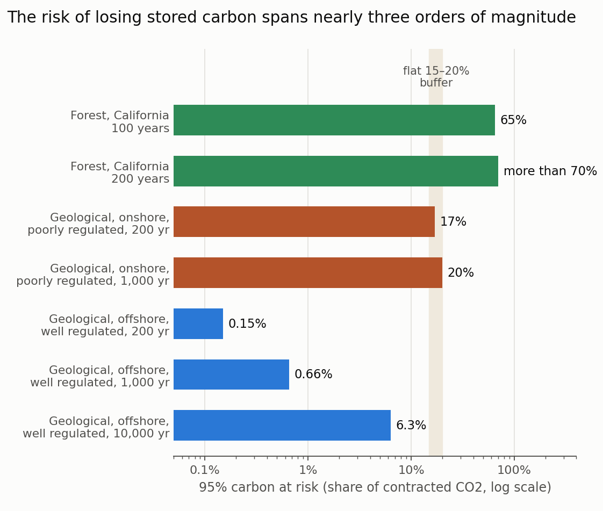
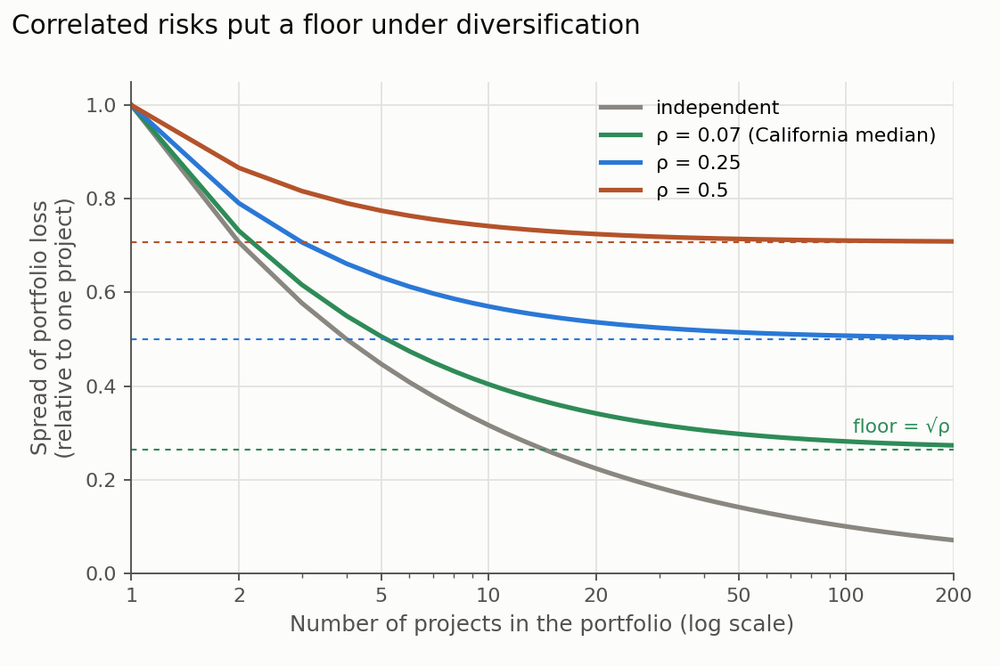

To limit warming to 1.5°C, most scenarios need billions of tonnes of CO2 to be removed from the atmosphere every year by mid-century, through forests, soils, direct air capture and other methods. Buyers already pay for these removals in the form of carbon credits. But removals do not always stay removed. Forests burn, and CO2 injected underground can leak. Because CO2 stays in the atmosphere for centuries to millennia, a loss decades or centuries after a project started still matters for the climate.

How do you compare the risk of a forest credit in California with that of CO2 stored under the North Sea? Today, mostly with labels: "permanent" versus "non-permanent", "nature-based" versus "engineered". Projects then set aside a share of their credits in a buffer pool, often a flat 15–20%, to cover future losses. A new paper in _Nature Climate Change_ by Lee and colleagues argues that these labels and flat buffers hide the actual risk, and proposes a single number to replace them: **carbon at risk** (Lee et al. 2026).

## 1. Borrowing from finance

The idea comes from banking. In the 1990s, banks needed a way to compare the risk of very different assets, such as bonds, shares and currencies. The answer was _value at risk_ (VaR): the loss that will not be exceeded over a given period with a chosen probability, say 95%. VaR turned many kinds of uncertainty into one number that could be used to set capital reserves and compare portfolios.

Carbon at risk (CaR) does the same for stored carbon, in tonnes rather than dollars. If $$Q_T$$ is the amount of carbon removal a buyer has contracted and $$D_T$$ the uncertain amount still stored at a horizon $$T$$, then at a confidence level $$\alpha$$ (for example 95%)

$$\mathrm{CaR}_T^{\alpha} = Q_T - D_T^{1-\alpha},$$

where $$D_T^{1-\alpha}$$ is the lower quantile of storage: with probability $$\alpha$$, at least this much is still stored. In the paper's illustrative example, a contract for 1,000 kg of CO2 has a 95% CaR of 397 kg, so there is a 95% chance that at least 603 kg remain stored at the horizon.

CaR has a second, practical reading: it is the buffer. A buyer who must be 95% sure that 603 kg stay stored should contract 1,000 kg, of which 397 kg is the buffer. Because the quantile is computed over all contracted tonnes, buffer tonnes that themselves fail are already accounted for. The authors also split CaR into two parts: a _contracting gap_, the difference between what was credited and what is expected to stay stored, and a _tail component_, the extra shortfall in a bad outcome.

For hydrologists, this will feel familiar. A design flood is not the average flood but a quantile of the flood distribution, chosen for a given risk level. CaR does the same for carbon storage: it asks not what is expected, but what we can be confident of.

## 2. Forests: fire, regrowth and a short record

The first case study models forest carbon under wildfire in three regions: California, Mato Grosso in Brazil and Papua in Indonesia. Each simulated year, a fraction of the forest burns, drawn at random from the 2002–2023 record of annual burned area from the European Forest Fire Information System. The burned part regrows at a region-specific rate taken from satellite-based recovery studies (2.0% per year in California, 3.0% in Mato Grosso and 1.5% in Papua), and the burn rate rises by 0.5% per year to represent climate change. The model is run 5,000 times over 200 years.

California and Mato Grosso burn at almost the same average rate, about 1.8% of forest area per year, but California's forests regrow more slowly and its worst year burned 11.3% of the forest, against 4.6% in Mato Grosso. Both the typical loss and the tail are therefore larger in California, where a single project's 95% CaR is about 65% of contracted carbon at 100 years and more than 70% at 200 years. In other words, there is a 5% chance that more than two-thirds of the credited carbon is gone within a century (Figure 1). Papua has little fire in this model, but when the authors added the risk of forest conversion, its 100-year CaR rose by a factor of 2.6, a reminder that fire is only one way forest carbon is lost.

The paper is candid about a problem every hydrologist knows. A 22-year record cannot produce a fire larger than the largest one observed. When the authors fitted a generalized Pareto distribution to the upper tail, the same tool we use for extreme floods, California's 100-year CaR rose by about 23%. Some assumptions push the other way: the model assumes that fire destroys all carbon in the burned area and that projects start with an intact forest, which overstates losses for established forests.

{: style="width: 100%; height: auto;" data-zoomable="" }

_**Figure 1.** 95% carbon at risk, as a share of contracted CO2, for a single forest project in California and for geological storage under two regulatory scenarios, at different horizons. The shaded band marks a flat 15–20% buffer for comparison. Figure by Daeha Kim, based on values reported by Lee et al. (2026)._

## 3. Geological storage: regulation matters more than geology

The second case study uses the Storage Security Calculator, a process-based model that simulates CO2 leaking through wells, faults and blowouts while the CO2 is progressively trapped underground (Alcalde et al. 2018). At a 200-year horizon, the threshold used for removals in the UK Emissions Trading Scheme, the 95% CaR is 0.15% for well-regulated offshore storage and 17% for poorly regulated onshore storage, a difference of two orders of magnitude within the same technology. At 1,000 years, the values are 0.66% and 20%; even at 10,000 years, offshore CaR is only 6.3%.

The difference comes mainly from old wells. Onshore fields can have many abandoned wells, and under weak regulation more are left unplugged and some are not even on record. The original model's authors regarded this onshore scenario as a worst case. The lesson, however, holds: calling all geological storage "permanent" hides a risk that depends heavily on site selection and regulation.

## 4. Why diversification has limits

Buyers and registries usually hold many projects, hoping that losses in one place will be offset elsewhere. That works only for risks that are independent. The variance of the average loss across $$K$$ projects with a common pairwise correlation $$\rho$$ is

$$\mathrm{Var}(\bar{X}_K) = \frac{\sigma^2 (1-\rho)}{K} + \rho \sigma^2,$$

which never falls below $$\rho\sigma^2$$, however many projects are added (Figure 2).

{: style="width: 100%; height: auto;" data-zoomable="" }

_**Figure 2.** How the spread of the average loss across a portfolio falls as projects are added, for different correlations between projects. Correlation sets a floor that more projects cannot break. Figure by Daeha Kim, an analytical illustration of the variance formula used by Lee et al. (2026)._

In California, annual burned areas in different 1° grid cells are only weakly correlated, with a median correlation of 0.07, and the correlation decays with distance. Even so, pooling 100 California projects reduces the 100-year CaR only from about 65% to about 56% if projects are independent, and to 57.8% if their correlation is 0.1. Diversification narrows only the tail component of CaR; it does nothing about the contracting gap, the expected loss that every project shares. Most of the possible gain comes with the first 20 to 50 projects, and the largest benefits come from spreading projects across regions rather than adding more in one.

## 5. Building a portfolio

Because forest and geological storage fail for different reasons, combining them can be a cheap way to meet a permanence target. The authors illustrate this with a stylized example. Forest credits cost 40 US dollars per tonne but each project survives 200 years with a probability of only 0.4. Direct air capture with geological storage costs 500 dollars per tonne but survives with a probability of 0.99. A buyer needs to be 95% sure that 30,000 tonnes are still stored after 200 years.

Many combinations meet this target, but they differ in cost. The cheapest is a mix of 61 storage projects and 45 forest projects, costing about 16 million dollars. If forest projects were independent, buying more of the cheap forest credits would be enough. But once forest projects are even modestly correlated (above about 0.16), adding more forests stops buying protection against the bad tail, and a mix becomes cheaper. The value of a technology to a portfolio depends on what else is in it, not only on its own price and risk.

## 6. Why it matters, and the caveats

The authors' main point is not the specific numbers, which they call proof of concept, but that a common risk metric makes assumptions explicit. A flat 15–20% buffer also embeds a claim about future losses; it just does not say what horizon, confidence level or loss distribution it assumes. An earlier study found that California's forest offset buffer pool, sized by such rules, was severely undercapitalized against wildfire losses (Badgley et al. 2022). A metric like CaR could let regulators size buffers to actual risk, give insurers a basis for pricing reversal risk, and give pension funds and other institutional investors the kind of risk numbers they need before entering a new market.

Some caveats are worth keeping in mind:

1. **CaR is only as good as the distribution behind it.** For new technologies there is little or no track record, and some researchers argue that such deep uncertainty should not be squeezed into probabilities at all. The authors' reply is that the alternative is not no assumptions but hidden ones.
2. **VaR has known weaknesses.** It says nothing about how bad losses are beyond the quantile. The paper uses it because practitioners find it familiar, and reports expected shortfall as well in its supplementary material.
3. **Correlations may be underestimated.** The portfolio example assumes zero correlation between forest and geological projects, which the authors call optimistic. From a hydroclimate perspective, I would add that large-scale climate modes such as El Niño can synchronize droughts and fire seasons across distant regions, so cross-regional diversification may be less effective in exactly the years that matter most.

For hydrologists, this paper is a reminder that our tools for extremes, nonstationarity and spatial dependence are increasingly needed outside water. Estimating the tail of a loss distribution from a short record under a changing climate is our daily work; carbon markets now face the same problem.

**Questions to think about**

1. A 22-year fire record is shorter than many streamflow records. What would a hydrologist do to estimate a 200-year fire loss, and how confident could we be in it?
2. Should carbon removal buffers be set at 95% confidence, or higher? Who should decide, and on what basis?
3. If droughts synchronize forest fires across continents, how should a buyer think about diversifying forest carbon credits?

---

**한 줄 요약 (Korean summary).** Lee 등(2026)은 금융의 VaR(value at risk)를 본떠, 계약한 탄소 제거량 중 일정 신뢰수준에서 시간이 지나도 저장되어 있지 못할 수 있는 양을 나타내는 'carbon at risk(CaR)'를 제안했다. 산불 자료로 모의한 결과 캘리포니아 숲 사업은 95% CaR이 100년에 약 65%, 200년에 70% 이상으로 매우 높았고, 지중 저장은 규제가 잘된 해상에서는 200년에 0.15%였지만 규제가 약한 육상에서는 17%로 같은 기술 안에서도 위험이 백 배 넘게 달랐다. 여러 사업을 묶으면 위험이 줄지만, 기후처럼 공통 요인으로 사업들의 손실이 상관되어 있으면 아무리 많이 묶어도 줄일 수 없는 하한이 생기며, 위험 요인이 다른 숲과 지중 저장을 섞는 것이 목표를 가장 싸게 달성하는 방법이 될 수 있다. 짧은 기록으로 극한값을 추정하고 비정상성과 공간 상관을 다루는 이 문제는 홍수빈도해석과 같은 성격이어서 수문학의 방법이 탄소시장에도 쓰일 수 있음을 보여준다.

---

**References**

Alcalde, J., Flude, S., Wilkinson, M., Johnson, G., Edlmann, K., Bond, C. E., et al. (2018). Estimating geological CO2 storage security to deliver on climate mitigation. _Nature Communications_, 9, 2201. [https://doi.org/10.1038/s41467-018-04423-1](https://doi.org/10.1038/s41467-018-04423-1)

Badgley, G., Chay, F., Chegwidden, O. S., Hamman, J. J., Freeman, J., & Cullenward, D. (2022). California's forest carbon offsets buffer pool is severely undercapitalized. _Frontiers in Forests and Global Change_, 5, 930426. [https://doi.org/10.3389/ffgc.2022.930426](https://doi.org/10.3389/ffgc.2022.930426)

Lee, B., Bearpark, T., Kit, O., Meth-Cohn, D., Olbert, F., Venmans, F., Walker, G., Young, P., & Groom, B. (2026). The carbon at risk measure for managing carbon removal risk and guiding portfolio construction. _Nature Climate Change_. [https://doi.org/10.1038/s41558-026-02785-9](https://doi.org/10.1038/s41558-026-02785-9)

_The figures are original. The Python scripts that produce them are available on GitHub: [Figure 1](https://github.com/daehakim-waterlab/daehakim-waterlab.github.io/blob/main/scripts/blog/2026-11-15-carbon-at-risk.py) and [Figure 2](https://github.com/daehakim-waterlab/daehakim-waterlab.github.io/blob/main/scripts/blog/2026-11-15-diversification-floor.py)._
