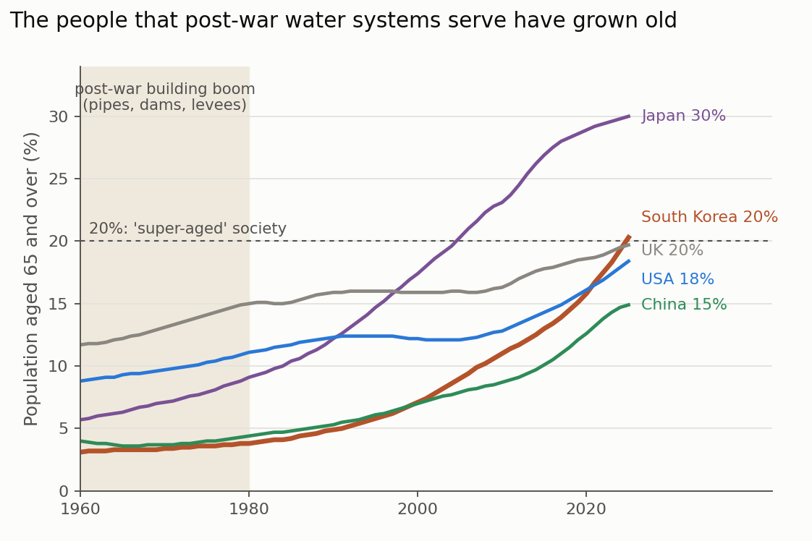
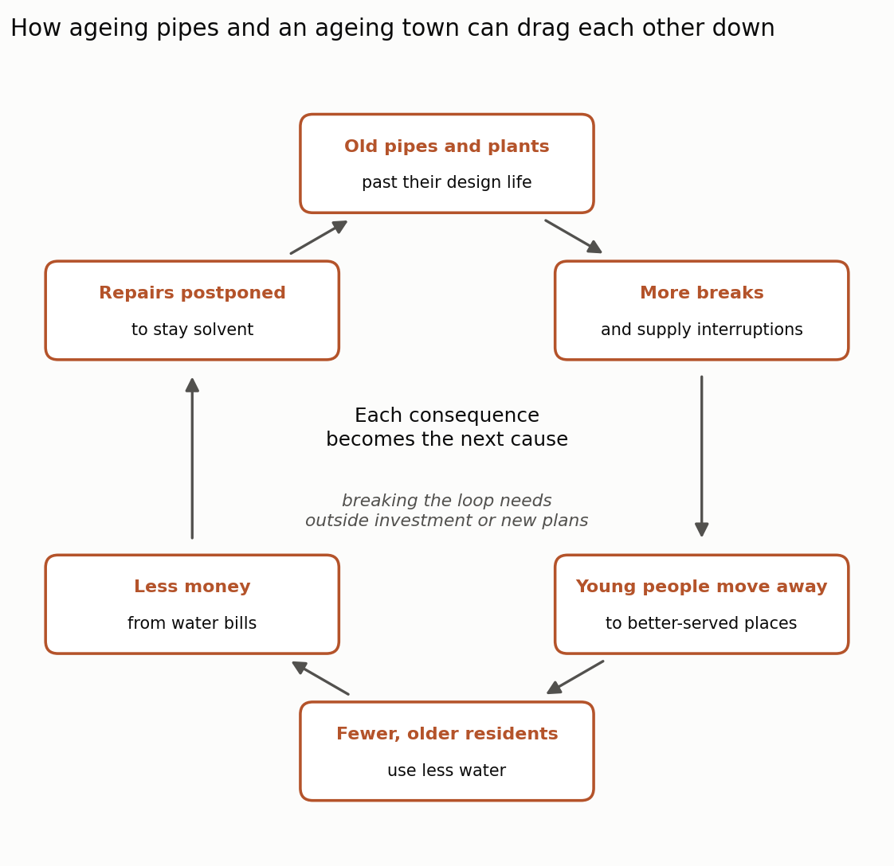

Most of the pipes, dams, levees and treatment plants that serve us today were built in a burst after the Second World War, mostly between the 1950s and 1970s. They are now reaching the end of their design lives at about the same time. That alone is a big engineering problem. A new comment in _Nature Water_ by Vahedifard and colleagues argues that it is only half of the problem: the people these systems serve have aged too, and planning rarely takes that into account (Vahedifard et al. 2026).

## 1. The first ageing: the infrastructure

The numbers the authors collect are striking:

- In the USA, nearly a fifth of drinking-water mains, more than 724,000 km of pipe, have already passed their design life of 75–100 years.
- In England and Wales, water mains were 57 years old on average in 2021, and 13% were more than 100 years old.
- US levees protecting property worth over 2 trillion US dollars are 62 years old on average.
- Large dams in the UK and Japan are, on average, more than a century old. Worldwide, more than half of large dams with a known completion date are already 50 years or older.

On top of this, infrastructure built for the climate of the twentieth century is now being asked to cope with the floods, droughts and heatwaves of the twenty-first.

## 2. The second ageing: the people

The postwar systems were built for young, growing societies with an expanding workforce and tax base. That is no longer the world they serve. The number of people aged 65 and over is projected to reach 1.6 billion by 2050, nearly double the 2021 level. Japan and more than twenty European countries already have a fifth to a third of their populations over 65.

South Korea is the most dramatic case (Figure 1). In 1970, when much of its modern water infrastructure was being built, only about 3% of Koreans were 65 or older. In December 2024 the share passed 20%, making Korea a "super-aged" society, and in the most rural provinces, such as Jeollanam-do, it is above 27%.

{: style="width: 100%; height: auto;" data-zoomable="" }

_**Figure 1.** Share of the population aged 65 and over, 1960–2025, in five countries. The shaded band marks the post-war decades in which much of today's water infrastructure was built. Figure by Daeha Kim, based on World Bank data (World Development Indicators, from the UN World Population Prospects)._

## 3. When two kinds of ageing meet

The authors call the growing mismatch between a water system and the society it serves the **infrastructure–society ageing gap**. A water network built in the 1960s for a young, growing town may, sixty years later, serve a smaller and older population with less money, more health vulnerabilities and different needs. The pipes and the people have aged by the same number of years, but they no longer fit each other.

The gap shows up in four ways:

1. **Workforce.** Experienced operators and engineers are retiring faster than they can be replaced, taking system-specific know-how with them.
2. **Health.** Older people are more vulnerable when the water stops or becomes unsafe. They may find it harder to fetch bottled water, follow a boil-water notice or leave home during a flood.
3. **Money.** Many utilities depend on water bills. A shrinking customer base means less money for maintenance, while pensions and healthcare compete for public budgets.
4. **Place.** Older populations, the oldest pipes and the weakest utility finances tend to sit in the same places: rural, post-industrial and economically struggling regions.

## 4. A spiral that is hard to escape

The real danger, the authors argue, is that these four effects feed each other (Figure 2). Old pipes break more often. Unreliable service pushes younger residents to move away. The town becomes smaller and older, uses less water and pays less in water bills. The utility postpones repairs to stay solvent, and the pipes deteriorate faster. Less water use even causes its own problems: water sits longer in oversized pipes, and quality can suffer.

{: style="width: 100%; height: auto;" data-zoomable="" }

_**Figure 2.** How ageing water infrastructure and an ageing, shrinking community can reinforce each other. Figure by Daeha Kim, a schematic of the decline spiral described by Vahedifard et al. (2026)._

There is no natural way out of this loop. Without outside investment, new policies or new plans, each round makes the next one worse, and the longer it runs, the more expensive it becomes to fix.

## 5. Why this is a climate-risk problem

For me, the most important example in the comment is about floods. Imagine a levee that has been perfectly maintained and is structurally as good as the day it was built. When it was designed, it was assumed that residents would receive a warning and move themselves to safety within a few hours. If many of those residents are now in their eighties, some living alone and some in care homes, the protection the levee actually provides has fallen, even though the levee itself has not changed.

In other words, protection is not only a property of the structure, but also of the people's ability to benefit from it. The same is true for droughts and heatwaves: a water outage during a heatwave is far more dangerous for older people than for younger ones. As climate extremes become more frequent, the cost of ignoring who lives behind the levee or at the end of the pipe will rise.

## 6. Planning for the people, not only the pipes

Major works on water infrastructure happen rarely. A water main may be replaced once every 75–100 years, and a levee raised once in a generation. Population change, by contrast, never stops. Each major intervention therefore sets the design assumptions for decades.

The authors contrast two approaches. An intervention that ignores the gap simply restores the system to its original design, as if the population were still the same. An intervention that accounts for the gap asks a different question: not just "how old is this asset?" but "who will this system serve over its lifetime?" The physical work may be similar, but the design, emergency plans, communication and financing are updated for the people who actually live there now. In ageing communities, that might mean better protection and communication for vulnerable residents during outages, more affordable pricing, and financing that does not rely solely on a shrinking customer base. In young, growing places, it means flexibility and extra capacity.

The authors call for standard indicators of this gap, an open global observatory linking population projections with infrastructure inventories and condition data, and international cooperation, raising the issue at the 2026 UN Water Conference.

For Korea, where the population is ageing faster than in almost any other major economy and ageing is most advanced in rural areas, this seems especially relevant. Flood warnings, drought responses and pipe-renewal plans all quietly assume something about who will receive them, act on them and pay for them. It may be time to make those assumptions explicit.

**Questions to think about**

1. Think of a levee or dam near where you live. When it was built, who was it designed to protect, and has that population changed?
2. If a rural water utility loses a third of its customers over the next 20 years, who should pay to keep its pipes working?
3. How should flood warning and evacuation plans change in a town where a quarter of residents are over 65?

---

**한 줄 요약 (Korean summary).** Vahedifard 등(2026)은 2차 세계대전 이후 젊고 성장하는 사회를 위해 지어진 상수도, 댐, 제방 같은 물 인프라가 설계수명에 이르는 동시에 그 인프라가 서비스하는 사람들도 늙어 가는 '이중 고령화'를 지적하고, 이 둘의 어긋남을 '인프라–사회 고령화 격차'라고 불렀다. 숙련 인력의 은퇴, 고령자의 건강 취약성, 줄어드는 요금 수입, 그리고 노후 시설과 고령 인구가 같은 지역에 몰리는 현상이 서로를 강화해, 노후 관로 고장이 젊은 층의 유출과 수입 감소, 보수 지연으로 이어지는 악순환을 만들 수 있다. 특히 구조적으로 완벽한 제방이라도 주민 다수가 스스로 대피하기 어려운 고령자라면 실제 보호 수준은 떨어진 것이므로, 기후 극한이 잦아지는 시대의 기후위험 관리에서는 시설의 나이뿐 아니라 '이 시설이 앞으로 누구를 위해 쓰일 것인가'를 물어야 한다. 2024년 말 초고령사회에 들어선 한국, 특히 고령화가 빠른 농촌 지역의 물 관리 계획에 시사하는 바가 크다.

---

**References**

Vahedifard, F., Azhar, M., Li, J., AghaKouchak, A., Brown, D. C., Marfeo, E., Null, S. E., Spearing, L. A., & Tajik, N. (2026). To fix ageing water infrastructure, we must plan for an ageing population. _Nature Water_, 4, 1062–1067. [https://doi.org/10.1038/s44221-026-00711-z](https://doi.org/10.1038/s44221-026-00711-z)

World Bank (2026). Population ages 65 and above (% of total population), indicator SP.POP.65UP.TO.ZS. World Development Indicators. [https://data.worldbank.org/indicator/SP.POP.65UP.TO.ZS](https://data.worldbank.org/indicator/SP.POP.65UP.TO.ZS)

_The figures are original. The Python scripts that produce them are available on GitHub: [Figure 1](https://github.com/daehakim-waterlab/daehakim-waterlab.github.io/blob/main/scripts/blog/2026-11-17-ageing-population.py) and [Figure 2](https://github.com/daehakim-waterlab/daehakim-waterlab.github.io/blob/main/scripts/blog/2026-11-17-decline-spiral.py)._
