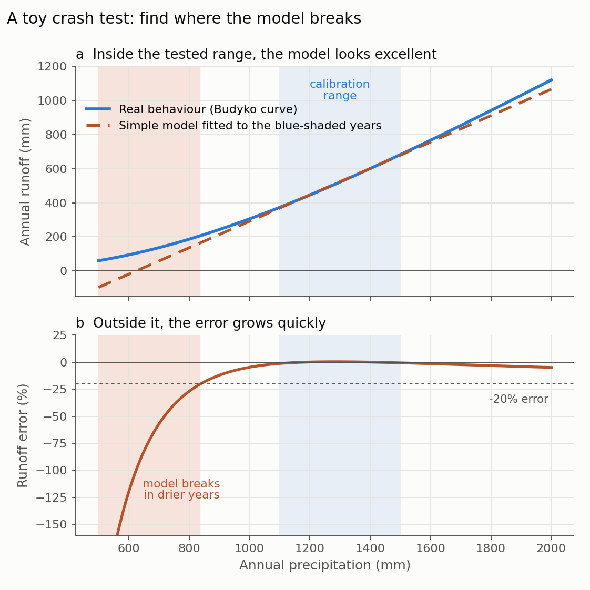

Most research papers are success stories. A new method works, a model fits the data, a device performs as designed. What we rarely read is where the method stops working. A short editorial in _Nature Communications_ argues that this silence is a missed opportunity, and asks authors to do something unusual: push their work until it breaks, and tell readers where and why (Nature Communications 2026).

## 1. What the editorial asks for

The message is simple. Don't only show that your system works under expected conditions; test its boundaries. Push your assumptions, methods, models or devices until they falter, and report the point where they fail and the reason.

The editors acknowledge that testing to failure costs time and money. But they argue that the breaking points are not weaknesses to hide. They are some of the most useful information a paper can contain, because they tell others how the work can be used responsibly, and where the next advance has to come from. A paper that shows where it fails helps define the frontier of a field, instead of only adding to it.

The editorial also offers practical advice:

- **Be selective.** Report the failures that matter for the main claims, and put side analyses in the supplementary material.
- **Learn from past reviews.** Since November 2022, the journal has published the peer-review files of its research articles. Reading what reviewers asked for in similar work shows which limitations the community cares about.
- **Don't fear rejection.** Disclosed limitations, on their own, are not held against a paper by the editors, and reviewers are asked to take the same view.

## 2. Hydrologists have been saying this for forty years

This idea will be familiar to hydrologists. In 1986, Vít Klemeš proposed a hierarchy of tests for hydrological models (Klemeš 1986). The simplest, the split-sample test, calibrates a model on one part of a record and checks it on another. But if both parts come from similar climate, the test says little about how the model behaves when conditions change. Klemeš therefore proposed a tougher _differential_ split-sample test: calibrate the model in wet years and test it in dry years, or the other way around. A model meant for a changing world should pass that test.

Two decades later, Andréassian and colleagues called for "crash tests" of hydrological models, borrowing the idea from the car industry: you learn the most about a car's safety by deliberately driving it into a wall (Andréassian et al. 2009). When such tests were run on 216 Australian catchments, model errors grew as the climate of the test period moved further from that of the calibration period (Coron et al. 2012).

## 3. A toy crash test

The figure below shows a simple example. Suppose the "real" relationship between annual precipitation and runoff in a catchment follows a Budyko curve, a well-established description of how precipitation is split between evaporation and runoff. Now fit a simple straight line to years with 1,100 to 1,500 mm of precipitation.

{: style="width: 100%; height: auto;" data-zoomable="" }

_**Figure.** A toy crash test. (a) "Real" annual runoff from a Budyko curve and a straight-line model fitted only to the years in the blue band. (b) The model's error. Inside the calibration range the error is about 1%; below about 830 mm of precipitation it exceeds 20%, and in very dry years the model predicts negative runoff. Figure by Daeha Kim, an illustrative example that does not describe any real catchment._

Inside the calibration range, the model is almost perfect, with errors around 1%. A paper that tested it only there would report an excellent model. But in drier years, the error grows quickly: at 800 mm the model underestimates runoff by more than a quarter, and below about 620 mm it predicts negative runoff, which is physically impossible. The useful finding is not that the model works, but where it stops working: somewhere around 830 mm of annual precipitation.

This is exactly what the editorial asks for. Reporting that breaking point does not make the model worse. It tells users when they can trust it.

## 4. Why this matters more in a changing climate

For water and climate research, the stakes are high. Almost every study of climate change impacts asks a model to work under conditions it has never seen: warmer temperatures, longer droughts, more intense rainfall. In a sense, every climate projection is a differential split-sample test that we cannot run, because the future data do not exist yet. The least we can do is test our models across the widest range of past conditions available and say clearly where they began to fail.

The same applies beyond hydrology. Machine-learning models are notorious for performing brilliantly on data similar to their training set and failing on anything different. Engineering designs, statistical methods and AI tools all have edges, and users deserve to know where they are.

## 5. What this means in practice

For students and young researchers, the editorial suggests a few habits worth adopting:

1. **State the range of conditions you tested,** for example the climates, catchment types or data periods, and avoid claims beyond it.
2. **Deliberately test the hard cases,** such as the driest years, the largest floods or the most unusual catchments, even if the results look bad.
3. **Report where and why your method fails,** not just that it fails. The "why" is what helps others improve it.
4. **Treat limitations as results,** not as an apologetic paragraph at the end of the discussion.

It takes some courage to show where your own work breaks. But in research, as in engineering, knowing where things fail is as valuable as knowing that they work.

**Questions to think about**

1. In your last model study, what was the driest or most extreme condition you tested? Would you trust the model beyond it?
2. Why do you think papers so rarely report failures? What could reviewers and journals do to change that?
3. If you were asked to design a "crash test" for a model in your field, what wall would you drive it into?

---

**한 줄 요약 (Korean summary).** Nature Communications 사설(2026)은 공학 연구가 잘 되는 결과만 보여주지 말고, 방법과 모형을 한계까지 밀어붙여 어디서 왜 실패하는지를 보고하라고 요청하며, 밝힌 한계 자체는 심사에서 불리하게 보지 않겠다고 밝혔다. 수문학에서는 이미 1986년 Klemeš가 습윤한 해에 보정하고 건조한 해에 검증하는 '차등 분할표본 검정'을 제안했고, 2009년에는 모형을 일부러 극한 조건에 부딪쳐 보는 '충돌 시험'이 제안되었다. 간단한 예시에서 좁은 범위에 맞춘 모형은 그 안에서는 오차가 1% 정도로 완벽해 보이지만, 연 강수량이 약 830 mm 아래로 내려가면 오차가 20%를 넘고 매우 건조한 해에는 음의 유출을 예측한다. 기후변화 영향 연구는 모형이 겪어보지 않은 조건에서 쓰이는 만큼, 어디까지 시험했고 어디서 실패하는지를 분명히 밝히는 것이 결과만큼 중요하다.

---

**References**

Andréassian, V., Perrin, C., Berthet, L., Le Moine, N., Lerat, J., Loumagne, C., Oudin, L., Mathevet, T., Ramos, M.-H., & Valéry, A. (2009). HESS Opinions "Crash tests for a standardized evaluation of hydrological models". _Hydrology and Earth System Sciences_, 13, 1757–1764. [https://doi.org/10.5194/hess-13-1757-2009](https://doi.org/10.5194/hess-13-1757-2009)

Coron, L., Andréassian, V., Perrin, C., Lerat, J., Vaze, J., Bourqui, M., & Hendrickx, F. (2012). Crash testing hydrological models in contrasted climate conditions: an experiment on 216 Australian catchments. _Water Resources Research_, 48(5). [https://doi.org/10.1029/2011WR011721](https://doi.org/10.1029/2011WR011721)

Klemeš, V. (1986). Operational testing of hydrological simulation models. _Hydrological Sciences Journal_, 31, 13–24. [https://doi.org/10.1080/02626668609491024](https://doi.org/10.1080/02626668609491024)

Nature Communications (2026). Push until it breaks: engineering is stronger when we know its limits. _Nature Communications_, 17, 8005. [https://doi.org/10.1038/s41467-026-76456-w](https://doi.org/10.1038/s41467-026-76456-w)

_The figure is original. The Python script that produces it is available on [GitHub](https://github.com/daehakim-waterlab/daehakim-waterlab.github.io/blob/main/scripts/blog/2026-11-17-model-breaking-point.py)._
