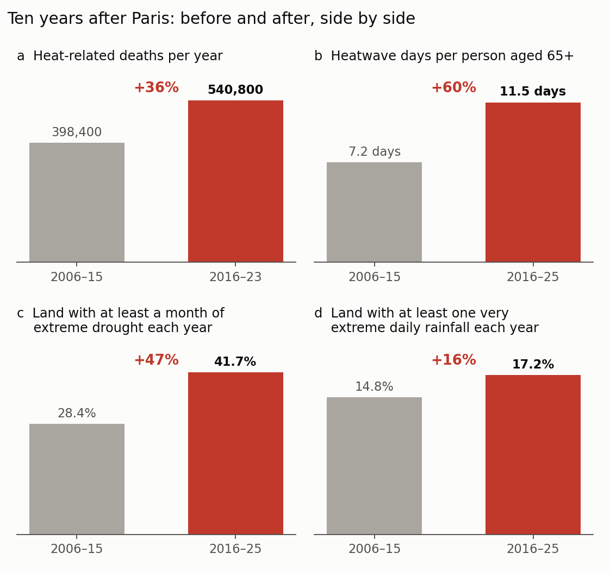

Every year since 2016, the year the Paris Agreement entered into force, a large international team has published a check-up on how climate change is affecting human health. The tenth report of the _Lancet_ Countdown, written by 146 researchers and published in _The Lancet_ in October 2026, looks back over that whole decade (Romanello et al. 2026). Its title sums up the conclusion: "a decade of escalating health harms and a decisive moment for all."

The report is long, with 54 indicators covering heat, extreme weather, infectious disease, food, air pollution, money and politics. Here I pick out the main messages, with a focus on the water-related ones that matter most to hydrologists.

## 1. Not only worse, but getting worse faster

The most striking finding is about speed. Comparing the ten years after Paris (2016–25) with the ten years before (2006–15), the report finds that many health threats have not just increased, but increased at an accelerating rate (Figure).

{: style="width: 100%; height: auto;" data-zoomable="" }

_**Figure.** Four headline indicators, before and after the Paris Agreement entered into force: (a) average heat-related deaths per year (the latest period is 2016–23), (b) heatwave days per person aged 65 and over, (c) share of global land with at least one month of extreme drought in a year, and (d) share of global land with at least one very extreme daily rainfall (rarer than once in ten years) in a year. Figure by Daeha Kim, based on numbers reported by Romanello et al. (2026)._

**Heat.** Heat was linked to about 540,800 deaths per year in 2016–23, up from about 398,400 per year in the previous decade. In 2023, the number reached a record of about 710,000, and the authors attribute 71.5% of those deaths to human-caused climate change. In 2025, the average person on Earth experienced 13.5 heatwave days, and 11.3 of them would not have been expected without climate change. People over 65, who are the most vulnerable, faced 11.5 heatwave days a year on average, up from 7.2.

**Work and money.** Heat cost 573 billion potential working hours in 2025, equivalent to about 1.07 trillion US dollars in lost income. The burden is strikingly unequal: in countries with the lowest human development the losses equal 5.0% of GDP, ten times the 0.5% in the most developed countries.

## 2. Water extremes: drier and wetter at the same time

For hydrologists, the drought and rainfall indicators are the most interesting part of the report.

- **Drought.** In 2016–25, on average 41.7% of the world's land experienced at least one month of extreme drought each year, up from 28.4% in 2006–15. In 2025, the figure was 51.8%, the second highest on record after 2023 (54.9%). The report measures drought in two ways: from climate data, using a standard drought index that combines rainfall and evaporation, and from GRACE satellites, which weigh changes in the water stored on and under the land.
- **Water storage.** The satellite data show that between 2003 and 2025, water storage fell in about 43% of global land and rose in about 37%. Drying and wetting are happening side by side, often in neighboring regions.
- **Extreme rainfall.** In 2016–25, 17.2% of global land saw at least one very extreme daily rainfall (rarer than a 1-in-10-year event) each year, up from 14.8%. The growth itself has sped up: the increase was 57% larger than in the decade before.

Droughts are the single most destructive climate hazard for agriculture, and floods bring injuries, drowning, contaminated water and waterborne disease. The report also warns that these hazards increasingly come together or one after another, so the real risk can be larger than any single indicator suggests.

## 3. Adaptation is lagging

Protection is not keeping pace. By 2025, about three in four WHO member states had not reported completing a health vulnerability and adaptation assessment since 2020, and about seven in ten had no health adaptation plan. International climate finance has covered less than a third of even the limited adaptation needs that developing countries have reported, and development aid is falling sharply. The report notes that aid from the 17 largest donors is projected to drop by roughly a quarter within three years, with South Korea among the countries making the largest proportional cuts.

There are bright spots. Early warning systems for climate-related health hazards now exist in 75 countries, and 56 countries have a health adaptation plan, up from 14 in 2015.

## 4. The fossil fuel problem, and the opportunity

Fossil fuels still supply about 81% of the world's energy. They also harm health directly: air pollution from burning them caused about 2.78 million deaths a year on average since 2016. Meanwhile, countries spent a cumulative 6.2 trillion US dollars on net fossil fuel subsidies between 2016 and 2024, and in 2024 ten countries spent more on these subsidies than on their health systems.

But the report also documents real progress. Renewables are now cheaper than fossil power in many places, clean energy investment in 2025 exceeded fossil fuel investment by 82%, and in more than half of the 140 countries assessed, deaths from fossil fuel air pollution have fallen, saving an estimated 323,000 lives a year. Expected warming by 2100 has come down from 3.0–3.5 °C to 2.6–3.4 °C since the Paris Agreement. That is still far too high, but it shows that action works.

## 5. A decisive moment

The authors are frank about the politics. The USA withdrew from the Paris Agreement and WHO, climate disinformation is growing, and the 2026 war involving Iran has disrupted oil markets, pushing some countries towards renewables and others back towards fossil fuels. Against this, the report calls for six priorities, including formally recognizing climate change as a global health emergency, putting the reduction of deaths and illness at the center of all climate policy, and building a global data commons on climate and health as a public good.

That last point deserves attention from our field. Almost every indicator in this report rests on long, open records of temperature, rainfall, drought and water storage. Keeping those observations running, and openly available, is part of protecting health.

**Questions to think about**

1. The report measures drought both with a climate index and with satellite water storage. Why might the two give different pictures of the same drought?
2. Heat costs the least developed countries ten times more of their GDP than the most developed ones. What makes the same heat so much more costly in some places?
3. Which water-related health risks in your own country are tracked well, and which have no long-term record at all?

---

**한 줄 요약 (Korean summary).** 파리협정 발효 10년을 맞아 146명의 연구진이 54개 지표로 기후변화가 건강에 미친 영향을 점검한 Romanello 등(2026)의 Lancet Countdown 10번째 보고서는, 지난 10년 동안 피해가 커졌을 뿐 아니라 그 증가 속도도 빨라졌다고 결론짓는다. 폭염 관련 사망은 연평균 약 39만 8천 명(2006–15년)에서 약 54만 1천 명(2016–23년)으로 늘었고, 극한 가뭄을 한 달 이상 겪은 육지 면적은 28.4%에서 41.7%로, 10년 빈도를 넘는 극한 강우를 겪은 면적은 14.8%에서 17.2%로 늘어 마르는 곳과 젖는 곳이 동시에 확대되고 있다. 반면 건강 적응 계획을 갖춘 나라는 여전히 소수이고 국제 원조는 줄어들고 있지만, 재생에너지 투자 확대로 대기오염 사망이 줄어든 나라도 절반을 넘는 등 행동의 효과도 분명히 나타나고 있다. 보고서는 기후변화를 세계 보건 비상사태로 인정하고 기후·건강 자료를 공공재로 구축할 것을 촉구하며, 이는 장기 수문·기상 관측을 지키는 일이 곧 건강을 지키는 일임을 보여준다.

---

**Reference**

Romanello, M., Walawender, M., Israelsson, J., Hasan, M. M., Battaglia, F., Dutta, A., et al. (2026). The 2026 report of the Lancet Countdown on health and climate change: a decade of escalating health harms and a decisive moment for all. _The Lancet_, 408, 1979–2032. [https://doi.org/10.1016/S0140-6736(26)01779-4](https://doi.org/10.1016/S0140-6736(26)01779-4)

_The figure is original. The Python script that produces it is available on [GitHub](https://github.com/daehakim-waterlab/daehakim-waterlab.github.io/blob/main/scripts/blog/2026-11-18-health-climate-decade.py)._
