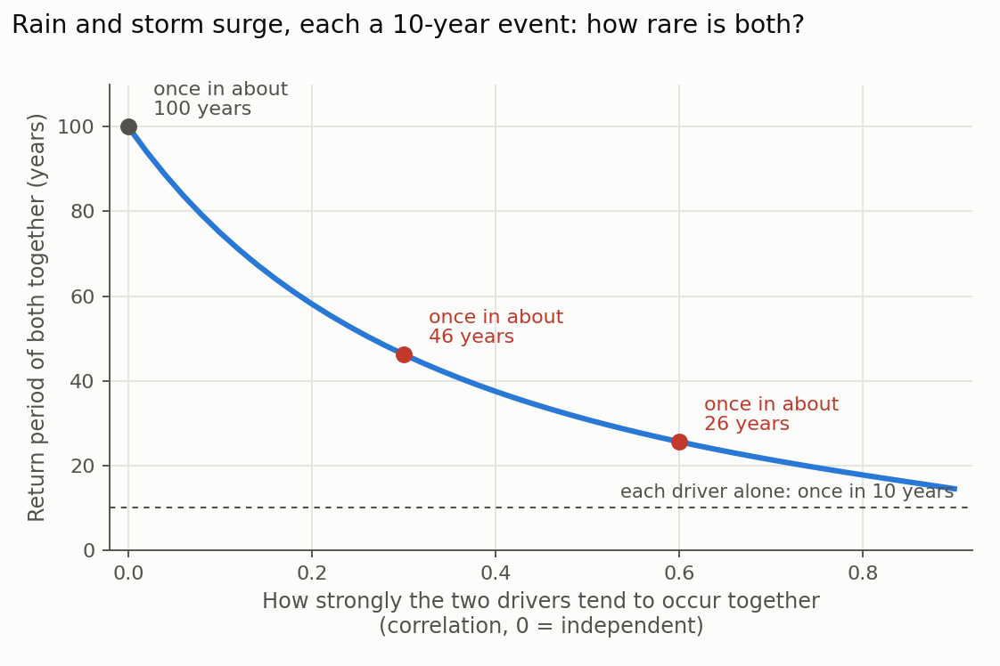
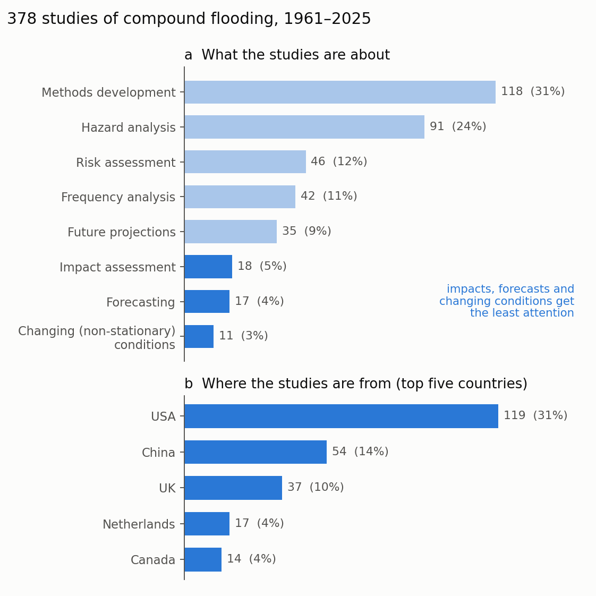

We usually think of floods one at a time: a river overflows, a downpour overwhelms city drains, or a storm pushes the sea onto the coast. In reality, the worst floods often come when several of these happen at once. When Hurricane Harvey struck Texas in 2017, extreme rainfall, high rivers and storm surge combined. Scientists call such events **compound floods**.

A new systematic review in _Environmental Impact Assessment Review_ by Usman Mohseni, R. Vinnarasi, Abdou Khouakhi and Amir AghaKouchak, published online in July 2026, brings together 378 studies of compound flooding from 1961 to 2025 (Mohseni et al. 2027). It asks three questions: what drives compound floods, how we model them, and where research should go next. This post is the second this week involving AghaKouchak's group; the [first]() looked at how one drought can set off a chain of other hazards.

## 1. Three main drivers, and many helpers

The review finds that most compound floods involve three main drivers:

- **Heavy rain** (pluvial flooding), which overwhelms drains and fills streets, especially in cities with sealed surfaces.
- **High river flow** (fluvial flooding), from long or intense rain, snowmelt or dam releases.
- **Storm surge** (coastal flooding), the rise of the sea pushed by strong winds and low pressure in storms.

The danger lies in how they interact. A high sea can block a river from draining into it, so the river backs up and floods inland. A high tide can stop city drains from emptying, so even moderate rain floods the streets. Soils that are already wet from earlier rain cannot absorb more, so the next downpour runs straight off.

Many secondary factors make things worse: high tides, waves, sea-level rise, sinking land in deltas and coastal cities, rising groundwater, snowmelt, ice jams, and human structures such as levees and drains that work well for one hazard but can shift the risk elsewhere.

## 2. Why "together" changes the odds

The key point is that the combined flood can be much worse, and much more likely, than each driver alone would suggest. Figure 1 shows a simple example. Suppose heavy rain and storm surge each reach their 10-year level. If the two were completely independent, both would happen together only once in about 100 years. But they are often not independent, because the same storm brings both the rain and the surge. With a modest link between them, the combined event becomes a once-in-about-46-years event, and with a stronger link, once in about 26 years.

{: style="width: 100%; height: auto;" data-zoomable="" }

_**Figure 1.** How often two 10-year events happen together depends on how strongly they are linked. With no link (independence), the joint event happens once in about 100 years; with a correlation of 0.6, once in about 26 years. Figure by Daeha Kim, a simple illustration using a standard statistical model (a Gaussian copula), not taken from the review._

This is why the review stresses that ignoring the dependence between drivers leads to underestimating flood risk. A design that assumes independence may protect a coastal city far less well than its engineers think.

## 3. How we model compound floods

The review groups the 378 studies by their main method:

- **Statistical models** (53% of studies) estimate how often drivers occur together, often with copulas, a family of tools that describe how two or more variables move together. They are fast and need little data, but they say nothing about where the water goes.
- **Numerical models** (42%) simulate the physics of water flowing over land, in rivers and along coasts. They show which streets flood and how deep, but they are slow and need detailed data.
- **Hybrid models** (5%) combine the two, for example by using statistics to choose realistic storm scenarios and a physical model to simulate them, or by training machine learning to mimic a slow physical model. They are still rare but growing quickly since about 2019.

The review also highlights a growing problem: **non-stationarity**. Traditional flood statistics assume that the past is a good guide to the future. With rising seas, sinking land, more intense rain and expanding cities, that assumption no longer holds, and even the link between drivers may change over time. Only a small share of studies so far take this into account.

## 4. What the research is about, and where it comes from

Research on compound flooding has exploded. Fewer than 20 studies appeared between 1961 and 2000, but more than 230, over 60% of the total, were published in just 2021–2025. Yet the focus is uneven (Figure 2).

{: style="width: 100%; height: auto;" data-zoomable="" }

_**Figure 2.** (a) Main research focus of the 378 reviewed studies and (b) the five countries with the most studies. Figure by Daeha Kim, based on numbers reported by Mohseni et al. (2027)._

Most studies develop methods or analyze the hazard itself. Far fewer assess the actual impacts on people and property (5%) or try to forecast compound floods in real time (4%). Geographically, the USA alone accounts for nearly a third of the studies, followed by China and the UK. Africa, Southeast Asia and Latin America, where many people live in exposed coastal deltas and cities, remain largely unstudied.

## 5. Where research should go next

The authors propose several directions:

1. **Use more and better data**, from satellites, weather reanalyses, sensors and even crowdsourcing and social media, to describe floods where gauges are scarce.
2. **Build models that allow change over time**, linking the behavior of flood drivers to factors such as sea-level rise, land use and climate patterns like El Niño.
3. **Create libraries of flood maps for compound events.** Such libraries exist for river floods, so that forecasters can quickly look up the expected flooding, but not yet for compound floods.
4. **Explore many scenarios**, not just one, to deal with the deep uncertainty about future climate and cities.
5. **Connect the physics with people**, including exposure, vulnerability and how human decisions shape flood risk.
6. **Close the regional gaps**, especially in the most vulnerable parts of the world.

## 6. Why this matters for Korea

Korea has a long coastline, large tidal ranges on the west coast, and typhoons that bring heavy rain and storm surge at the same time. Many cities, such as Busan, Incheon and Changwon, sit where rivers meet the sea. The review lists Korea among the countries with a moderate number of compound flood studies, so there is a base to build on. As sea levels rise and summer rainfall intensifies, flood planning that treats rain, rivers and the sea separately may increasingly underestimate the risk.

**Questions to think about**

1. Why might the same storm make both heavy rain and storm surge more likely? What does that do to the chance of a compound flood?
2. Think of a coastal city you know. Where do its rivers and drains meet the sea, and what happens to them at high tide?
3. A levee may protect against river floods but trap rainwater behind it. How should engineers design for more than one driver at once?

---

**한 줄 요약 (Korean summary).** Mohseni 등(2027)은 1961–2025년에 발표된 378편의 연구를 체계적으로 검토해, 집중호우, 하천 범람, 폭풍해일이 함께 일어나는 '복합홍수'의 원인과 모형, 앞으로의 과제를 정리했다. 같은 태풍이 비와 해일을 함께 몰고 오는 것처럼 원인들이 서로 연관되어 있으면, 각각 10년 빈도인 두 사건이 함께 일어날 확률은 독립을 가정할 때(100년에 한 번)보다 훨씬 커지므로 이를 따로 다루면 위험을 과소평가하게 된다. 연구는 2021–2025년에만 230편 이상이 나올 만큼 급증했지만, 통계 모형과 수치 모형을 결합한 하이브리드 모형, 기후변화에 따른 비정상성, 실제 피해 평가와 실시간 예측은 아직 적고, 연구의 약 3분의 1이 미국에 집중되어 있다. 해안 도시가 많고 태풍이 비와 해일을 함께 가져오는 한국에서도 비, 하천, 바다를 따로 보지 않는 복합홍수 관점의 홍수 계획이 점점 더 중요해지고 있다.

---

**Reference**

Mohseni, U., Vinnarasi, R., Khouakhi, A., & AghaKouchak, A. (2027). A systematic review of compound flooding: drivers, models, and future directions. _Environmental Impact Assessment Review_, 122, 108620. [https://doi.org/10.1016/j.eiar.2026.108620](https://doi.org/10.1016/j.eiar.2026.108620)

_The figures are original. The Python scripts that produce them are available on GitHub: [Figure 1](https://github.com/daehakim-waterlab/daehakim-waterlab.github.io/blob/main/scripts/blog/2026-11-21-compound-flood-odds.py) and [Figure 2](https://github.com/daehakim-waterlab/daehakim-waterlab.github.io/blob/main/scripts/blog/2026-11-21-compound-flood-research.py)._
