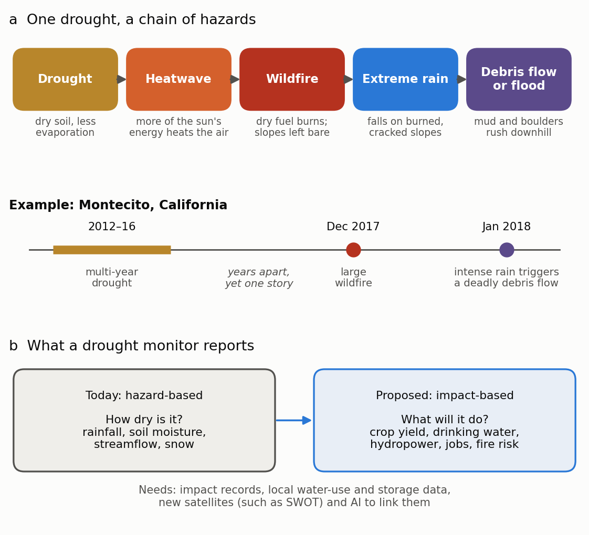

Drought monitoring has come a long way. A century ago, it meant counting the days without rain at a few weather stations. Today, satellites measure rainfall, soil moisture, vegetation, snow and even the total water stored underground, and drought maps are updated every week. Yet a Perspective in _Nature Reviews Earth & Environment_ by Amir AghaKouchak and 21 colleagues argues that these maps still answer the wrong question (AghaKouchak et al. 2023). They tell us **how dry it is**. What farmers, water managers and emergency planners need to know is **what the drought will do**.

## 1. Seventy indicators, one blind spot

The authors count more than 70 drought indicators. Some use a single variable, such as the Standardized Precipitation Index for rainfall or soil moisture percentiles. Others combine several variables into one composite index. Operational systems, such as the US Drought Monitor, blend many of these with the judgment of hundreds of local experts.

This variety exists for a good reason: drought is not one thing. A shortage of rain (meteorological drought) can lead to dry soils (agricultural drought), which can lead to low rivers, reservoirs and groundwater (hydrological drought), each on its own timescale. Snow adds another layer. In many mountain regions, the snowpack is the largest natural reservoir, and a "snow drought" can occur even after a normal winter if warm weather melts the snow too early.

But all of these indicators share one feature: they describe the hazard, not its consequences. They are "top-down". A map can show that soil moisture is two standard deviations below normal, but not whether this means a 10% or a 50% loss of wheat yield, a water shortage in a city, or a fire season ahead.

## 2. Droughts rarely come alone

The second problem is that droughts are monitored in isolation, while in reality they set off chains of other hazards (Figure, panel a). The authors call these **cascading hazards**:

- **Heatwaves.** When soils dry out, less of the sun's energy goes into evaporating water and more goes into heating the air. Drought and heat then feed each other. The 2003 European drought and heatwave is estimated to have killed more than 70,000 people.
- **Wildfires.** Drought dries out vegetation and turns it into fuel. Several years of drought preceded the extreme fire seasons in Australia and the western USA in 2020.
- **Debris flows.** Drought weakens soils and opens deep cracks, and fire removes the vegetation that holds slopes together. When intense rain then falls on burned slopes, mud and boulders can rush downhill. In Montecito, California, a drought from 2012 to 2016 was followed by a large fire in December 2017 and, a month later, by intense rain that triggered the deadliest debris flow in the state's history.
- **Floods.** Droughts and floods are two ends of the same water cycle, and droughts can make floods worse. Cracked soils can weaken levees: during the dry summer of 2003, a dyke failed at Wilnis in the Netherlands, flooding about 600 homes. California's 2012–16 drought ended with extreme rain that badly damaged the spillway of the Oroville Dam, and Australia's Millennium Drought ended in 2011 with widespread flooding.
- **Water quality.** Low river flows mean less dilution and warmer water, which encourage algal blooms. The authors link drought to the dead zone in Lake Erie in 2012, and toxins from algae closed the water supply of Toledo, Ohio, in 2014.

{: style="width: 100%; height: auto;" data-zoomable="" }

_**Figure.** (a) A drought can set off a chain of further hazards, illustrated with the Montecito, California example described by AghaKouchak et al. (2023); the timeline is not to scale. (b) The shift the authors propose, from monitoring how dry it is to forecasting what the drought will do. Figure by Daeha Kim, a schematic based on AghaKouchak et al. (2023)._

None of the existing indicators captures these links. A drought index does not tell you that a wildfire is likely, and nothing tells you that the cracked soil on a burned hillside has become dangerous when the rain returns.

## 3. From "how dry?" to "what will it do?"

The authors' main proposal is **impact-based drought monitoring** (Figure, panel b). Instead of starting from rainfall and soil moisture, it starts from the things people care about: crop yields, food prices, drinking water, hydropower, jobs, health and the risk of fire or flood. Drought information is then linked to models that translate the hazard into these impacts, ideally months in advance.

One example in the paper is snow. In many basins, irrigated wheat, rice and maize depend heavily on snowmelt. Linking a snow drought map to these farms would turn "less snow than normal" into "this much less irrigation water for these crops this summer".

## 4. Why it is hard

If this is such a good idea, why is it not done already? The authors list several obstacles:

1. **Few consistent impact records.** Damage from drought is slow, spread out and often unrecorded. Systems such as the US Drought Impact Reporter, which lets citizens and local officials report impacts, are a start, but such data remain patchy.
2. **Missing water-use data.** The impact of a drought depends on how much water people take and where it comes from. Even in the USA, water use by sector is published only at the county level every five years. Los Angeles, for example, cannot judge its drought risk from local rainfall alone, because much of its water comes from northern California and the Colorado River.
3. **Unknown local storage.** Groundwater and the water stored in lakes and reservoirs are poorly measured in much of the world, and satellite measurements of total water storage are too coarse for a single basin.
4. **Disconnected tools.** Drought monitors, crop models, fire systems and flood forecasts are run by different agencies and rarely talk to each other.

## 5. New data and AI as part of the solution

The authors see two developments that could help. New satellites, such as SWOT (Surface Water and Ocean Topography), launched in December 2022, measure both the area and the water level of lakes and reservoirs, giving a new picture of how much water is actually stored. And with data volumes growing far beyond what people can inspect by hand, artificial intelligence, especially models that combine physical knowledge with machine learning, can help learn the complicated links between drought and its impacts.

## 6. What this means for us

For water researchers, the message is that a good drought index is only the first step. The next step is to connect it to what happens on the ground, and to monitor droughts together with the heatwaves, fires and floods they bring, instead of in separate silos.

This also matters for Korea. Our droughts are often short and sharp, such as flash droughts during hot summers, and they increasingly overlap with heatwaves, wildfires in spring and heavy monsoon rain. Knowing what a dry spell will do to reservoirs, farms and burned mountain slopes may be more useful than knowing that it is dry.

**Questions to think about**

1. Think of the last drought in your region. What did the drought map say, and what actually happened to farms, water supplies or forests?
2. Why might a drought end in a flood? Which processes make the transition dangerous?
3. If you could collect one new kind of data to forecast drought impacts better, what would it be?

---

**한 줄 요약 (Korean summary).** AghaKouchak 등(2023)은 70개가 넘는 가뭄 지수와 위성 자료로 가뭄 감시가 크게 발전했지만, 여전히 '얼마나 건조한가'라는 위험(hazard)만 보여줄 뿐 '그 가뭄이 무엇을 일으킬 것인가'라는 영향은 알려주지 못한다고 지적한다. 실제로 가뭄은 폭염, 산불, 산불 뒤 집중호우에 의한 토석류, 홍수, 수질 악화로 이어지는 연쇄 재해를 일으키는데(예: 2012–16년 가뭄, 2017년 12월 산불, 2018년 1월 토석류로 이어진 미국 캘리포니아주 몬테시토), 현재의 감시 체계는 이들을 따로따로 다룬다. 저자들은 작물 수확량, 식수, 수력발전, 일자리 같은 영향에서 출발하는 '영향 기반 가뭄 감시'로 전환하자고 제안하며, 이를 위해 일관된 영향 기록과 지역별 물 사용·저류량 자료, SWOT 같은 새 위성 자료, 그리고 물리 지식과 결합한 AI가 필요하다고 본다. 짧고 강한 돌발가뭄이 폭염, 봄철 산불, 장마철 호우와 겹치는 한국에서도 가뭄을 다른 재해와 함께, 그리고 그 영향 중심으로 감시할 필요가 크다.

---

**Reference**

AghaKouchak, A., Huning, L. S., Sadegh, M., Qin, Y., Markonis, Y., Vahedifard, F., et al. (2023). Toward impact-based monitoring of drought and its cascading hazards. _Nature Reviews Earth & Environment_, 4, 582–595. [https://doi.org/10.1038/s43017-023-00457-2](https://doi.org/10.1038/s43017-023-00457-2)

_The figure is original. The Python script that produces it is available on [GitHub](https://github.com/daehakim-waterlab/daehakim-waterlab.github.io/blob/main/scripts/blog/2026-11-21-drought-cascade.py)._
