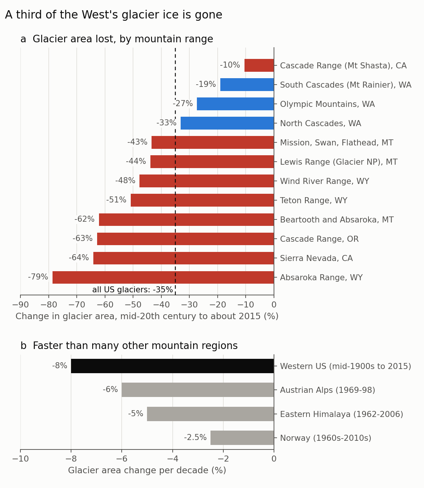

When we think of water storage in the western United States, we think of the large dams on the Colorado and Columbia rivers, or of the winter snowpack. Glaciers are rarely on the list. They are small, remote and few compared with those in Alaska or Canada. Yet a new study in _PNAS_ by Andrew Fountain and colleagues shows why they matter, and how quickly they are disappearing (Fountain et al. 2026).

## 1. Why small glaciers matter for water

Snow and glaciers both store winter precipitation and release it later. But they behave differently. Seasonal snow melts in spring and early summer and is usually gone by July. Glaciers last from year to year, and they keep melting in late summer, when it is hottest and driest and other water sources run low.

Glaciers also act as a natural buffer. In a hot, dry summer they melt more and add more water to streams; in a cool summer they melt less. This keeps streamflow more even from year to year and supplies cold water that many alpine fish and insects depend on. As glaciers shrink, this buffer weakens, and mountain streams become more exposed to drought and warmer water.

## 2. The first complete count

Surprisingly, nobody had measured the change of all the glaciers in the lower 48 states before. Individual glaciers have been studied since the late 1950s, but a complete inventory was compiled only recently.

The authors compared two inventories:

- a **historic** one, taken from US Geological Survey topographic maps made between the early 1950s and the mid-1980s, a relatively cool period when glaciers were fairly stable, and
- a **recent** one, from aerial and satellite images taken around 2015.

To estimate how much thinner the glaciers have become, they compared the old map elevations with modern elevation data from radar satellites and airborne laser scanning (lidar).

## 3. What they found

The numbers are stark:

- The number of glaciers fell from 1,453 to 1,331. In total, **398 glaciers, about a quarter, disappeared.** The net loss looks smaller only because some large glaciers split into several smaller pieces as they retreated.
- **Glacier area fell by about 35%**, from about 562 to 367 km², a rate of about 8% per decade. That is faster than in the Austrian Alps, Norway or the eastern Himalaya over comparable periods (Figure, panel b).
- Glacier surfaces dropped by about 11.6 m on average. The total **ice volume fell by about a third**, from about 19.7 to 13.2 km³. The lost ice, about 6.5 km³, is equivalent to about 5.5 billion tonnes of water.
- **The smallest glaciers suffered most.** Glaciers smaller than 0.1 km² lost about two-thirds of their area, while the largest lost about 15%.

{: style="width: 100%; height: auto;" data-zoomable="" }

_**Figure.** (a) Change in glacier area from the mid-twentieth century to about 2015 in the mountain ranges with at least 2 km² of glacier ice at the start, with ranges in Washington in blue and those in other states in red. (b) Rate of glacier area change per decade in the western United States compared with other regions, as quoted by Fountain et al. (2026) from earlier studies. Figure by Daeha Kim, based on numbers reported by Fountain et al. (2026)._

## 4. Wet coasts versus dry interior

The losses are far from even. Most of the ice is in the wet, maritime climate of Washington State, where the North Cascades alone hold about 89% of the remaining glacier volume. Glaciers there have lost about 29% of their area on average. Outside Washington, in the drier continental climate of the Sierra Nevada and the Rocky Mountains, glaciers have shrunk much faster, by about 52% on average. The Sierra Nevada and the Beartooth Mountains of Montana have lost about three-quarters of their ice volume.

There is even one glacier that grew. After Mount St. Helens erupted in 1980, a new glacier, Crater Glacier, formed inside its crater. Between 2003 and 2015 it grew by 64% in area and thickened by about 100 m.

## 5. Small glaciers live by local rules

One might expect higher glaciers, in cooler air, to lose less ice. In the wet Cascades there is a weak trend of this kind, but in the dry interior there is none. The authors explain this by the glaciers' small size: most are smaller than 1 km², and their survival depends less on regional climate than on local terrain. Snow blown by wind or brought down by avalanches from the valley walls can matter as much as snowfall itself, and shade from steep cliffs protects ice from the summer sun. Many of these glaciers, in other words, are hanging on in sheltered spots in a climate that no longer favors them.

## 6. What this means for water

The remaining ice, about 13.2 km³, is not much on the scale of a continent. By my own rough calculation, using the authors' conversion from ice to water, it holds about 11 km³ of water, roughly four times the storage of Korea's largest reservoir, the Soyang Dam. Its value lies less in its total amount than in its timing: it releases water in late summer, exactly when streams are lowest and warmest.

That is why the shrinking of these glaciers matters for hydrology. With smaller glaciers, mountain streams will lose part of their late-summer supply and their buffer against drought, at the same time as the snowpack shrinks and reservoirs become less reliable. And because the losses vary so much from one range to the next, the effects on streams and ecosystems will be uneven too.

Korea has no glaciers, but the lesson is familiar. Any natural storage, whether snow, glaciers, wetlands or groundwater, helps to smooth out the water supply between wet and dry seasons. When it disappears, the pressure on man-made storage grows.

**Questions to think about**

1. Why does a glacier provide more water in a hot, dry summer than in a cool one? Why is that useful?
2. The smallest glaciers lost the largest share of their area. Why might small glaciers be more vulnerable?
3. What natural forms of water storage exist in your region, and how are they changing?

---

**한 줄 요약 (Korean summary).** Fountain 등(2026)은 미국 본토의 모든 빙하를 20세기 중반 지형도와 2015년 무렵 항공·위성 자료로 처음 전수 비교해, 1,453개 빙하 중 398개(약 4분의 1)가 사라지고 면적은 약 35%(10년에 약 8%), 얼음 부피는 약 3분의 1(19.7 km³에서 13.2 km³로) 줄었음을 보였다. 감소 속도는 오스트리아 알프스, 노르웨이, 동부 히말라야보다 빨랐고, 작은 빙하일수록, 그리고 습윤한 워싱턴주보다 건조한 내륙(시에라네바다, 로키산맥)에서 손실이 훨씬 컸다. 대부분 1 km²보다 작은 이 빙하들은 고도보다 바람에 날린 눈, 눈사태, 절벽 그늘 같은 국지 지형에 기대어 겨우 유지되고 있다. 빙하는 가장 덥고 건조한 늦여름에 물을 공급하고 해마다의 유량 변동을 완충하는 '얼어 있는 저수지'이므로, 빙하의 축소는 산지 하천이 가뭄과 수온 상승에 더 취약해진다는 뜻이다.

---

**Reference**

Fountain, A. G., Glenn, B., McNeil, C., & Menounos, B. (2026). Extensive glacier loss in the coterminous United States. _Proceedings of the National Academy of Sciences_, 123(43), e2600941123. [https://doi.org/10.1073/pnas.2600941123](https://doi.org/10.1073/pnas.2600941123)

_The figure is original. The Python script that produces it is available on [GitHub](https://github.com/daehakim-waterlab/daehakim-waterlab.github.io/blob/main/scripts/blog/2026-11-21-us-glacier-loss.py)._
