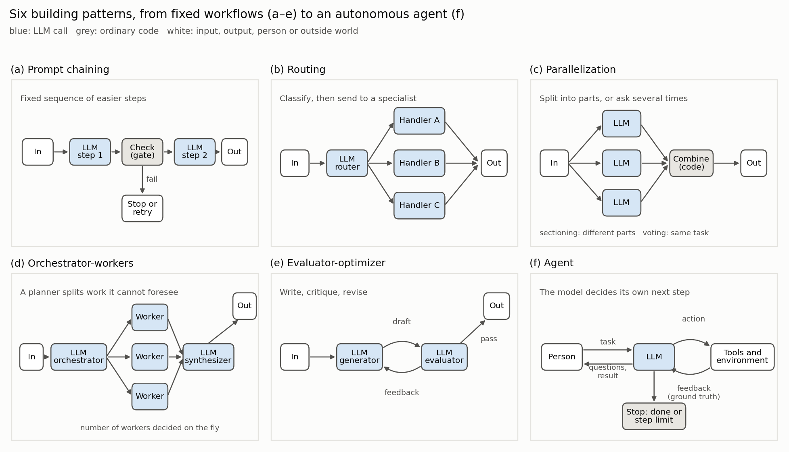

"AI agent" has become one of the most used, and least defined, terms in technology. In December 2024, two engineers at Anthropic, Erik Schluntz and Barry Zhang, wrote a short guide called _Building effective agents_ (Schluntz and Zhang, 2024). It is based on their work with dozens of teams building agents across industries, and it has been widely read since. Its central finding is refreshingly plain: the teams that succeeded were not using complex frameworks. They were combining a few simple patterns.

The page now notes that much of the tooling it mentions has changed since 2024. The patterns and principles, though, are still the clearest map of the field I know of, and they are useful well beyond software. Here are the key points, with examples from hydrology research added by me. In an [earlier post](), I looked at how LLMs moved from answering questions to acting in hydrology; this post is about how such systems are built.

## 1. Workflows and agents are different things

The guide calls everything in this space an **agentic system**, but it separates two kinds:

- **Workflows**: the LLM and its tools follow a path that a person wrote in code beforehand. The model fills in each step, but the steps are fixed.
- **Agents**: the LLM decides for itself what to do next and which tools to use, and keeps control over how the task gets done.

The difference is who holds the plan. In a workflow, the programmer does. In an agent, the model does.

## 2. Start with the simplest thing that works

The most important advice comes first: find the simplest solution, and add complexity only when it is needed. Often that means **not building an agentic system at all**. A single, well-written request to an LLM, perhaps with some retrieved documents and a few examples, is enough for many applications.

Agentic systems usually buy better results with more time and more cost. That trade is worth it only for some tasks. When more structure is needed, workflows give predictable, consistent results on well-defined tasks. Agents are the better choice when flexibility and model-driven decisions are needed.

The same caution applies to frameworks. Software libraries that promise to make agents easy can help at the start, but they add layers that hide the actual prompts and responses, which makes errors hard to find. The authors suggest starting by calling the model directly, since many patterns take only a few lines of code, and, if you use a framework, making sure you understand what it does underneath.

## 3. The building block: an LLM with tools

Every pattern is built from one unit: an **augmented LLM**, a model that can search for information, use tools and keep memory. Today's models can decide for themselves what to search for, which tool to use and what to remember. The guide's advice is to tailor these abilities to the task and give the model a clear, well-documented way to use them. (The Model Context Protocol, an open standard for connecting models to tools and data, is one way to do this.)

## 4. Five workflows and one agent

From that block, the guide builds up in steps of increasing complexity (Figure).

{: style="width: 100%; height: auto;" data-zoomable="" }

_**Figure.** The six patterns described by Schluntz and Zhang (2024). Blue boxes are LLM calls, grey boxes are ordinary code, and white boxes are inputs, outputs, people or the outside world. Figure by Daeha Kim, redrawn from scratch as simple diagrams._

**(a) Prompt chaining.** Split a task into a fixed sequence of steps, each LLM call working on the output of the one before. Simple checks in code (a "gate") can stop the chain if a step goes wrong. Each step is easier, so accuracy goes up, at the cost of time. _Hydrology example:_ outline a field campaign report, check that the outline has all required sections, write the report, then translate it.

**(b) Routing.** First classify the input, then send it to a handler built for that kind of input. Without routing, tuning the system for one kind of request can make it worse at others. Routing also lets easy questions go to a small, cheap model and hard ones to a stronger model. _Example:_ a lab's incoming questions sorted into data requests, coursework questions and research questions, each with its own instructions and tools.

**(c) Parallelization.** Run several LLM calls at once and combine the results in code. There are two versions. **Sectioning** splits the task into independent parts; **voting** runs the same task several times to get more confident answers. LLMs tend to do better when each concern gets its own call. _Example:_ review a manuscript with one call each for the methods, the statistics and the figures (sectioning), or ask three separate calls whether a streamflow record has a suspicious jump and flag it if two agree (voting).

**(d) Orchestrator-workers.** A central LLM breaks the task into subtasks, hands them to worker LLMs and combines their results. It looks like parallelization, but the subtasks are not fixed in advance; the orchestrator decides them for each input. The guide's main examples are coding changes that touch an unknown number of files and searches across many sources. _Example:_ "find and summarize every study of compound flooding in Korean estuaries," where the number and kind of searches cannot be known beforehand.

**(e) Evaluator-optimizer.** One LLM writes, another critiques, and the loop repeats until the result passes. This fits when there are clear criteria and when feedback demonstrably improves the result, much as a human writer revises a draft after comments. _Example:_ a plain-language summary of a paper, with the evaluator checking for jargon and for claims that are not in the paper.

**(f) Agents.** An agent starts from a person's instruction or a conversation. Once the task is clear, it plans and works on its own, coming back to the person when it needs information or judgment. At each step it should get **ground truth from the environment**, such as the result of a tool call or of running code, to see whether it is making progress. It can pause at checkpoints, and it usually has a stopping rule such as a maximum number of steps.

The surprising part is how simple an agent is underneath: it is usually just an LLM using tools in a loop, guided by feedback from its environment. Agents fit open-ended problems where the number of steps cannot be predicted and no fixed path can be written down. But autonomy brings higher cost and the risk that **errors compound** over many steps, so the guide recommends extensive testing in sandboxed (isolated) environments and suitable guardrails. _Example:_ fixing a model calibration script, where the agent runs the code, reads the error, edits, and reruns until the tests pass.

These patterns are not rules. They are pieces to be shaped and combined, and the only way to know whether a more complex design helps is to measure it.

## 5. Three principles

The guide ends with three principles for building agents:

1. **Keep the design simple.**
2. **Make it transparent**, by showing the agent's planning steps so a person can follow what it is doing.
3. **Design the agent-computer interface carefully**, with thorough tool documentation and testing.

## 6. Tools deserve as much care as prompts

The last principle is developed in an appendix that I found the most practical part. The authors point out that we spend a great deal of effort on human-computer interfaces, and suggest spending as much on **agent-computer interfaces**: the descriptions, parameters and formats of the tools an agent uses. Their suggestions:

- Choose formats that are easy for a model to write, close to text it has seen often, without overhead such as counting lines or escaping characters in code.
- Put yourself in the model's place. If using a tool would require careful thought from you, it will for the model too. A good tool description reads like a good docstring written for a new team member, with examples, edge cases and how it differs from similar tools.
- Test how the model actually uses the tools, and revise.
- **Mistake-proof the tools** (the Japanese term _poka-yoke_): change the inputs so that errors become hard to make.

Their own example is telling. While building a coding agent, they spent more time improving its tools than its overall prompt. The model kept making mistakes with relative file paths after moving out of the starting folder, so they changed the tool to require absolute paths, and the mistakes stopped.

The guide also describes where agents have worked best so far: customer support and coding. Both combine conversation with action, have clear measures of success, allow feedback loops and keep humans in charge of important decisions. In coding, automated tests show whether a fix works, but human review is still needed to check that it fits the larger system.

## 7. A few thoughts

What I like about this guide is that its advice is the same advice we give students about models in hydrology: start with the simplest model that answers the question, and add complexity only when it clearly improves the result. A distributed model with fifty parameters is not better than a lumped one if the data cannot support it, and a multi-agent system is not better than a single good prompt if the task does not need it.

The idea of ground truth is the key for research use. Agents work well in coding because a test either passes or fails. Much of our work has no such test: whether a calibration is physically sensible, or whether a trend is real, is a matter of judgment. That is where the guide's "human oversight" matters most. An agent can run the calibration loop, but deciding what counts as a good model should stay with the researcher. The same caution I described in a [post on LLM hallucination]() applies here, with one difference: an agent that makes a wrong choice early can build many steps on top of it.

**Questions to think about**

1. Think of a task in your own work that you might hand to an AI system. Would a single prompt, a workflow or an agent fit it best? Why?
2. What would serve as "ground truth from the environment" for an agent helping with hydrological modeling? What would it not be able to check?
3. The guide suggests treating tool descriptions like documentation written for a new colleague. How would you describe a rainfall-runoff model as a tool, so that an agent uses it correctly?

---

**한 줄 요약 (Korean summary).** Schluntz와 Zhang(2024)은 여러 산업의 수십 개 팀과 LLM 에이전트를 만든 경험을 바탕으로, 성공한 사례는 복잡한 프레임워크가 아니라 단순하고 조합 가능한 패턴을 쓴 경우였다고 정리했다. 이 글은 미리 정해진 코드 경로를 따르는 '워크플로'와 모델이 스스로 다음 단계와 도구 사용을 결정하는 '에이전트'를 구분하고, 프롬프트 체이닝, 라우팅, 병렬화, 오케스트레이터-워커, 평가자-최적화자의 다섯 가지 워크플로 패턴과 그 적용 조건을 설명한다. 핵심 조언은 가장 단순한 해법(대개 잘 만든 단일 프롬프트)에서 시작해 성능이 분명히 좋아질 때만 복잡성을 더하라는 것이며, 에이전트는 각 단계에서 환경으로부터 실제 결과(ground truth)를 받아 진행을 점검하고 샌드박스 시험과 안전장치를 갖춰야 한다. 또한 설계를 단순하게, 계획 과정을 투명하게, 그리고 에이전트가 쓰는 도구의 설명과 형식을 사람이 쓰는 인터페이스만큼 공들여 설계하라는 세 가지 원칙을 제시한다.

---

**Reference**

Schluntz, E., & Zhang, B. (2024, December 19). Building effective agents. _Anthropic Engineering_. [https://www.anthropic.com/research/building-effective-agents](https://www.anthropic.com/research/building-effective-agents)

_The figure is original. The Python script that produces it is available on GitHub: [Figure](https://github.com/daehakim-waterlab/daehakim-waterlab.github.io/blob/main/scripts/blog/2026-11-22-agent-patterns.py)._
