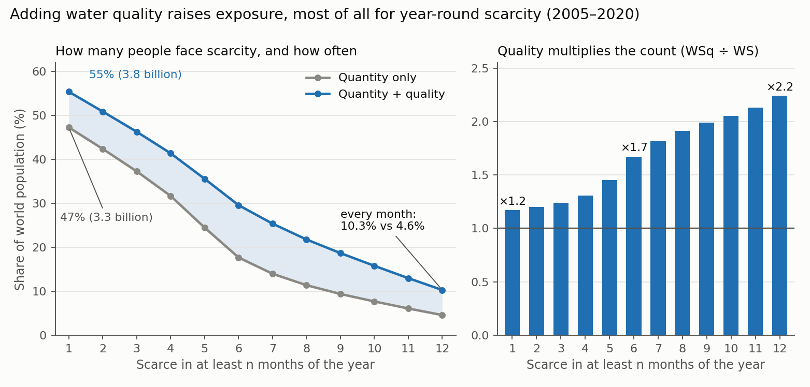
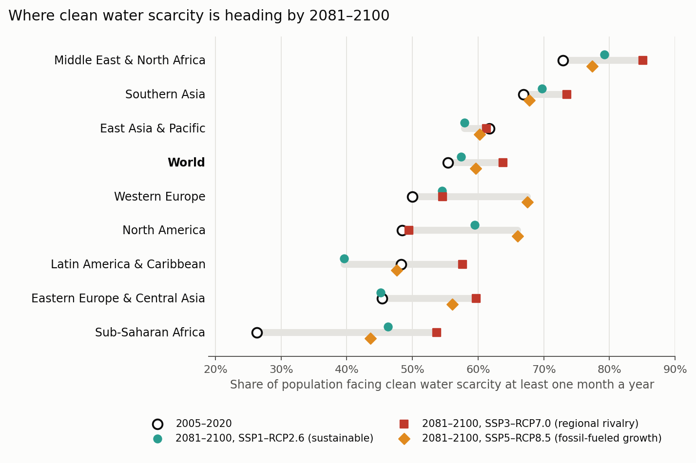

When we say a region is "water scarce," we usually mean that people want more water than the rivers can deliver. That is a question about quantity. But a river can be full and still useless if it is too salty, too loaded with organic waste, or full of pathogens. Edward Jones, Marc Bierkens and Michelle van Vliet at Utrecht University asked what happens to the global picture of water scarcity when water quality is counted as well (Jones et al., 2024). Their answer: more people are affected, and they are affected for more months of the year.

## 1. Water you cannot use is not available water

Every use of water has a quality requirement. Drinking water needs to be much cleaner than water for cooling a power plant or irrigating a field. The study tracks three common kinds of pollution in rivers:

- **Salinity**, measured as total dissolved solids. Too much salt harms crops and makes water unfit to drink.
- **Organic pollution**, measured as biological oxygen demand (BOD). This comes mostly from untreated sewage, livestock and food industries.
- **Pathogen pollution**, measured as fecal coliform bacteria, a sign of contamination by human or animal waste.

For each of these, the authors set a maximum concentration for each kind of use: domestic, industrial, livestock and irrigation. For organic pollution, for example, the limit is 5 mg/L for domestic water but 30 mg/L for irrigation. If a river is cleaner than the limit, its water counts as usable for that purpose. If not, it does not.

## 2. How do you add quality to a scarcity count?

The study uses two linked global models. PCR-GLOBWB 2 simulates river flow, groundwater and human water use. DynQual follows pollution as it enters and moves through the river network. Both run at a 5 arcminute grid (roughly 10 km) and the analysis is monthly, from 2005 to 2100.

The quantity part is a familiar ratio. Take the water people demand, subtract what groundwater pumping, desalination and wastewater reuse already provide, and compare the rest with what the river can give after leaving enough flow for the ecosystem. If demand is larger, the area is water scarce that month.

The quality part uses a clever idea called **dilution water**. Suppose a town needs 60 units of river water, but the river carries twice the allowed amount of organic pollution. To bring that water down to the limit, you would need to mix in another 60 units of clean water. The town's effective demand is now 120 units, not 60. Nobody actually dilutes water this way, but the idea turns pollution into a volume of water, so quantity and quality can be compared on the same scale. A place that looked comfortable on quantity alone can cross into scarcity once this extra water is counted.

The authors call the quantity-only indicator WS and the combined indicator WSq. "Clean water scarcity" means scarcity measured with WSq.

## 3. The world today

Averaged over 2005–2020, the results are:

- **3.8 billion people (55%)** face clean water scarcity at least one month a year. Counting quantity alone gives 3.3 billion (47%).
- In any given month, between 1.7 and 2.6 billion people face clean water scarcity, compared with 1.0 to 2.1 billion on quantity alone. On average, pollution adds about 634 million people each month.
- **0.71 billion people (10.3%)** face clean water scarcity in every month of the year, more than double the 0.32 billion (4.6%) counted on quantity alone.

The last point is the most striking. For short, seasonal scarcity, quality adds about one-fifth to the count. For year-round scarcity, it more than doubles it (Figure 1). Dry seasons come and go, but pollution in many rivers stays all year.

{: style="width: 100%; height: auto;" data-zoomable="" }

_**Figure 1.** Share of the world population exposed to water scarcity in at least n months of the year, averaged over 2005–2020, counting quantity only (grey) and quantity plus quality (blue). The right panel shows how many times larger the clean water count is. Figure by Daeha Kim, drawn from the values in Table 1 of Jones et al. (2024)._

Where does quality matter most? The paper's maps show that pollution creates scarcity in east Africa and large parts of China, often where there is enough water in the river. India suffers from both too little water and poor quality for much of the year. In Western Europe and North America, scarcity comes mostly in summer and is driven by quantity, but poor quality often makes it worse. Of the world regions, including quality changes the count most in Latin America and the Caribbean, the Middle East and North Africa, and East Asia and the Pacific.

## 4. The rest of the century

To look ahead, the authors combine three scenarios of social and climate change with five climate models:

- **SSP1–RCP2.6**, a sustainable world with strong climate action;
- **SSP3–RCP7.0**, a world of regional rivalry, high population growth and slow development;
- **SSP5–RCP8.5**, a world of fast, fossil-fueled economic growth.

In all three, clean water scarcity grows. The share of people facing it at least one month a year rises from 54–57% today to 56–62% by mid-century (2041–2060) and 56–66% by the end of the century (2081–2100). In numbers, that is 4.7–6.1 billion people by mid-century. By the end of the century the range is very wide, 3.8–8.2 billion, because the scenarios assume very different population sizes. The regional rivalry scenario (SSP3–RCP7.0) is the worst for both the share and the number of people.

The regional picture differs a lot (Figure 2):

- **Sub-Saharan Africa** sees the largest change. Today about 26% of its people face clean water scarcity at least one month a year; by 2081–2100 this becomes 44–54%, depending on the scenario. Both quantity and quality drive the increase.
- **East Asia and the Pacific** is the exception. Its exposure falls slightly in all scenarios, and the paper shows that the fall comes mainly from **improving river water quality**, not from more water.
- **North America and Western Europe** increase most under the sustainable and fossil-fueled scenarios. This sounds odd until you look at population: those scenarios assume strong population growth in these regions (for North America, +121% under SSP5 by 2100), while the regional rivalry scenario assumes population decline. The increases are driven mainly by quantity, in summer.
- **The Middle East and North Africa** remains the most exposed region, with 77–85% of people facing clean water scarcity at least one month a year by the end of the century.

{: style="width: 100%; height: auto;" data-zoomable="" }

_**Figure 2.** Share of each region's population facing clean water scarcity at least one month a year, for 2005–2020 (open circles) and for 2081–2100 under three scenarios (colored markers, slightly offset vertically so overlapping values stay visible). Values are means over five climate models. Figure by Daeha Kim, drawn from the values in Table 2 of Jones et al. (2024)._

## 5. What the numbers leave out

The authors are careful about the limits, and several of them mean the true numbers could be higher:

- Only three kinds of pollution are included. Nutrients, metals, plastics and many chemicals are not.
- **Groundwater is assumed to be clean.** In reality, arsenic, nitrate and salt make some groundwater unusable, so this assumption likely underestimates clean water scarcity.
- Only one hydrological model and one water quality model are used, so uncertainty from the models themselves is not captured.
- Future growth of desalination and wastewater reuse is not projected, because there are no good projections of how fast they will expand.
- The study measures physical scarcity only. Whether people can actually access water, and whether it is shared fairly, are different questions.

The authors also note that their estimates sit at the high end of earlier studies. They argue that many earlier assessments underestimated scarcity because they used coarse units such as whole countries or annual averages, and because they ignored quality.

## 6. A few thoughts

In practice, water quantity and water quality are often handled by different people, different models and even different agencies. This paper is a good reminder that, for the person turning on the tap or the farmer opening a gate, they are one problem. A river that is full but too dirty to use is, for that user, an empty river.

The East Asia result is the most hopeful part of the paper. It shows that cleaning up rivers can reduce water scarcity as surely as building new supply. Wastewater treatment is usually discussed as environmental protection, but here it also works as a water supply measure.

The paper does not report numbers for individual countries, so I cannot say what it implies for Korea. Korea sits inside the East Asia and Pacific region, and the regional averages hide large differences between countries. Still, the idea is easy to apply at home: a reservoir with a summer algal bloom, or a river reach just below a city's treatment plant, can be short of usable water even when it is full. In an [earlier post on water bankruptcy](), we saw the claim that about 4 billion people face severe water scarcity at least a month a year. This study arrives at a similar number from a different angle, and it shows how much of that number comes from water that is there but cannot be used.

**Questions to think about**

1. Why does including water quality more than double the number of people facing scarcity all year round, but add only about one-fifth for scarcity in at least one month?
2. The "dilution water" idea converts pollution into a volume of water. What are the strengths and weaknesses of this approach?
3. If you were a water manager, would you spend the next budget on a new reservoir or on better wastewater treatment upstream? What information would you need to decide?

---

**한 줄 요약 (Korean summary).** Jones 등(2024)은 전 지구 수문 모델(PCR-GLOBWB 2)과 수질 모델(DynQual)을 결합해, 물의 양뿐 아니라 염분, 유기물(BOD), 병원성 미생물 오염까지 고려한 '깨끗한 물 부족(clean water scarcity)'을 2005년부터 2100년까지 월 단위로 평가했다. 오염된 물을 용도별 수질 기준까지 희석하는 데 필요한 물을 수요에 더하는 방식으로 계산한 결과, 현재 세계 인구의 55%(38억 명)가 1년에 한 달 이상 깨끗한 물 부족을 겪으며, 이는 수량만 고려했을 때(47%)보다 많고 1년 내내 부족을 겪는 인구는 수질을 고려하면 두 배 이상(4.6%에서 10.3%)으로 늘어난다. 미래에는 세 가지 사회·기후 시나리오 모두에서 이 비율이 금세기 말 56–66%로 늘고, 특히 사하라 이남 아프리카에서 크게 증가하는 반면, 동아시아·태평양은 하천 수질 개선 덕분에 오히려 감소한다. 지하수를 깨끗하다고 가정하고 세 가지 오염 물질만 다뤘다는 한계가 있지만, 물 부족을 줄이려면 물 사용 절감과 함께 오염 저감이 반드시 필요하다는 점을 보여준다.

---

**Reference**

Jones, E. R., Bierkens, M. F. P., & van Vliet, M. T. H. (2024). Current and future global water scarcity intensifies when accounting for surface water quality. _Nature Climate Change_, 14, 629–635. [https://doi.org/10.1038/s41558-024-02007-0](https://doi.org/10.1038/s41558-024-02007-0)

_The figures are original. The Python scripts that produce them are available on GitHub: [Figure 1](https://github.com/daehakim-waterlab/daehakim-waterlab.github.io/blob/main/scripts/blog/2026-11-22-clean-water-months.py) and [Figure 2](https://github.com/daehakim-waterlab/daehakim-waterlab.github.io/blob/main/scripts/blog/2026-11-22-clean-water-regions.py)._
