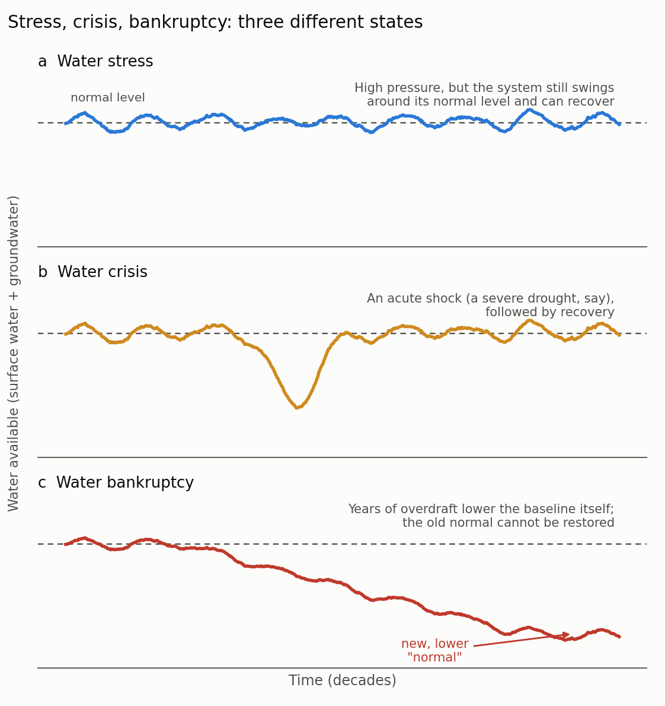
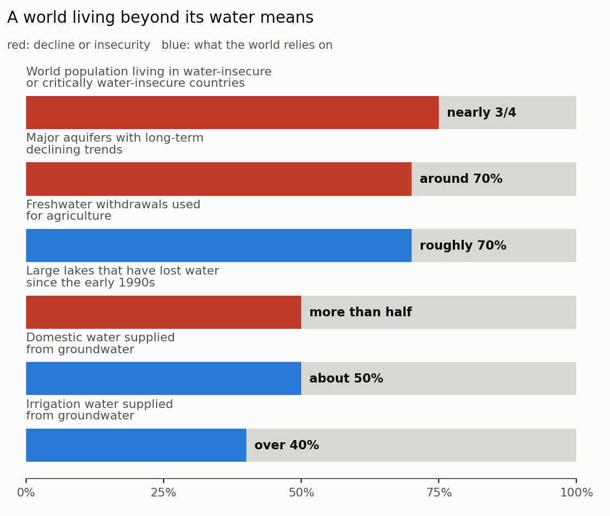

We hear about a "water crisis" almost everywhere: a failed monsoon in one year, a city close to running dry, an aquifer that has been falling for fifty years. Kaveh Madani, the Director of the United Nations University Institute for Water, Environment and Health (UNU-INWEH), argues that this word no longer fits many of these situations. In a recent paper in _Water Resources Management_, he gives the first formal definition of a term he has used for years: **water bankruptcy** (Madani 2026a). A UNU-INWEH report built on this paper goes further and declares that the world has entered an era of "global water bankruptcy" (Madani 2026b).

## 1. Why "crisis" is the wrong word

A crisis, in the usual sense, is a temporary departure from normal. It has a beginning and an end: a severe drought, a contamination event, a flood. The goal of crisis management is to get through it and return to the old normal.

Many of today's water problems do not look like that. Lakes and wetlands have dried, groundwater has fallen for decades, land has subsided, and rivers no longer reach the sea. These are not short shocks that will pass after a few wet years. Madani lists four reasons why calling them a crisis is misleading:

1. **A crisis implies it will end.** If a "crisis" lasts for decades, the system has not been through a crisis; it has failed.
2. **The word has lost its power.** "Water crisis" has been used so often that it creates fatigue rather than action.
3. **Crisis management aims to restore the past.** But a drained aquifer or a dried wetland cannot be restored on any realistic time scale.
4. **Crisis talk delays the admission of failure.** It encourages promises that the problem is temporary, usually followed by new supply projects that treat the symptom instead of the cause.

## 2. The bank account analogy

To explain the idea, Madani uses a simple analogy that has been widely quoted:

- **Surface water is the checking account.** Rivers, lakes and reservoirs are refilled every year or decade by rain and snow, our regular "income" from nature.
- **Groundwater is the savings account.** Many aquifers fill slowly over centuries or millennia. Like savings, they are meant for emergencies such as droughts, not for paying everyday bills.
- **Bankruptcy** comes when a society spends more than its income for so long that it also drains its savings. Then not every claim on the water, from cities, farmers, industry and nature, can be honored any more.

Glaciers, snowpack, wetlands and soils are part of the savings too, which is why the shrinking glaciers I wrote about [earlier]() are a sign of the same problem.

## 3. The formal definition

According to Madani, water bankruptcy is a persistent condition in which two things are true:

1. **Insolvency.** Over the long term, people take more water from rivers and aquifers than the system renews, and more than the safe limits for depleting reserves and stressing ecosystems.
2. **Irreversibility.** The resulting damage to water-related nature, such as compacted aquifers, subsided land, dried wetlands, melted glaciers and lost species, cannot be undone without unacceptable costs, so the historical level of water supply cannot be restored.

The second condition is what makes water bankruptcy different from financial bankruptcy. A bankrupt company can restructure and even grow beyond its old size. A bankrupt water system cannot return to its old baseline: the baseline itself has moved (Figure 1).

{: style="width: 100%; height: auto;" data-zoomable="" }

_**Figure 1.** Three states of concern in a human–water system, following Madani (2026a): (a) water stress, where the system is under pressure but still recovers; (b) water crisis, an acute shock followed by recovery; and (c) water bankruptcy, where long-term overdraft lowers the baseline itself. Figure by Daeha Kim, a schematic with invented curves._

Madani also stresses two points. First, water bankruptcy is a property of systems shaped by people, not of nature alone. Second, it is not about how much water a place has, but about how it is managed. A wet country can go bankrupt if it overspends; a dry one can stay solvent if it lives within its budget.

## 4. The global picture

In January 2026, UNU-INWEH published a report, _Global Water Bankruptcy: Living Beyond Our Hydrological Means in the Post-Crisis Era_, with Madani as lead author. It argues that while not every basin or country is bankrupt, enough critical systems have crossed these thresholds that the world as a whole has entered an era of water bankruptcy. Some of its headline numbers (Figure 2):

- Nearly three-quarters of the world's population lives in countries classified as water-insecure or critically water-insecure, and about 4 billion people face severe water scarcity for at least one month a year.
- More than half of the world's large lakes have lost water since the early 1990s.
- Around 70% of the world's major aquifers show long-term declines. Groundwater supplies about half of all domestic water and over 40% of irrigation water.
- About 410 million hectares of natural wetlands, almost the area of the European Union, have been lost over the past five decades.
- Land is subsiding over more than 6 million km², almost 5% of the world's land area, including densely populated areas where close to 2 billion people live. In some places the ground sinks by up to 25 cm a year.
- Over 1.8 billion people lived under drought in 2022–2023, and drought damage already costs about 307 billion US dollars a year.

{: style="width: 100%; height: auto;" data-zoomable="" }

_**Figure 2.** Selected headline figures from the UNU-INWEH report; the report gives them as approximate values, as labeled. Figure by Daeha Kim, based on numbers reported by Madani (2026b)._

The report highlights hotspots such as the Middle East and North Africa, parts of South Asia where groundwater-fed farming and growing cities are lowering water tables, and the American Southwest, where the Colorado River has become a symbol of over-promised water. Its examples include the shrinking of the Aral Sea and the drying of Lake Urmia in Iran, Madani's home country, where the term water bankruptcy first entered public debate about a decade ago.

## 5. What changes if we call it bankruptcy?

Naming the problem correctly changes the response. Madani suggests five principles for governing a bankrupt water system:

1. **Admit it honestly and early.** Promising a return to past water deliveries is unrealistic and, in his view, unethical.
2. **Shift from new supply to less demand and fair reallocation.** New dams, deeper wells, water transfers and desalination can help, but they cannot erase decades of overcommitment, and often take on "more debt from nature".
3. **Protect what remains.** Remaining wetlands, aquifers, rivers and glaciers are now a strategic reserve.
4. **Rethink development goals,** including national ambitions for self-sufficiency in water-hungry crops.
5. **Share the losses fairly,** with transparent rules, participation and safety nets for those whose livelihoods must change.

Climate change, in this view, does not cause water bankruptcy, but it makes it worse: it reduces the "income" of rain and snow, raises the "spending" through higher evaporation and crop water demand, and makes the swings between wet and dry years larger. This fits the idea of human-made, or anthropogenic, drought discussed in my [post on drought monitoring]().

## 6. A few thoughts

The concept is powerful because it combines two things that are usually discussed separately: the water balance (how much we take compared with how much is renewed) and the condition of the natural systems that produce the water. It also reminds us that admitting failure is not giving up. It is the first step towards realistic plans.

There are open questions too. Where exactly is the line between a severe, long-lasting stress and bankruptcy? The definition deliberately sets no numerical thresholds, because they differ from basin to basin, and the paper calls for indicators to be developed. Turning the idea into something that can be measured and monitored will be a task for hydrologists.

Korea receives plenty of rain, so the term may sound distant. But Madani's point is that bankruptcy depends on management, not on how wet a place is. Groundwater levels, wetland losses and the balance between water rights and what rivers can actually deliver are worth watching through this lens.

**Questions to think about**

1. Think of a water problem in your country that has been called a "crisis" for decades. Would "bankruptcy" describe it better? Why or why not?
2. In the bank account analogy, what would a "fresh start" look like for an over-pumped aquifer?
3. Which indicators would you use to decide whether a river basin is water-bankrupt?

---

**한 줄 요약 (Korean summary).** Madani(2026a)는 수십 년째 이어지는 물 문제를 일시적 충격을 뜻하는 '물 위기'로 부르는 것은 잘못이라며, '물 파산(water bankruptcy)'을 처음으로 공식 정의했다. 물 파산은 장기간 재생 가능한 양과 안전한 한계를 넘어 하천수와 지하수를 끌어 쓴 상태(지불불능)이면서, 그 결과 대수층 압밀, 지반침하, 습지 소실, 빙하 손실처럼 되돌릴 수 없는 피해가 생겨 과거의 물 공급 수준을 회복할 수 없는 상태(비가역성)를 말한다. 지표수를 입출금 계좌, 지하수를 저축 계좌에 비유하면, 물 파산은 수입보다 많이 쓰다 저축까지 바닥낸 상황이며, 회복할 수 있는 금융 파산과 달리 기준선 자체가 낮아진다는 점이 다르다. UNU-INWEH 보고서(Madani 2026b)는 대형 호수의 절반 이상이 물을 잃고 주요 대수층의 약 70%가 장기 감소하는 등 세계가 이미 '물 파산의 시대'에 들어섰다고 보고, 실패를 인정하고 공급 확대보다 수요 감축, 공정한 재배분, 남은 자연 자본 보호로 전환할 것을 촉구한다.

---

**References**

Madani, K. (2026a). Water bankruptcy: the formal definition. _Water Resources Management_, 40, 78. [https://doi.org/10.1007/s11269-025-04484-0](https://doi.org/10.1007/s11269-025-04484-0)

Madani, K. (2026b). _Global Water Bankruptcy: Living Beyond Our Hydrological Means in the Post-Crisis Era_. United Nations University Institute for Water, Environment and Health (UNU-INWEH), Richmond Hill, Ontario, Canada. [https://doi.org/10.53328/INR26KAM001](https://doi.org/10.53328/INR26KAM001)

_The figures are original. The Python scripts that produce them are available on GitHub: [Figure 1](https://github.com/daehakim-waterlab/daehakim-waterlab.github.io/blob/main/scripts/blog/2026-11-22-water-bankruptcy-states.py) and [Figure 2](https://github.com/daehakim-waterlab/daehakim-waterlab.github.io/blob/main/scripts/blog/2026-11-22-water-bankruptcy-numbers.py)._
